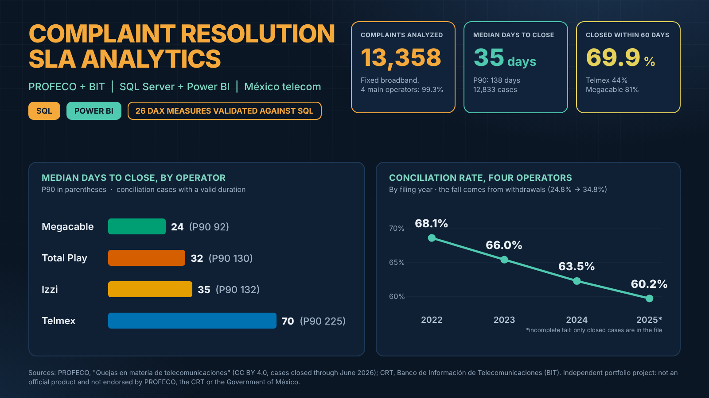
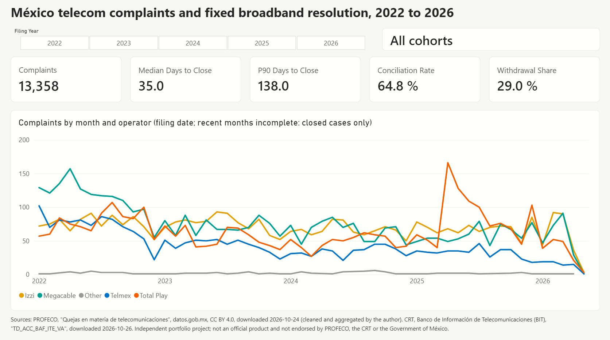

# complaint-resolution-sla-analytics

> Análisis con SQL Server + Power BI de los tiempos de resolución de quejas frente a metas de nivel de servicio, por responsable y región, construido con datos abiertos del gobierno. Esquema en estrella independiente de la fuente, con adaptadores de ingesta por fuente.

  

**English:** [README.md](README.md) | **Resumen ejecutivo:** [`docs/resumen_ejecutivo.md`](docs/resumen_ejecutivo.md)

> Nota: el código, los nombres de tablas y medidas, y la documentación técnica en `docs/` están en inglés. Este archivo es la versión en español del README principal.

---

## Autor

**Ing. Rafael Cansigno Peláez** ([@sigloxiii](https://github.com/sigloxiii)): ingeniero en telecomunicaciones en transición hacia el análisis de datos.

Este es mi segundo proyecto de portafolio, después del capstone del certificado Google Data Analytics: [ftth-qos-qoe-risk-framework](https://github.com/sigloxiii/ftth-qos-qoe-risk-framework). Todas las decisiones de diseño, los scripts y los hallazgos de este repositorio están documentados bajo mi autoría.

---

## Objetivos de aprendizaje

1. Construir un pipeline por capas en **SQL Server** (`stg` → `clean` → `mart`) con scripts T-SQL documentados y re-ejecutables.
2. Limpiar datos abiertos reales: conversión de tipos, formatos de fecha inconsistentes, duraciones negativas y normalización de nombres de proveedor mediante una tabla de mapeo.
3. Aplicar **modelado dimensional**: definir el grano, construir un esquema en estrella y una dimensión de fecha con múltiples roles.
4. Construir un modelo semántico en **Power BI**: relaciones, medidas DAX (percentiles, tasas por 100 mil) y un reporte, con los resultados contrastados contra SQL.
5. Definir métricas de tipo SLA, hacer un análisis de sensibilidad de las metas y comunicar las limitaciones con honestidad.
6. Diseñar el modelo para que sea **independiente de la fuente**, de modo que el mismo mart y el mismo reporte puedan reutilizarse con otro conjunto de datos.
7. Seguir prácticas profesionales de repositorio: flujo de Git, documentación en inglés y conciencia sobre las licencias de los datos.

---

## Preguntas de negocio

**Pregunta central:** ¿Cuánto esperan los consumidores por una resolución, qué responsables y regiones son los más lentos y cómo ha cambiado esto con el tiempo?

| # | Pregunta | Métricas principales |
|---|---|---|
| BQ1 | ¿Cuánto tardan en cerrarse las quejas, por responsable, región (oficina de la PROFECO) y categoría? | Mediana y P90 de días para cerrar |
| BQ2 | ¿Qué responsables y regiones tienen los peores resultados? | Tasa de conciliación (los montos son solo descriptivos, ver D9) |
| BQ3 | ¿Cómo se compara el volumen de quejas al normalizarlo por la base de clientes? | Quejas de servicios fijos por cada 100,000 accesos de banda ancha del operador (2022 a 2024, D14) |
| BQ4 | ¿Cómo han evolucionado estos indicadores en el periodo? | Tendencia y estacionalidad |
| BQ5 | ¿Cómo se comparan los resultados con referencias publicadas? | Comparación contextual con reportes del regulador |

**Fuera de alcance:** la calidad técnica de la red (latencia, jitter, pérdida de paquetes). Los datos de quejas miden la conciliación de protección al consumidor, no el desempeño de la red.

**Metas de SLA:** el proceso de conciliación no tiene una meta oficial de nivel de servicio. Por eso las metas se tratan como **parámetros** y se evalúan con un análisis de sensibilidad. La cuadrícula es de 30, 60, 90, 120 y 180 días, con 60 días por defecto (decisión D15).

---

## Enfoque

El pipeline es por capas y solo las dos primeras dependen de la fuente de datos. Sigue una forma reducida de la **arquitectura medallón** (bronce, plata, oro) y un enfoque **ELT**: los datos crudos se cargan primero y se transforman dentro de la base de datos. Las razones están en las decisiones D2, D5 y D6 de [`docs/decisions.md`](docs/decisions.md).

### Mapa del pipeline: del archivo crudo al dashboard

```
[ FUENTES EXTERNAS ]  (archivos CSV publicados por la PROFECO y por la CRT, BIT)
        │
        ▼
[ ETAPA 1: INGESTA / STAGING ]  esquema stg  (bronce)
 ├── Concepto: copia fiel y literal de la fuente.
 └── Regla: todo entra como texto (NVARCHAR), sin filtros ni transformaciones.
        │
        ▼
[ ETAPA 2: LIMPIEZA Y NORMALIZACIÓN ]  esquema clean  (plata)
 ├── Concepto: limpieza técnica y estructuración.
 └── Reglas: tipos de dato correctos (fechas, números), texto estandarizado,
            valores de relleno convertidos a NULL y banderas de calidad en lugar de filas eliminadas.
        │
        ▼
[ ETAPA 3: MODELADO DIMENSIONAL ]  esquema mart  (oro)
 ├── Concepto: arquitectura orientada al negocio para el análisis.
 └── Reglas: esquema en estrella, con una tabla de hechos para las métricas de SLA
            y tablas de dimensión para tiempo, región, proveedor y tipo de queja.
        │
        ▼
[ ETAPA 4: PRESENTACIÓN Y ANALÍTICA ]  Power BI
 ├── Concepto: explotación visual y gobierno de los indicadores.
 └── Reglas: conectar al mart (modo Import), definir las relaciones,
            construir las medidas de negocio (DAX) y diseñar la narrativa visual.
```

Las etapas de arriba describen cómo fluyen los datos. Las fases de abajo describen el orden del trabajo.

| Fase | Descripción | Estado |
|---|---|---|
| 0 | Estructura del repositorio y compuerta de factibilidad con el conjunto de datos mexicano | Hecha (4 de 4 criterios cumplidos, decisión D1) |
| 1 | Crear la base de datos y los esquemas; cargar los datos crudos en `stg` | Hecha (`step_0` y `step_1`) |
| 2 | Limpiar y normalizar: tipos, duraciones, mapeo de proveedores | Hecha (`step_3`, revisión 2; el estado es la oficina de la PROFECO, ver D8) |
| 3 | Cargar los denominadores (accesos del BIT) y construir las dimensiones | Hecha (`step_5`, `step_6`; D12 y D13) |
| 4 | Construir el esquema en estrella `mart`; consultas de validación en SQL | Hecha (`step_7`, `step_8`; D14 y D15) |
| 5 | Modelo de Power BI, medidas DAX y reporte | Hecha (`powerbi/build_guide.md`, D16; PDF en `powerbi/complaint_sla_report.pdf`) |
| 6 | Documentación, hallazgos y limitaciones | Hecha (este README, `docs/`, `data/data_dictionary.md`) |

**Esquema en estrella (`mart`):** `fact_complaint` (una fila por caso) y `fact_accesses` (operador × estado × mes) comparten `dim_operator`, `dim_state` y `dim_date`; `dim_brand`, `dim_reason` y `dim_outcome` describen las quejas (decisión D14).

---

## Exploración inicial de los datos: México

La investigación de las fuentes candidatas está completa, y los cinco archivos de la PROFECO se descargaron y revisaron en Power Query. El archivo base (36,034 filas) se cargó en SQL Server y se perfiló con `step_2.sql`: los cuatro criterios de la compuerta de factibilidad se cumplen (decisión D1, aceptada el 2026-10-27). El BIT da los accesos de banda ancha fija por grupo operador y estado hasta diciembre de 2024, por lo que las tasas por 100,000 accesos se limitan a 2022 a 2024. La tabla del BIT se limpió en `clean.bit_access` (592,281 filas, una etiqueta de operador por fila), y los accesos de diciembre de Telmex, Izzi, Megacable y Total Play son los denominadores. La evidencia y los detalles de cada archivo están en [`docs/sources/MX_profeco.md`](docs/sources/MX_profeco.md).

### Fuentes candidatas

| Fuente | Grano | Papel en el proyecto |
|---|---|---|
| Quejas de telecomunicaciones de la PROFECO (datos.gob.mx) | Una fila por caso de queja | **Fuente primaria de hechos** |
| BIT, Banco de Información de Telecomunicaciones (CRT) | Trimestral, por operador / estado / tecnología | Denominadores (accesos de banda ancha fija; los accesos no son suscripciones) |
| IFT *Manual de definiciones de los indicadores estadísticos de telecomunicaciones* (2018) | PDF | Definiciones de los indicadores del BIT y claves de las tablas ([enlace](https://www.ift.org.mx/sites/default/files/contenidogeneral/estadisticas/manualdefinicionesmarzo2018.pdf)) |
| Reportes trimestrales "Soy Usuario" (IFT/CRT) | Agregados, PDF | Validación cruzada de los resultados |
| Lineamientos de calidad de servicios fijos (IFT, 2020) | Umbrales regulatorios | Contexto para las referencias |
| Ookla Open Data / M-Lab (opcional) | Mosaicos / registros de pruebas | Capa técnica opcional |

### Columnas de la PROFECO (23, según el encabezado del archivo)

| Grupo | Columnas |
|---|---|
| Caso | `expediente` |
| Fechas | `fecha_ingreso`, `fecha_cierre` |
| Proceso | `tipo_conciliacion`, `estado_procesal`, `procedimiento`, `medio_ingreso` |
| Proveedor | `proveedor` (razón social), `nombre_comercial` (marca), `giro`, `sector` |
| Oficina y estado | `odeco`, `estado` |
| Queja | `tipo_reclamacion`, `motivo_reclamacion`, `problema_especial` |
| Montos | `costo_bien_servicio`, `monto_reclamado`, `monto_recuperado` |
| Compra | `clase`, `tipo_producto`, `modalidad_compra`, `modalidad_pago` |

Los nombres difieren del diccionario de datos publicado (que usa mayúsculas, por ejemplo `ID_EXP`). El perfilado mostró que `giro` clasifica al proveedor (no el servicio de la queja) y que `clase` separa servicios de bienes. `odeco` es el nombre de la oficina de la PROFECO que atendió el caso (revisión 3.3.16 de `step_3.sql`).

### Advertencias conocidas

- **Los nombres de proveedor varían** entre registros (por ejemplo, con y sin el sufijo corporativo), por lo que se requiere una tabla de mapeo de normalización.
- **Formato de fecha:** el diccionario de datos documenta `dd-mm-yyyy`, pero el archivo usa texto con el año primero y guiones (`2022-01-03`), como se confirmó en `step_2.sql` (0 valores con otro formato). Todas las fechas se cargan como texto y se convierten en la capa clean.
- **Actualizaciones retroactivas:** el publicador advierte que los datos históricos pueden cambiar. Se registrarán una copia congelada y la fecha de descarga.
- **Se publican cinco cortes** y no son versiones simples y crecientes unas de otras. El corte base es `junio_2026`, confirmado por una auditoría de traslape (decisión D4 en `docs/decisions.md`): contiene todos los casos de los tres cortes más antiguos.
- **No hay una columna completa de tipo de servicio:** `giro` es una clasificación del proveedor y `problema_especial` nombra un servicio en solo el 27% de las filas. El análisis es a nivel de proveedor y lo fijo frente a lo móvil sale de un mapeo de marcas (decisión D7 en `docs/decisions.md`).
- **Un proveedor por queja:** la base conserva una fila por ID de caso, así que una queja contra dos proveedores (por ejemplo, el operador y el fabricante del teléfono) aparece con uno de ellos. Alrededor del 0.3% de las quejas de operadores fijos puede verse afectado (decisión D4).
- **Valores de relleno** como `-` (montos, proveedor) y `sin dato` (`medio_ingreso`) se usan en lugar de valores vacíos y se vuelven `NULL` en la capa clean.
- **Valores en la columna equivocada:** en 430 filas (todas ingresadas en 2022) los valores de `clase` y `medio_ingreso` están intercambiados. Se corrigen en la capa clean y se marcan con una bandera.
- **IDs sin distinción de mayúsculas:** dos valores de `expediente` difieren solo en mayúsculas y pertenecen a proveedores distintos. No son duplicados, y los datos no se deduplican por ID.
- **Solo casos cerrados:** el archivo no tiene casos abiertos, así que los meses más recientes están incompletos (censura por la derecha) y los tiempos de resolución pueden parecer más cortos que la realidad.
- **Etiquetas abreviadas y cortadas:** `procedimiento` y `tipo_conciliacion` contienen texto abreviado, y algunos valores de `procedimiento` se cortan a 30 caracteres (por ejemplo "Conciliación Medios Electrónic"), así que la misma etiqueta aparece escrita de dos formas. Se mapean en la capa clean.
- **El estado es la oficina de la PROFECO:** el 62% de las quejas están en Ciudad de México porque el canal de Internet lo atiende una oficina central (decisión D8). Los análisis regionales usan solo los casos no atendidos de forma central.
- **Los montos no son confiables:** `monto_reclamado` es 0 en el 78% de las filas y el monto recuperado supera al reclamado en el 24% (decisión D9). Se usan solo como información descriptiva.
- **Significado de la métrica:** los días para cerrar miden la duración del procedimiento de conciliación de la PROFECO, no el tiempo de reparación del proveedor. Solo se registran las quejas que llegan a la PROFECO (sesgo de autoselección).

### Compuerta de factibilidad

El conjunto de datos mexicano se usa solo si se cumplen todos los criterios. Se revisaron el 2026-10-27 y los cuatro se cumplen (decisión D1).

| # | Criterio | Resultado |
|---|---|---|
| 1 | Al menos 2,000 quejas contra operadores de red fija (aproximación a nivel de proveedor; el archivo no tiene una columna completa de tipo de servicio, ver D7) | Cumplido: 13,268 |
| 2 | `fecha_cierre` faltante en menos del 30% de las filas | Cumplido: 66 filas (0.18%) |
| 3 | Proveedores principales (Telmex, Izzi, Megacable, Total Play) con al menos 100 casos por año | Cumplido en 2022 a 2025. 2026 es parcial (hasta mayo): Telmex tiene 68 |
| 4 | Suscriptores por operador y estado descargables del BIT | Cumplido con limitaciones: accesos por grupo operador y estado, de enero de 2013 a diciembre de 2024 |

La evidencia de la compuerta está en `docs/` (ver `docs/sources/MX_profeco.md` y `docs/run_log.md`).

---

## Alternativa: conjuntos de datos de EE. UU.

La compuerta se cumplió, así que esta contingencia no está en uso. Si un hallazgo posterior invalidara los datos mexicanos, el proyecto cambiaría a un conjunto de datos abiertos de EE. UU. **sin rediseñar el pipeline**. El candidato principal es el conjunto NYC 311 Service Requests de [NYC Open Data](https://opendata.cityofnewyork.us/), que tiene fechas de creación y cierre, agencia, tipo de queja y distrito (borough).

| Se mantiene | Cambia |
|---|---|
| Esquema `mart` canónico y modelo en estrella | Adaptadores de fuente en `sql/us_nyc311/` |
| Scripts en `sql/common/` | Responsable = agencia |
| Estructura de las medidas DAX y diseño del reporte | Región = distrito (borough) |
| Preguntas de negocio BQ1, BQ3 (adaptada), BQ4 | Normalización por población en lugar de suscriptores |
| Estructura de la documentación | No hay métrica de "monto recuperado", así que BQ2 cambia |

Las razones de cualquier cambio se documentarán en `docs/`.

---

## Stack tecnológico

- SQL Server 2025 Express y SSMS 22 (T-SQL)
- Power BI Desktop (modo Import)
- Git y GitHub, con VS Code para el control de versiones

---

## Estructura del repositorio

```
assets/            # banner y otras imágenes estáticas
data/
  raw/             # archivos fuente tal como se descargaron (sin versionar)
  interim/         # archivos intermedios (sin versionar)
  reference/       # archivos semilla pequeños, si los hay (el mapeo de proveedores vive en SQL: clean.brand_map)
  data_dictionary.md  # cada tabla y vista de stg, clean y mart
sql/
  common/          # independiente de la fuente: base de datos, esquemas, mart (step_7), vistas
  mx_profeco/      # quejas de la PROFECO: carga, auditoría y limpieza (stg → clean)
  mx_bit/          # accesos del BIT: carga y limpieza (stg → clean)
powerbi/           # guía de construcción y exportación en PDF del reporte (el .pbix se queda local, D16)
docs/
  decisions.md     # bitácora de decisiones (D1 a D16)
  run_log.md       # ejecuciones de los scripts y su evidencia
  glossary_of_terms.md
  sources/         # una nota por fuente de datos, y licenses.md
  img/             # imágenes de evidencia, con nombre <tema>_<nombre>.png
```

La estructura se limita a dos niveles de carpetas.

---

## Fuentes de datos y licencias

El código y la documentación de este repositorio tienen licencia MIT. **Los datos conservan la licencia de su publicador original.** Los archivos crudos nunca se publican; solo se publican el código, la documentación, las capturas y los resultados agregados (decisión D10). Registro completo: [`docs/sources/licenses.md`](docs/sources/licenses.md).

| Fuente | Uso | Licencia | Cita |
|---|---|---|---|
| PROFECO, "Quejas en materia de telecomunicaciones" | Quejas (a nivel de caso, limpiadas en SQL) | Creative Commons Attribution 4.0 (CC BY 4.0) | PROFECO; https://www.datos.gob.mx/dataset/quejas_materia_telecomunicaciones; CC BY 4.0; 2026-10-24. Modificado: limpiado y agregado por el autor |
| CRT, Banco de Información de Telecomunicaciones (BIT), `TD_ACC_BAF_ITE_VA` | Accesos de banda ancha fija por grupo operador y estado (denominadores). Se publica solo como agregados | Sin licencia explícita registrada; usado de buena fe (riesgo aceptado, D10) | Comisión Reguladora de Telecomunicaciones; https://bit.crt.gob.mx/BitWebApp/; 2026-10-26 |

*Proyecto de portafolio independiente. No es un producto oficial y no cuenta con el aval de la PROFECO, la CRT ni el Gobierno de México. Cualquier contenido derivado del BIT se retira a solicitud de la CRT.*

---

## Cómo reproducirlo

Los archivos crudos y el archivo de Power BI no se publican (decisiones D10 y D16), así que el pipeline se reconstruye a partir de las fuentes públicas. Todos los scripts están en `sql/` y se explican paso a paso en `sql/README.md`.

**Requisitos:** SQL Server 2025 Express (instancia `.\SQLEXPRESS`), SSMS 22 y Power BI Desktop. Windows, porque `BULK INSERT` lo ejecuta el servicio de SQL Server.

1. **Descargar las fuentes** (los enlaces, las fechas de descarga y el SHA-256 de los archivos usados están en `docs/sources/`) y guardarlas en `data/raw/` con sus nombres originales:
   - PROFECO, *Quejas en materia de telecomunicaciones*, recurso cerrado en junio de 2026 (`quejas_telecomunicaciones_2022_junio_2026.csv`).
   - CRT, BIT, tabla `TD_ACC_BAF_ITE_VA` (`TD_ACC_BAF_ITE_VA.csv`).
2. **Ajustar las rutas.** Los scripts `step_1.sql`, `step_5.sql` (y `step_4.sql`, opcional) leen los archivos con una ruta absoluta; cámbiela a su carpeta `data/raw/` y dé permiso de lectura sobre esa carpeta a la cuenta del servicio de SQL Server.
3. **Ejecutar los scripts en SSMS, en orden:** `step_0` a `step_8` (ver el orden de ejecución en `sql/README.md`). `step_2` y `step_4` son pasos de auditoría: la capa clean no depende de ellos. Cada script termina con revisiones; los valores esperados están en `docs/run_log.md`.

| Objeto | Filas esperadas |
|---|---|
| `stg.profeco_raw`, `clean.profeco_complaint`, `mart.fact_complaint` | 36,034 |
| `stg.bit_acc_baf`, `clean.bit_access` | 592,281 |
| `mart.fact_accesses` | 19,840 |
| `mart.dim_date`, `dim_state`, `dim_operator`, `dim_brand`, `dim_reason`, `dim_outcome` | 5,113; 33; 5; 190; 176; 39 |
| `mart.v_duration_cases` | 12,833 |

4. **Construir el reporte.** En Power BI Desktop, conectar a `.\SQLEXPRESS`, base de datos `complaint_sla`, en modo Import, cargar las ocho tablas de `mart` y seguir `powerbi/build_guide.md` (modelo, 26 medidas, páginas de validación y las seis páginas del reporte). Cada medida tiene un valor de referencia de SQL para comparar.
5. **Verificar el resultado** contra el PDF `powerbi/complaint_sla_report.pdf` y las capturas en `docs/img/` (`powerbi_page_01.png` a `powerbi_page_06.png`).

---

## Resultados y hallazgos

El reporte tiene seis páginas (`powerbi/complaint_sla_report.pdf`). El alcance es la **banda ancha fija**: 13,358 quejas, de las cuales 13,268 (99.3%) son contra Telmex, Izzi, Megacable y Total Play. Los resultados de duración y de desenlace usan los 12,833 casos de conciliación con duración válida. El eje temporal es el **año de ingreso**: 2022 a 2024 son cohortes completas, 2025 tiene una cola incompleta y 2026 es parcial (decisión D15).



| BQ | Hallazgo | Evidencia |
|---|---|---|
| BQ1 | **Telmex es el más lento.** Mediana y P90 de días para cerrar: Telmex 70 y 225, Izzi 35 y 132, Total Play 32 y 130, Megacable 24 y 92 (los cuatro: 35 y 138). En 60 días cierra el 44.3% de los casos de Telmex, frente a 71.8% Izzi, 71.3% Total Play y 81.2% Megacable | `docs/run_log.md`, revisiones 8.4 y 8.6 |
| BQ1 | **Tres tipos de reclamo concentran el 92.5% de las quejas:** Cobro Indebido (4,343), Entrega del Producto o Servicio (4,335) y Contratos (3,682) | revisiones P3 y P4 |
| BQ2 | **La tasa de conciliación de los cuatro operadores cae de 68.1% (2022) a 60.2% (2025), y la caída viene de los desistimientos** (Desistimiento), que pasan de 24.8% a 34.8% de los casos. Entre los casos decididos la proporción se mantiene entre 90.9% y 92.8% | revisiones 8.7 y 8.9 |
| BQ2 | **Velocidad y resultado no van juntos.** Telmex es el más lento pero tiene una tasa de conciliación de 67.7%; Total Play cierra rápido (mediana 32) y tiene la tasa más baja (60.2%) | revisiones 8.4 y 8.7 |
| BQ3 | **Las quejas por cada 100,000 accesos de banda ancha fija bajan de 16.60 (2022) a 11.51 (2023) y 9.33 (2024)**, a nivel nacional para los cuatro operadores combinados | revisión P2 |
| BQ4 | **La cohorte 2024 es la más rápida** (mediana de 30 días) y 2025 es más lenta en los cuatro operadores (mediana 41), aunque la falta de casos abiertos hace que las cohortes recientes parezcan más rápidas | revisión 8.8 |
| BQ4 | **Total Play tuvo un pico de quejas de abril a julio de 2025:** 503 casos frente a 200 en los mismos meses de 2024 (máximo mensual de 166 en abril, 3.4 veces el promedio de 2024). Cobro Indebido (201 contra 51) y Contratos (209 contra 84) explican el 91% del aumento. Los datos no muestran la causa | revisiones P5 y P6 |
| D8 | **Ciudad de México concentra el 58.0% de las quejas por estado** (7,748), en gran parte porque la oficina central atiende el 49.6% de los casos de banda ancha fija. La gráfica por estado se lee como "oficina de la PROFECO", y no hay mapa | revisiones P1 y P3 |

La calidad de los datos es marginal (66 casos sin fecha de cierre, 3 que cierran antes de ingresar, 48 cancelados, 147 en un día de cierre por lote, 1,831 filas del BIT sin valor y 325 copias exactas) y no cambia los hallazgos (página 6 del reporte).

---

## Limitaciones

- **Solo casos cerrados.** El archivo no tiene casos abiertos, así que los meses de ingreso recientes están incompletos y sus duraciones parecen más cortas que la realidad (censura por la derecha). Por eso el análisis usa cohortes por año de ingreso y marca 2025 y 2026 como incompletos (D15). Los valores de 2026 se basan en pocos casos cerrados y no son comparables.
- **El estado es la oficina de la PROFECO, no el lugar del consumidor** (D8). Una comparación regional solo es válida para los casos no atendidos por la oficina central.
- **La tasa por 100,000 accesos es nacional, anual y se limita a 2022 a 2024.** Los accesos del BIT son un inventario de diciembre (D12), el BIT termina en diciembre de 2024 y el archivo de quejas no tiene una columna completa de tipo de servicio (D7): el numerador cuenta todas las quejas de la marca, mientras que el denominador es solo banda ancha fija. No hay tasa por estado ni por mes.
- **La duración mide el proceso de conciliación de la PROFECO**, no el tiempo de reparación del proveedor (D15). Solo se registran las quejas que llegan a la PROFECO, por lo que hay un sesgo de autoselección. No hay una meta oficial de nivel de servicio: las metas de 30 a 180 días son parámetros para un análisis de sensibilidad.
- **Un proveedor por queja** (D4), y los montos se usan solo como información descriptiva porque no son confiables (D9).
- **Día de cierre por lote:** 50 casos cerrados el 2026-03-10 tienen duraciones más largas y se quedan en la población (0.4%) (D15).
- **BQ5 no se desarrolló.** La comparación con los reportes del regulador ("Soy Usuario", lineamientos de calidad) queda como trabajo futuro, porque esas cifras no están cargadas en la base de datos.
- **Asociaciones, no causas.** Los hallazgos describen los datos; por ejemplo, los datos no explican los desistimientos ni el pico de Total Play.
- **Derechos sobre las fuentes.** El BIT no tiene una licencia explícita registrada, así que solo se publican agregados y el archivo `.pbix` (datos a nivel de fila) se mantiene local (D10 y D16). Los datos cambian de forma retroactiva: las fechas de descarga están registradas en `docs/sources/`.

---

## Referencias

- PROFECO, [*Quejas en materia de telecomunicaciones*](https://www.datos.gob.mx/dataset/quejas_materia_telecomunicaciones), datos.gob.mx, CC BY 4.0.
- CRT, [Banco de Información de Telecomunicaciones (BIT)](https://bit.crt.gob.mx/BitWebApp/), tabla `TD_ACC_BAF_ITE_VA`.
- IFT, *Manual de definiciones de los indicadores estadísticos de telecomunicaciones* (2018), diccionario de datos del BIT.
- Documentación del proyecto (en inglés): [decisiones](docs/decisions.md), [bitácora de ejecución](docs/run_log.md), [glosario](docs/glossary_of_terms.md), [diccionario de datos](data/data_dictionary.md), [fuentes y licencias](docs/sources/licenses.md).

Referencias de arquitectura:

- Microsoft Learn: [Understand medallion lakehouse architecture for Microsoft Fabric with OneLake](https://learn.microsoft.com/en-us/fabric/onelake/onelake-medallion-lakehouse-architecture).
- Microsoft Learn (módulo de capacitación): [Organize a Fabric lakehouse using medallion architecture design](https://learn.microsoft.com/en-us/training/modules/describe-medallion-architecture/).
- Blog de Databricks: [What is Medallion Architecture?](https://www.databricks.com/blog/what-is-medallion-architecture).
- Documentación de Databricks: [What is the medallion lakehouse architecture?](https://docs.databricks.com/aws/en/lakehouse/medallion.html).

La arquitectura medallón se usa aquí como patrón de diseño, en una forma reducida (una base de datos de SQL Server con tres esquemas, sin data lake). El proyecto no está atado a esas plataformas.

---

## Licencia

El código y la documentación se publican bajo la [Licencia MIT](LICENSE).