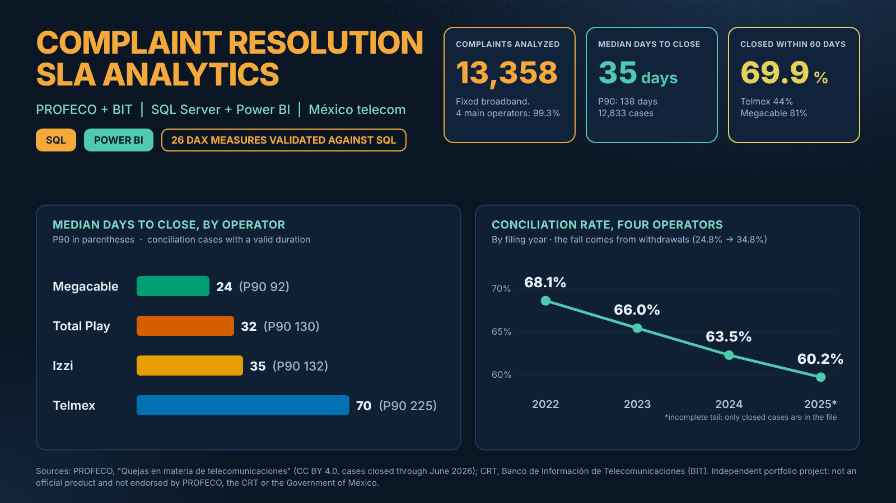
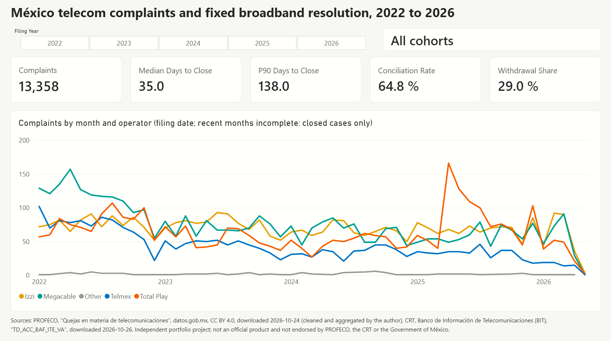

# complaint-resolution-sla-analytics

> SQL Server + Power BI analysis of complaint resolution times against service-level targets, by responsible party and region, built on open government data. Source-agnostic star schema with per-source ingestion adapters.

  

---

## Author

**Eng. Rafael Cansigno Peláez** ([@sigloxiii](https://github.com/sigloxiii)): telecommunications engineer transitioning into data analytics.

This is my second portfolio project, following the Google Data Analytics certificate capstone: [ftth-qos-qoe-risk-framework](https://github.com/sigloxiii/ftth-qos-qoe-risk-framework). All design decisions, scripts and findings in this repository are documented under my authorship.

---

## Learning objectives

1. Build a layered **SQL Server** pipeline (`stg` → `clean` → `mart`) with documented, re-runnable T-SQL scripts.
2. Clean real-world open data: type conversion, inconsistent date formats, negative durations, and provider-name normalization through a mapping table.
3. Apply **dimensional modeling**: define the grain, build a star schema and a role-playing date dimension.
4. Build a **Power BI** semantic model: relationships, DAX measures (percentiles, rates per 100k) and a report, with results cross-checked against SQL.
5. Define SLA-style metrics, run a sensitivity analysis on the targets, and communicate limitations honestly.
6. Design the model to be **source-agnostic**, so the same mart and report can be reused with a different dataset.
7. Follow professional repository practices: Git workflow, English documentation, and awareness of data licensing.

---

## Business questions

**Core question:** How long do complainants wait for a resolution, which responsible parties and regions are slowest, and how has this changed over time?

| # | Question | Main metrics |
|---|---|---|
| BQ1 | How long do complaints take to close, by responsible party, region (PROFECO office) and category? | Median and P90 of days to close |
| BQ2 | Which responsible parties and regions have the worst outcomes? | Conciliation rate (amounts are descriptive only, see D9) |
| BQ3 | How does complaint volume compare once normalized by customer base? | Complaints about fixed services per 100,000 broadband accesses of the operator (2022 to 2024, D14) |
| BQ4 | How have these indicators evolved over the period? | Trend and seasonality |
| BQ5 | How do results compare with published benchmarks? | Contextual comparison with regulator reports |

**Out of scope:** network technical quality (latency, jitter, packet loss). The complaint data measures consumer-protection conciliation, not network performance.

**SLA targets:** the conciliation process has no official service-level target. Targets are therefore treated as **parameters** and evaluated with a sensitivity analysis. The grid is 30, 60, 90, 120 and 180 days, with 60 days as the default (decision D15).

---

## Approach

The pipeline is layered, and only the first two layers depend on the data source. It follows a reduced form of the **medallion architecture** (bronze, silver, gold) and an **ELT** approach: the raw data are loaded first and transformed inside the database. The reasons are in decisions D2, D5 and D6 of [`docs/decisions.md`](docs/decisions.md).

### Pipeline map: from the raw file to the dashboard

```
[ EXTERNAL SOURCES ]  (CSV files published by PROFECO and by the CRT, BIT)
        │
        ▼
[ STAGE 1: INGESTION / STAGING ]  schema stg  (bronze)
 ├── Concept: faithful, literal copy of the source.
 └── Rule: everything enters as text (NVARCHAR), with no filters or transformations.
        │
        ▼
[ STAGE 2: CLEANING AND NORMALIZATION ]  schema clean  (silver)
 ├── Concept: technical cleaning and structuring.
 └── Rules: correct data types (dates, numbers), standardized text,
            placeholders turned into NULL, and quality flags instead of deleted rows.
        │
        ▼
[ STAGE 3: DIMENSIONAL MODELING ]  schema mart  (gold)
 ├── Concept: business-oriented architecture for analysis.
 └── Rules: star schema, with a fact table for the SLA metrics and dimension tables
            for time, region, provider and complaint type.
        │
        ▼
[ STAGE 4: PRESENTATION AND ANALYTICS ]  Power BI
 ├── Concept: visual exploitation and governance of the indicators.
 └── Rules: connect to the mart (Import mode), define the relationships,
            build the business measures (DAX) and design the visual story.
```

The pipeline stages above describe how the data flow. The project phases below describe the order of the work.


| Phase | Description | Status |
|---|---|---|
| 0 | Repository scaffold and feasibility gate on the Mexican dataset | Done (4 of 4 criteria passed, decision D1) |
| 1 | Create database and schemas; load raw data into `stg` | Done (`step_0` and `step_1`) |
| 2 | Clean and normalize: types, durations, provider mapping | Done (`step_3`, revision 2; the state is the PROFECO office, see D8) |
| 3 | Load denominators (BIT accesses) and build dimensions | Done (`step_5`, `step_6`; D12 and D13) |
| 4 | Build the `mart` star schema; SQL validation queries | Done (`step_7`, `step_8`; D14 and D15) |
| 5 | Power BI model, DAX measures and report | Done (`powerbi/build_guide.md`, D16; PDF in `powerbi/complaint_sla_report.pdf`) |
| 6 | Documentation, findings and limitations | Done (this README, `docs/`, `data/data_dictionary.md`) |

**Star schema (`mart`):** `fact_complaint` (one row per case) and `fact_accesses` (operator × state × month) share `dim_operator`, `dim_state` and `dim_date`; `dim_brand`, `dim_reason` and `dim_outcome` describe the complaints (decision D14).

---

## Initial dataset exploration: México

Desk research on the candidate sources is complete, and the five PROFECO files were downloaded and inspected in Power Query. The base file (36,034 rows) was loaded into SQL Server and profiled with `step_2.sql`: the four criteria of the feasibility gate are met (decision D1, accepted on 2026-10-27). BIT gives fixed broadband accesses by operator group and state up to December 2024, so rates per 100,000 accesses are limited to 2022 to 2024. The BIT table was cleaned into `clean.bit_access` (592,281 rows, one operator label per row), and the December accesses of Telmex, Izzi, Megacable and Total Play are the denominators. The evidence and the details of each file are in [`docs/sources/MX_profeco.md`](docs/sources/MX_profeco.md).

### Candidate sources

| Source | Grain | Role in the project |
|---|---|---|
| PROFECO telecommunications complaints (datos.gob.mx) | One row per complaint case | **Primary fact source** |
| BIT, Telecommunications Information Bank (CRT) | Quarterly, by operator / state / technology | Denominators (fixed broadband accesses; accesses are not subscriptions) |
| IFT *Manual de definiciones de los indicadores estadísticos de telecomunicaciones* (2018) | PDF | Definitions of the BIT indicators and table keys ([link](https://www.ift.org.mx/sites/default/files/contenidogeneral/estadisticas/manualdefinicionesmarzo2018.pdf)) |
| "Soy Usuario" quarterly reports (IFT/CRT) | Aggregated, PDF | Cross-validation of results |
| Fixed-service quality guidelines (IFT, 2020) | Regulatory thresholds | Context for benchmarks |
| Ookla Open Data / M-Lab (optional) | Tiles / test records | Optional technical layer |

### PROFECO columns (23, as found in the file header)

| Group | Columns |
|---|---|
| Case | `expediente` |
| Dates | `fecha_ingreso`, `fecha_cierre` |
| Process | `tipo_conciliacion`, `estado_procesal`, `procedimiento`, `medio_ingreso` |
| Provider | `proveedor` (legal name), `nombre_comercial` (brand), `giro`, `sector` |
| Office and state | `odeco`, `estado` |
| Complaint | `tipo_reclamacion`, `motivo_reclamacion`, `problema_especial` |
| Amounts | `costo_bien_servicio`, `monto_reclamado`, `monto_recuperado` |
| Purchase | `clase`, `tipo_producto`, `modalidad_compra`, `modalidad_pago` |

The names differ from the published data dictionary (which uses upper case, for example `ID_EXP`). Profiling showed that `giro` classifies the provider (not the service of the complaint) and that `clase` separates services from goods. `odeco` is the name of the PROFECO office that handled the case (check 3.3.16 of `step_3.sql`).

### Known caveats

- **Provider names vary** between records (for example, with and without the corporate suffix), so a normalization mapping table is required.
- **Date format:** the data dictionary documents `dd-mm-yyyy`, but the file uses year-first text with dashes (`2022-01-03`), as confirmed in `step_2.sql` (0 values with another format). All dates are loaded as text and converted in the clean layer.
- **Retroactive updates:** the publisher warns that historical data may change. A frozen copy and the download date will be recorded.
- **Five cuts are published** and they are not simple, growing versions of one another. The base cut is `junio_2026`, confirmed by an overlap audit (decision D4 in `docs/decisions.md`): it contains every case of the three older cuts.
- **No complete service-type column:** `giro` is a provider classification, and `problema_especial` names a service in only 27% of the rows. The analysis is at provider level, and fixed vs mobile comes from a brand mapping (decision D7 in `docs/decisions.md`).
- **One provider per complaint:** the base keeps one row per case ID, so a complaint against two providers (for example the operator and the phone maker) appears with one of them. About 0.3% of the fixed-operator complaints may be affected (decision D4).
- **Placeholders** such as `-` (amounts, provider) and `sin dato` (`medio_ingreso`) are used instead of empty values and become `NULL` in the clean layer.
- **Values in the wrong column:** in 430 rows (all filed in 2022) the values of `clase` and `medio_ingreso` are swapped. They are corrected in the clean layer and flagged.
- **Case-insensitive IDs:** two `expediente` values differ only in case and belong to different providers. They are not duplicates, and the data are not deduplicated by ID.
- **Closed cases only:** the file has no open cases, so the most recent months are incomplete (right-censoring) and resolution times can look shorter than reality.
- **Abbreviated and cut labels:** `procedimiento` and `tipo_conciliacion` hold abbreviated text, and some `procedimiento` values are cut at 30 characters (for example "Conciliación Medios Electrónic"), so the same label appears spelled two ways. They are mapped in the clean layer.
- **The state is the PROFECO office:** 62% of the complaints are in Ciudad de México because the Internet channel is handled by a central office (decision D8). Regional analyses use only the cases not handled centrally.
- **Amounts are unreliable:** `monto_reclamado` is 0 in 78% of the rows and the recovered amount exceeds the claimed one in 24% (decision D9). They are used only as descriptive information.
- **Metric meaning:** days to close measures the duration of the PROFECO conciliation procedure, not the provider's repair time. Only complaints that reach PROFECO are recorded (self-selection bias).

### Feasibility gate

The Mexican dataset is used only if all criteria are met. They were checked on 2026-10-27 and all four are met (decision D1).

| # | Criterion | Result |
|---|---|---|
| 1 | At least 2,000 complaints against fixed-network operators (provider-level proxy; the file has no complete service-type column, see D7) | Passed: 13,268 |
| 2 | Missing `fecha_cierre` below 30% of rows | Passed: 66 rows (0.18%) |
| 3 | Main providers (Telmex, Izzi, Megacable, Total Play) with at least 100 cases per year | Passed for 2022 to 2025. 2026 is partial (to May): Telmex has 68 |
| 4 | Subscribers by operator and state downloadable from BIT | Passed with limitations: accesses by operator group and state, January 2013 to December 2024 |

The evidence of the gate is stored in `docs/` (see `docs/sources/MX_profeco.md` and `docs/run_log.md`).

---

## Fallback: US datasets

The gate was passed, so this contingency is not in use. If a later finding invalidates the Mexican data, the project pivots to a US open dataset **without redesigning the pipeline**. The leading candidate is the NYC 311 Service Requests dataset from [NYC Open Data](https://opendata.cityofnewyork.us/), which has creation and closing dates, agency, complaint type and borough.

| Stays the same | Changes |
|---|---|
| Canonical `mart` schema and star model | Source adapters in `sql/us_nyc311/` |
| Scripts in `sql/common/` | Responsible party = agency |
| DAX measure structure and report layout | Region = borough |
| Business questions BQ1, BQ3 (adapted), BQ4 | Normalization by population instead of subscribers |
| Documentation structure | No "recovered amount" metric, so BQ2 changes |

The reasons for any pivot will be documented in `docs/`.

---

## Tech stack

- SQL Server 2025 Express and SSMS 22 (T-SQL)
- Power BI Desktop (Import mode)
- Git and GitHub, with VS Code for version control

---

## Repository structure

```
assets/            # banner and other static images
data/
  raw/             # source files as downloaded (not versioned)
  interim/         # intermediate files (not versioned)
  reference/       # small seed files, if any (the provider mapping lives in SQL: clean.brand_map)
  data_dictionary.md  # every table and view of stg, clean and mart
sql/
  common/          # source-agnostic: database, schemas, mart (step_7), views
  mx_profeco/      # PROFECO complaints: load, audit and clean (stg → clean)
  mx_bit/          # BIT accesses: load and clean (stg → clean)
powerbi/           # build guide and the PDF export of the report (the .pbix stays local, D16)
docs/
  decisions.md     # decision log (D1 to D16)
  run_log.md       # script runs and their evidence
  glossary_of_terms.md
  sources/         # one note per data source, and licenses.md
  img/             # evidence images, named <topic>_<name>.png
```

The structure is limited to two folder levels.

---

## Data sources and licenses

The code and documentation of this repository are MIT-licensed. **The data keeps the license of its original publisher.** Raw files are never published; only code, documentation, captures and aggregated results are (decision D10). Full record: [`docs/sources/licenses.md`](docs/sources/licenses.md).

| Source | Use | License | Citation |
|---|---|---|---|
| PROFECO, "Quejas en materia de telecomunicaciones" | Complaints (case level, cleaned in SQL) | Creative Commons Attribution 4.0 (CC BY 4.0) | PROFECO; https://www.datos.gob.mx/dataset/quejas_materia_telecomunicaciones; CC BY 4.0; 2026-10-24. Modified: cleaned and aggregated by the author |
| CRT, Banco de Información de Telecomunicaciones (BIT), `TD_ACC_BAF_ITE_VA` | Fixed broadband accesses by operator group and state (denominators). Published only as aggregates | No explicit license on record; used in good faith (risk accepted, D10) | Comisión Reguladora de Telecomunicaciones; https://bit.crt.gob.mx/BitWebApp/; 2026-10-26 |

*Independent portfolio project. It is not an official product and is not endorsed by PROFECO, the CRT or the Government of México. Any BIT-derived content is removed on request of the CRT.*

---

## How to reproduce

The raw files and the Power BI file are not published (decisions D10 and D16), so the pipeline is rebuilt from the public sources. All scripts are in `sql/` and are explained step by step in `sql/README.md`.

**Requirements:** SQL Server 2025 Express (instance `.\SQLEXPRESS`), SSMS 22 and Power BI Desktop. Windows, because `BULK INSERT` is run by the SQL Server service.

1. **Download the sources** (links, download dates and SHA-256 of the files used are in `docs/sources/`) and save them in `data/raw/` with their original names:
   - PROFECO, *Quejas en materia de telecomunicaciones*, resource closed in June 2026 (`quejas_telecomunicaciones_2022_junio_2026.csv`).
   - CRT, BIT, table `TD_ACC_BAF_ITE_VA` (`TD_ACC_BAF_ITE_VA.csv`).
2. **Adjust the paths.** The scripts `step_1.sql`, `step_5.sql` (and `step_4.sql`, optional) read the files with an absolute path; change it to your `data/raw/` folder and give read permission on that folder to the SQL Server service account.
3. **Run the scripts in SSMS, in order:** `step_0` to `step_8` (see the execution order in `sql/README.md`). `step_2` and `step_4` are audit steps: the clean layer does not depend on them. Every script ends with checks; the expected values are in `docs/run_log.md`.

| Object | Expected rows |
|---|---|
| `stg.profeco_raw`, `clean.profeco_complaint`, `mart.fact_complaint` | 36,034 |
| `stg.bit_acc_baf`, `clean.bit_access` | 592,281 |
| `mart.fact_accesses` | 19,840 |
| `mart.dim_date`, `dim_state`, `dim_operator`, `dim_brand`, `dim_reason`, `dim_outcome` | 5,113; 33; 5; 190; 176; 39 |
| `mart.v_duration_cases` | 12,833 |

4. **Build the report.** In Power BI Desktop connect to `.\SQLEXPRESS`, database `complaint_sla`, in Import mode, load the eight `mart` tables and follow `powerbi/build_guide.md` (model, 26 measures, validation pages and the six report pages). Every measure has a reference value from SQL to compare with.
5. **Check the result** against the PDF `powerbi/complaint_sla_report.pdf` and the screenshots in `docs/img/` (`powerbi_page_01.png` to `powerbi_page_06.png`).

---

## Results and findings

The report has six pages (`powerbi/complaint_sla_report.pdf`). The scope is **fixed broadband**: 13,358 complaints, of which 13,268 (99.3%) are against Telmex, Izzi, Megacable and Total Play. The duration and outcome results use the 12,833 conciliation cases with a valid duration. The time axis is the **filing year**: 2022 to 2024 are complete cohorts, 2025 has an incomplete tail and 2026 is partial (decision D15).



| BQ | Finding | Evidence |
|---|---|---|
| BQ1 | **Telmex is the slowest.** Median and P90 days to close: Telmex 70 and 225, Izzi 35 and 132, Total Play 32 and 130, Megacable 24 and 92 (all four: 35 and 138). Within 60 days close 44.3% of Telmex cases, against 71.8% Izzi, 71.3% Total Play and 81.2% Megacable | `docs/run_log.md`, checks 8.4 and 8.6 |
| BQ1 | **Three claim types hold 92.5% of the complaints:** Cobro Indebido (4,343), Entrega del Producto o Servicio (4,335) and Contratos (3,682) | checks P3 and P4 |
| BQ2 | **The conciliation rate of the four operators falls from 68.1% (2022) to 60.2% (2025), and the fall comes from withdrawals** (Desistimiento), which go from 24.8% to 34.8% of the cases. Among the decided cases the share stays between 90.9% and 92.8% | checks 8.7 and 8.9 |
| BQ2 | **Speed and outcome do not go together.** Telmex is the slowest but has a conciliation rate of 67.7%; Total Play closes fast (median 32) and has the lowest rate (60.2%) | checks 8.4 and 8.7 |
| BQ3 | **Complaints per 100,000 fixed broadband accesses fall from 16.60 (2022) to 11.51 (2023) and 9.33 (2024)**, at national level for the four operators combined | check P2 |
| BQ4 | **The 2024 cohort is the fastest** (median 30 days) and 2025 is slower in the four operators (median 41), even though the missing open cases make recent cohorts look faster | check 8.8 |
| BQ4 | **Total Play had a spike of complaints in April to July 2025:** 503 cases against 200 in the same months of 2024 (monthly peak of 166 in April, 3.4 times the 2024 average). Cobro Indebido (201 against 51) and Contratos (209 against 84) explain 91% of the increase. The data do not show the cause | checks P5 and P6 |
| D8 | **Ciudad de México concentrates 58.0% of the complaints by state** (7,748), largely because the central office handles 49.6% of the fixed broadband cases. The state chart is read as "PROFECO office", and there is no map | checks P1 and P3 |

Data quality is marginal (66 cases without close date, 3 closing before filing, 48 cancelled, 147 on a batch closing day, 1,831 BIT rows without value and 325 exact copies) and does not change the findings (page 6 of the report).

---

## Limitations

- **Only closed cases.** The file has no open cases, so recent filing months are incomplete and their durations look shorter than reality (right-censoring). That is why the analysis uses filing-year cohorts and marks 2025 and 2026 as incomplete (D15). The 2026 values rest on few closed cases and are not comparable.
- **The state is the PROFECO office, not the place of the consumer** (D8). A regional comparison is only valid for the cases not handled by the central office.
- **The rate per 100,000 accesses is national, annual and limited to 2022 to 2024.** The BIT accesses are a December stock (D12), the BIT ends in December 2024, and the complaint file has no complete service-type column (D7): the numerator counts every complaint of the brand, while the denominator is fixed broadband only. There is no rate by state or by month.
- **The duration measures the PROFECO conciliation process**, not the repair time of the provider (D15). Only complaints that reach PROFECO are recorded, so there is a self-selection bias. There is no official service-level target: the targets of 30 to 180 days are parameters for a sensitivity analysis.
- **One provider per complaint** (D4), and amounts are used only as descriptive information because they are unreliable (D9).
- **Batch-closing day:** 50 cases closed on 2026-03-10 have longer durations and stay in the population (0.4%) (D15).
- **BQ5 was not developed.** The comparison with the reports of the regulator ("Soy Usuario", quality guidelines) is left for future work, because those figures are not loaded in the database.
- **Associations, not causes.** The findings describe the data; for example, the data do not explain the withdrawals or the spike of Total Play.
- **Source rights.** The BIT has no explicit license on record, so only aggregates are published and the `.pbix` file (row-level data) is kept local (D10 and D16). The data change retroactively: the download dates are recorded in `docs/sources/`.

---

## References

- PROFECO, [*Quejas en materia de telecomunicaciones*](https://www.datos.gob.mx/dataset/quejas_materia_telecomunicaciones), datos.gob.mx, CC BY 4.0.
- CRT, [Banco de Información de Telecomunicaciones (BIT)](https://bit.crt.gob.mx/BitWebApp/), table `TD_ACC_BAF_ITE_VA`.
- IFT, *Manual de definiciones de los indicadores estadísticos de telecomunicaciones* (2018), data dictionary of the BIT.
- Project documentation: [decisions](docs/decisions.md), [run log](docs/run_log.md), [glossary](docs/glossary_of_terms.md), [data dictionary](data/data_dictionary.md), [sources and licenses](docs/sources/licenses.md).

Architecture references:

- Microsoft Learn: [Understand medallion lakehouse architecture for Microsoft Fabric with OneLake](https://learn.microsoft.com/en-us/fabric/onelake/onelake-medallion-lakehouse-architecture).
- Microsoft Learn (training module): [Organize a Fabric lakehouse using medallion architecture design](https://learn.microsoft.com/en-us/training/modules/describe-medallion-architecture/).
- Databricks blog: [What is Medallion Architecture?](https://www.databricks.com/blog/what-is-medallion-architecture).
- Databricks documentation: [What is the medallion lakehouse architecture?](https://docs.databricks.com/aws/en/lakehouse/medallion.html).

The medallion architecture is used here as a design pattern, in a reduced form (one SQL Server database with three schemas, no data lake). The project is not tied to those platforms.

---

## License

Code and documentation are released under the [MIT License](LICENSE).