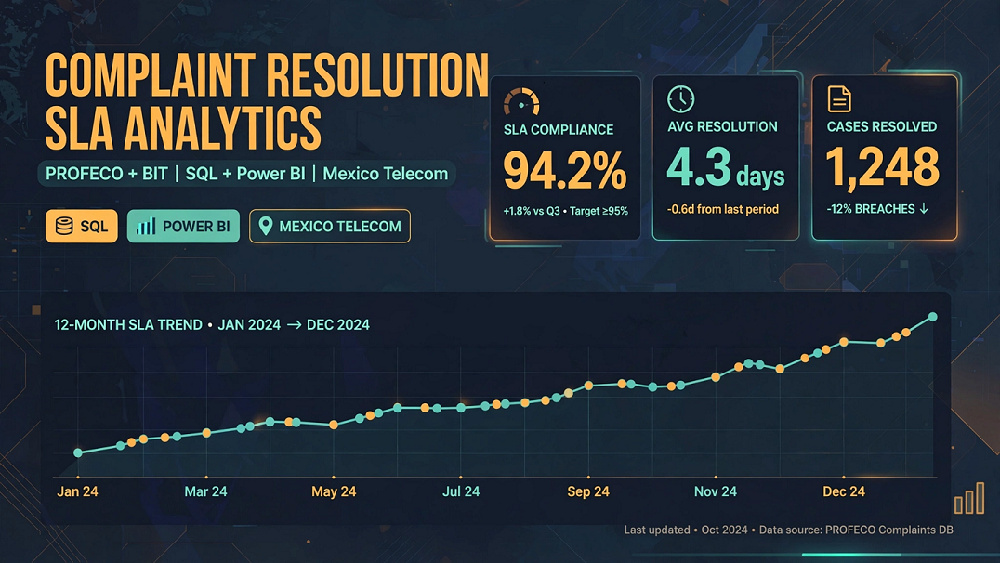

# complaint-resolution-sla-analytics

> SQL Server + Power BI analysis of complaint resolution times against service-level targets, by responsible party and region, built on open government data. Source-agnostic star schema with per-source ingestion adapters.

  

---

## Author

**Eng. Rafael Cansigno Peláez** ([@sigloxiii](https://github.com/sigloxiii)): telecommunications engineer transitioning into data analytics.

This is my second portfolio project, following the Google Data Analytics certificate capstone: [ftth-qos-qoe-risk-framework](https://github.com/sigloxiii/ftth-qos-qoe-risk-framework). All design decisions, scripts and findings in this repository are documented under my authorship.

---

## Learning objectives

1. Build a layered **SQL Server** pipeline (`stg` → `clean` → `mart`) with documented, re-runnable T-SQL scripts.
2. Clean real-world open data: type conversion, inconsistent date formats, negative durations, and provider-name normalization through a mapping table.
3. Apply **dimensional modeling**: define the grain, build a star schema and a role-playing date dimension.
4. Build a **Power BI** semantic model: relationships, DAX measures (percentiles, rates per 100k) and a report, with results cross-checked against SQL.
5. Define SLA-style metrics, run a sensitivity analysis on the targets, and communicate limitations honestly.
6. Design the model to be **source-agnostic**, so the same mart and report can be reused with a different dataset.
7. Follow professional repository practices: Git workflow, English documentation, and awareness of data licensing.

---

## Business questions

**Core question:** How long do complainants wait for a resolution, which responsible parties and regions are slowest, and how has this changed over time?

| # | Question | Main metrics |
|---|---|---|
| BQ1 | How long do complaints take to close, by responsible party, region and category? | Median and P90 of days to close |
| BQ2 | Which responsible parties and regions have the worst outcomes? | Conciliation rate, recovered / claimed amount |
| BQ3 | How does complaint volume compare once normalized by customer base? | Complaints per 100,000 subscribers |
| BQ4 | How have these indicators evolved over the period? | Trend and seasonality |
| BQ5 | How do results compare with published benchmarks? | Contextual comparison with regulator reports |

**Out of scope:** network technical quality (latency, jitter, packet loss). The complaint data measures consumer-protection conciliation, not network performance.

**SLA targets:** the conciliation process has no official service-level target. Targets are therefore treated as **parameters** and evaluated with a sensitivity analysis. The grid will be defined after profiling the data.

---

## Approach

The pipeline is layered, and only the first two layers depend on the data source. It follows a reduced form of the **medallion architecture** (bronze, silver, gold) and an **ELT** approach: the raw data are loaded first and transformed inside the database. The reasons are in decisions D2, D5 and D6 of [`docs/decisions.md`](docs/decisions.md).

### Pipeline map: from the raw file to the dashboard

```
[ EXTERNAL SOURCE ]  (CSV published by PROFECO)
        │
        ▼
[ STAGE 1: INGESTION / STAGING ]  schema stg  (bronze)
 ├── Concept: faithful, literal copy of the source.
 └── Rule: everything enters as text (NVARCHAR), with no filters or transformations.
        │
        ▼
[ STAGE 2: CLEANING AND NORMALIZATION ]  schema clean  (silver)
 ├── Concept: technical cleaning and structuring.
 └── Rules: correct data types (dates, numbers), standardized text,
            placeholders turned into NULL, and quality flags instead of deleted rows.
        │
        ▼
[ STAGE 3: DIMENSIONAL MODELING ]  schema mart  (gold)
 ├── Concept: business-oriented architecture for analysis.
 └── Rules: star schema, with a fact table for the SLA metrics and dimension tables
            for time, region, provider and complaint type.
        │
        ▼
[ STAGE 4: PRESENTATION AND ANALYTICS ]  Power BI
 ├── Concept: visual exploitation and governance of the indicators.
 └── Rules: connect to the mart (Import mode), define the relationships,
            build the business measures (DAX) and design the visual story.
```

The pipeline stages above describe how the data flow. The project phases below describe the order of the work.


| Phase | Description | Status |
|---|---|---|
| 0 | Repository scaffold and feasibility gate on the Mexican dataset | In progress (criteria 1 to 3 passed; BIT check pending) |
| 1 | Create database and schemas; load raw data into `stg` | Done (`step_0` and `step_1`) |
| 2 | Clean and normalize: types, durations, provider mapping | Pending |
| 3 | Load denominators (subscribers) and build dimensions | Pending |
| 4 | Build the `mart` star schema; SQL validation queries | Pending |
| 5 | Power BI model, DAX measures and report | Pending |
| 6 | Documentation, findings and limitations | Pending |

**Planned star schema:** `fact_complaint` (one row per case), `fact_subscribers` (provider × state × quarter), `dim_provider`, `dim_state`, `dim_reason`, `dim_date`.

---

## Initial dataset exploration: México

Desk research on the candidate sources is complete, and the five PROFECO files were downloaded and inspected in Power Query. The base file (36,034 rows) was loaded into SQL Server and profiled with `step_2.sql`: criteria 1 to 3 of the feasibility gate are met, and the BIT check (criterion 4) is **pending**. The evidence and the details of each file are in [`docs/sources/MX_profeco.md`](docs/sources/MX_profeco.md).

### Candidate sources

| Source | Grain | Role in the project |
|---|---|---|
| PROFECO telecommunications complaints (datos.gob.mx) | One row per complaint case | **Primary fact source** |
| BIT, Telecommunications Information Bank (CRT) | Quarterly, by operator / state / technology | Denominators (subscribers) |
| "Soy Usuario" quarterly reports (IFT/CRT) | Aggregated, PDF | Cross-validation of results |
| Fixed-service quality guidelines (IFT, 2020) | Regulatory thresholds | Context for benchmarks |
| Ookla Open Data / M-Lab (optional) | Tiles / test records | Optional technical layer |

### PROFECO columns (23, as found in the file header)

| Group | Columns |
|---|---|
| Case | `expediente` |
| Dates | `fecha_ingreso`, `fecha_cierre` |
| Process | `tipo_conciliacion`, `estado_procesal`, `procedimiento`, `medio_ingreso` |
| Provider | `proveedor` (legal name), `nombre_comercial` (brand), `giro`, `sector` |
| Office and state | `odeco`, `estado` |
| Complaint | `tipo_reclamacion`, `motivo_reclamacion`, `problema_especial` |
| Amounts | `costo_bien_servicio`, `monto_reclamado`, `monto_recuperado` |
| Purchase | `clase`, `tipo_producto`, `modalidad_compra`, `modalidad_pago` |

The names differ from the published data dictionary (which uses upper case, for example `ID_EXP`). Profiling showed that `giro` classifies the provider (not the service of the complaint) and that `clase` separates services from goods. The meaning of `odeco` is still to be confirmed.

### Known caveats

- **Provider names vary** between records (for example, with and without the corporate suffix), so a normalization mapping table is required.
- **Date format:** the data dictionary documents `dd-mm-yyyy`, but the file uses year-first text with dashes (`2022-01-03`), as confirmed in `step_2.sql` (0 values with another format). All dates are loaded as text and converted in the clean layer.
- **Retroactive updates:** the publisher warns that historical data may change. A frozen copy and the download date will be recorded.
- **Five cuts are published** and they are not simple, growing versions of one another. Which one to use, and how they overlap, will be confirmed during the gate (decision D4 in `docs/decisions.md`).
- **No complete service-type column:** `giro` is a provider classification, and `problema_especial` names a service in only 27% of the rows. The analysis is at provider level, and fixed vs mobile comes from a brand mapping (decision D7 in `docs/decisions.md`).
- **Placeholders** such as `-` (amounts, provider) and `sin dato` (`medio_ingreso`) are used instead of empty values and become `NULL` in the clean layer.
- **Values in the wrong column:** in 430 rows (all filed in 2022) the values of `clase` and `medio_ingreso` are swapped. They are corrected in the clean layer and flagged.
- **Case-insensitive IDs:** two `expediente` values differ only in case and belong to different providers. They are not duplicates, and the data are not deduplicated by ID.
- **Closed cases only:** the file has no open cases, so the most recent months are incomplete (right-censoring) and resolution times can look shorter than reality.
- **Abbreviated and cut labels:** `procedimiento` and `tipo_conciliacion` hold abbreviated text, and some `procedimiento` values seem cut at 30 characters (for example "Conciliación Medios Electrónic"), so the same label appears spelled two ways. They are mapped in the clean layer.
- **Metric meaning:** days to close measures the duration of the PROFECO conciliation procedure, not the provider's repair time. Only complaints that reach PROFECO are recorded (self-selection bias).

### Feasibility gate

The Mexican dataset is used only if all criteria are met.

| # | Criterion | Result |
|---|---|---|
| 1 | At least 2,000 complaints against fixed-network operators (provider-level proxy; the file has no complete service-type column, see D7) | Passed: 13,268 |
| 2 | Missing `fecha_cierre` below 30% of rows | Passed: 66 rows (0.18%) |
| 3 | Main providers (Telmex, Izzi, Megacable, Total Play) with at least 100 cases per year | Passed for 2022 to 2025. 2026 is partial (to May): Telmex has 68 |
| 4 | Subscribers by operator and state downloadable from BIT | Pending |

Evidence from the gate will be stored in `docs/` regardless of the outcome.

---

## Fallback: US datasets

If the Mexican data fails the gate, the project pivots to a US open dataset **without redesigning the pipeline**. The leading candidate is the NYC 311 Service Requests dataset from [NYC Open Data](https://opendata.cityofnewyork.us/), which has creation and closing dates, agency, complaint type and borough.

| Stays the same | Changes |
|---|---|
| Canonical `mart` schema and star model | Source adapters in `sql/us_nyc311/` |
| Scripts in `sql/common/` | Responsible party = agency |
| DAX measure structure and report layout | Region = borough |
| Business questions BQ1, BQ3 (adapted), BQ4 | Normalization by population instead of subscribers |
| Documentation structure | No "recovered amount" metric, so BQ2 changes |

The reasons for any pivot will be documented in `docs/`.

---

## Tech stack

- SQL Server 2025 Express and SSMS 22 (T-SQL)
- Power BI Desktop (Import mode)
- Git and GitHub, with VS Code for version control

---

## Repository structure

```
assets/            # banner and other static images
data/
  raw/             # source files as downloaded (not versioned)
  interim/         # intermediate files (not versioned)
  reference/       # small seed files, for example the provider mapping
sql/
  common/          # source-agnostic: database, schemas, mart, views
  mx_profeco/      # one folder per source: load and clean (stg → clean)
powerbi/           # .pbix and PDF report
docs/
  decisions.md    # decision log (D1 to D7)
  run_log.md       # script runs and their evidence
  glossary_of_terms.md
  sources/         # one note per data source
  img/             # evidence images, named <topic>_<name>.png
```

The structure is limited to two folder levels.

---

## Data sources and licenses

To be completed during the gate: source URL, license, download date and attribution for each dataset. The code in this repository is MIT-licensed. **The data keeps the license of its original publisher.**

---

## How to reproduce

To be completed once the pipeline is implemented.

---

## Results and findings

To be completed.

---

## Limitations

To be completed. The caveats listed above will be expanded with the results of profiling.

---

## References

- Microsoft Learn: [Understand medallion lakehouse architecture for Microsoft Fabric with OneLake](https://learn.microsoft.com/en-us/fabric/onelake/onelake-medallion-lakehouse-architecture).
- Microsoft Learn (training module): [Organize a Fabric lakehouse using medallion architecture design](https://learn.microsoft.com/en-us/training/modules/describe-medallion-architecture/).
- Databricks blog: [What is Medallion Architecture?](https://www.databricks.com/blog/what-is-medallion-architecture).
- Databricks documentation: [What is the medallion lakehouse architecture?](https://docs.databricks.com/aws/en/lakehouse/medallion.html).

The medallion architecture is used here as a design pattern, in a reduced form (one SQL Server database with three schemas, no data lake). The project is not tied to those platforms.

---

## License

Code and documentation are released under the [MIT License](LICENSE).