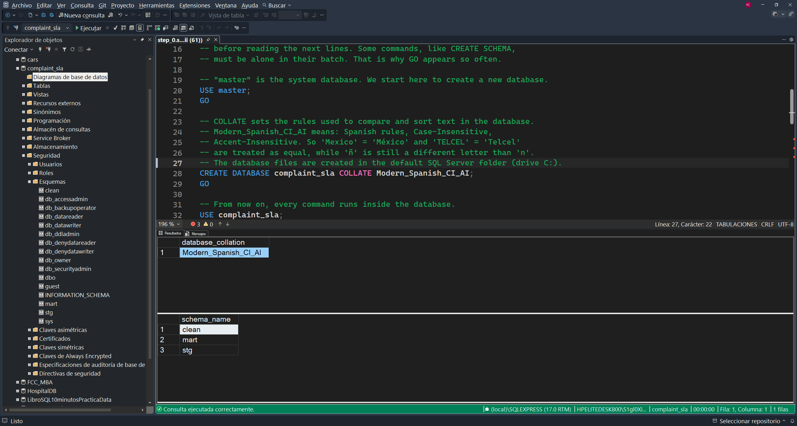
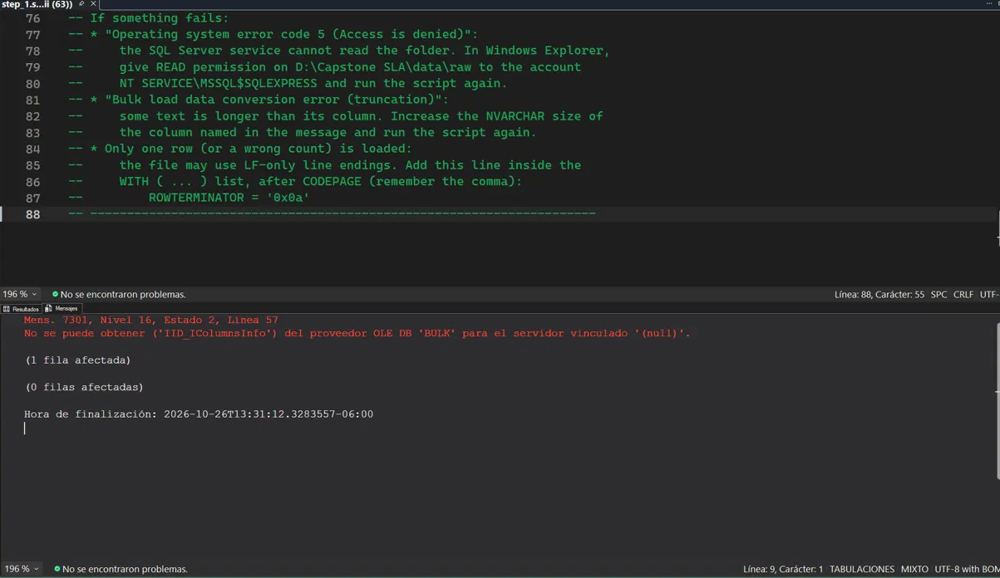
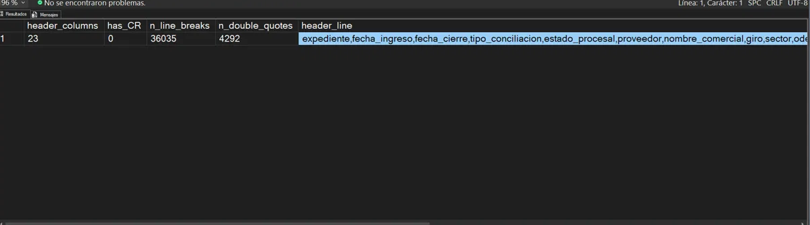
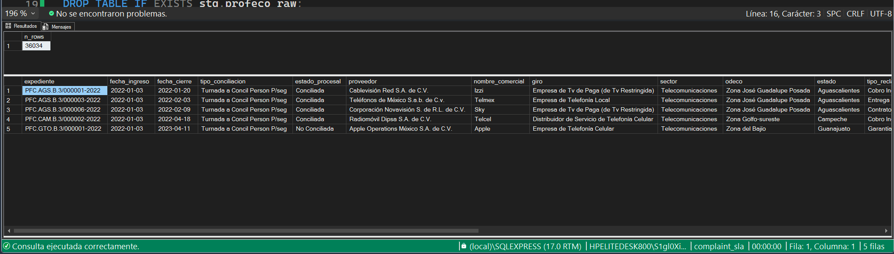

# Run log

Record of each script execution on the local instance (SQL Server 2025 Express, SSMS 22), with its evidence. Source-specific results of the feasibility gate are also summarized in `docs/sources/MX_profeco.md`.

| Step | Script | Date | Result |
|---|---|---|---|
| 0 | `sql/common/step_0.sql` | 2026-10-25 (confirm) | Done |
| 1 | `sql/mx_profeco/step_1.sql` | 2026-10-26 | Done (second attempt, see incident) |
| 2 | `sql/mx_profeco/step_2.sql` | 2026-10-26 | In progress (four columns of block 2.8 pending) |

## Step 0: database and schemas

What the evidence shows:

- The instance is `(local)\SQLEXPRESS`, SQL Server version 17.0 (SQL Server 2025), and the query finished with the message "Consulta ejecutada correctamente".
- The database `complaint_sla` exists and its collation is `Modern_Spanish_CI_AI`.
- The three schemas `clean`, `mart` and `stg` exist (they also appear under *Seguridad → Esquemas* in the Object Explorer).

Note: the editor shows three error markers (IntelliSense). The execution was successful, so they are probably warnings caused by the editor parsing the script before the objects existed. To be confirmed in the SSMS *Error List*.

## Step 1: raw load

### Incident: error 7301 on the first attempt

The first run failed with: *"Cannot obtain the required interface ('IID_IColumnsInfo') from OLE DB provider 'BULK' for linked server '(null)'"* (message 7301). The table `stg.profeco_raw` was created, but no rows were loaded.

The file was inspected as plain text with `OPENROWSET(BULK ..., SINGLE_CLOB)`:

| Check | Result | Meaning |
|---|---|---|
| `header_columns` | 23 | Same number of columns as the table |
| `has_CR` | 0 | Lines end with LF only, not CR+LF |
| `n_line_breaks` | 36,035 | 1 header + 36,034 rows, as expected |
| `n_double_quotes` | 4,292 | Even number, so no unclosed quotes |

**Cause:** the file uses LF line endings, and `BULK INSERT` with `FORMAT = 'CSV'` expects CR+LF by default (see *LF and CR+LF* in [`glossary_of_terms.md`](glossary_of_terms.md)).
**Fix:** `ROWTERMINATOR = '0x0a'` was added to the `WITH` list of `step_1.sql`.

### Result

What the evidence shows:

- `stg.profeco_raw` contains **36,034 rows**, the same count that Power Query showed.
- The first rows have each value in its own column (case ID, dates, outcome, provider, brand, state).
- Dates arrive as text with the year first and dashes (for example `2022-01-03`). This confirms the assumption made in `step_2.sql`.
- Accents load correctly (for example *México*, *Teléfonos*, *Telefonía*), so `CODEPAGE = '65001'` works.

## Step 2: feasibility gate profiling

Status: in progress. The script is read-only (SELECT). Results are summarized in `docs/sources/MX_profeco.md`; this section records what was run and what changed in the script.

| Block | Topic | Status |
|---|---|---|
| 2.1 to 2.7 | Row count, unique ID, date format and range, missing close date, close before filing | Done. 2.2: 2 IDs differ only in case and belong to different providers (not duplicates) |
| 2.8 | Type of service (checks A to I) | Done. See *Type of service* in `docs/sources/MX_profeco.md` and decision D7 |
| 2.9 to 2.14 | Provider names, gate criteria 1 and 3, batch closings, amounts, cancelled cases | Done. Gate criteria 1 to 3 passed |
| 2.15, 2.16 | Values in the wrong column (`clase`), explanation of missing close dates, amounts | Done. `clase` and `medio_ingreso` are swapped in 430 rows (all from 2022) |

Changes made to `step_2.sql` while running it:

- **Block 2.8 rewritten.** It was written as a search for a service column. It became a test of the hypothesis that no such column exists, with checks A to I.
- **Brand variants.** Check A showed that "Totalplay" (1,816) and "Total Play" (1,531) are the same company. The brand lists of blocks 2.10 and 2.11 now include both spellings. This is the first case for the provider mapping table of the clean layer.
- **Result.** `giro` is not the service of the complaint, and `problema_especial` names a service in 27.2% of the rows, with uneven coverage (decision D7).

- **`clase` and `tipo_producto`** do not hold the telecom service. D7 moved from Provisional to Accepted.
- **New block 2.15** added to the script: `clase` holds 430 values that belong to `medio_ingreso` (Internet, Personal, Escrito, Correo Electrónico). The block checks if the two columns were swapped and in which years it happens.