# Run log

Record of each script execution on the local instance (SQL Server 2025 Express, SSMS 22), with its evidence. Source-specific results of the feasibility gate are also summarized in `docs/sources/MX_profeco.md`.

| Step | Script | Date | Result |
|---|---|---|---|
| 0 | `sql/common/step_0.sql` | 2026-10-25 | Done |
| 1 | `sql/mx_profeco/step_1.sql` | 2026-10-26 | Done (second attempt, see incident) |
| 2 | `sql/mx_profeco/step_2.sql` | 2026-10-26 | Done (gate passed on 2026-10-27) |
| 3 | `sql/mx_profeco/step_3.sql` | 2026-10-27 | Run 1 done (checks 1 to 13); revision 2 done (checks 14 to 17) |
| 4 | `sql/mx_profeco/step_4.sql` | 2026-10-31 | Done (checks 4.1 to 4.11); D4 accepted |
| 5 | `sql/mx_bit/step_5.sql` | 2026-11-01 | Done (592,281 rows loaded; checks 5.0 to 5.8) |
| 6 | `sql/mx_bit/step_6.sql` | 2026-11-01 | Done (`clean.bit_access`, 592,281 rows; checks 6.1 to 6.6b); D12 and D13 accepted |
| 7 | `sql/common/step_7.sql` | 2026-11-05 | Done (mart: 6 dimensions, 2 facts; checks 7.3a to 7.3f); D14 accepted |
| 8 | `sql/common/step_8.sql` | 2026-11-06 | Done (checks 8.1 to 8.9; view `mart.v_duration_cases`); D15 accepted |
| 9 | `powerbi/build_guide.md` | 2026-11-06 to 2026-11-08 | Done (model, 28 measures validated against SQL, 6 report pages, PDF); D16 accepted |

## Step 0: database and schemas

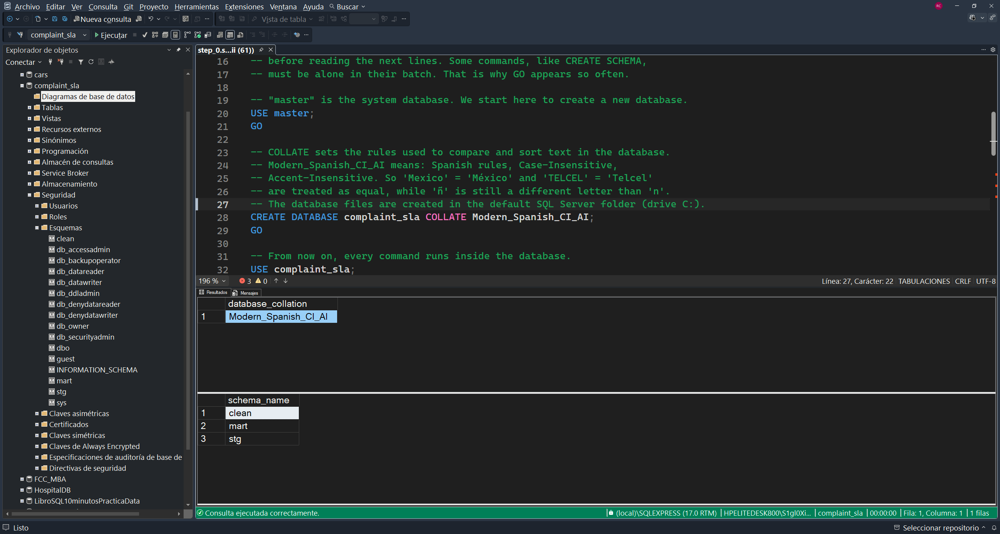

What the evidence shows:

- The instance is `(local)\SQLEXPRESS`, SQL Server version 17.0 (SQL Server 2025), and the query finished with the message "Consulta ejecutada correctamente".
- The database `complaint_sla` exists and its collation is `Modern_Spanish_CI_AI`.
- The three schemas `clean`, `mart` and `stg` exist (they also appear under *Seguridad → Esquemas* in the Object Explorer).

Note: the editor shows three error markers (IntelliSense). The execution was successful, so they are probably warnings caused by the editor parsing the script before the objects existed. To be confirmed in the SSMS *Error List*.

## Step 1: raw load

### Incident: error 7301 on the first attempt

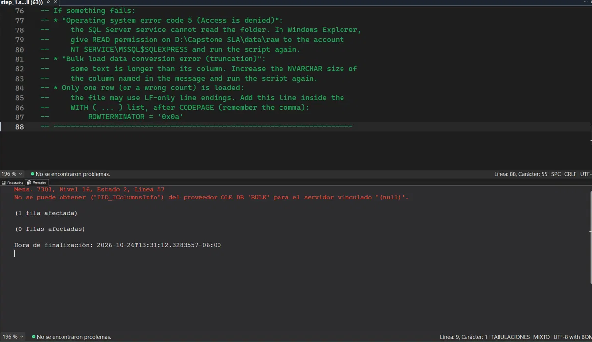

The first run failed with: *"Cannot obtain the required interface ('IID_IColumnsInfo') from OLE DB provider 'BULK' for linked server '(null)'"* (message 7301). The table `stg.profeco_raw` was created, but no rows were loaded.

The file was inspected as plain text with `OPENROWSET(BULK ..., SINGLE_CLOB)`:

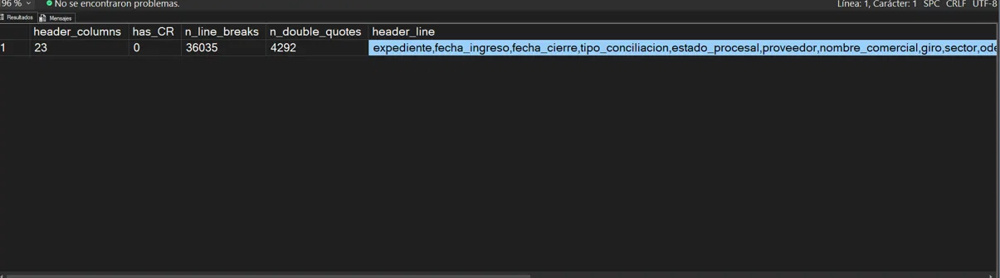

| Check | Result | Meaning |
|---|---|---|
| `header_columns` | 23 | Same number of columns as the table |
| `has_CR` | 0 | Lines end with LF only, not CR+LF |
| `n_line_breaks` | 36,035 | 1 header + 36,034 rows, as expected |
| `n_double_quotes` | 4,292 | Even number, so no unclosed quotes |

**Cause:** the file uses LF line endings, and `BULK INSERT` with `FORMAT = 'CSV'` expects CR+LF by default (see *LF and CR+LF* in [`glossary_of_terms.md`](glossary_of_terms.md)).
**Fix:** `ROWTERMINATOR = '0x0a'` was added to the `WITH` list of `step_1.sql`.

### Result

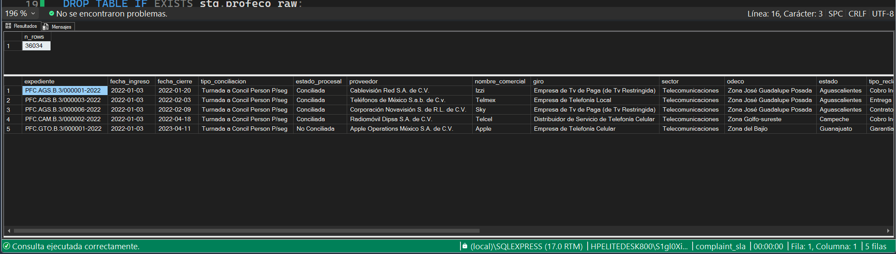

What the evidence shows:

- `stg.profeco_raw` contains **36,034 rows**, the same count that Power Query showed.
- The first rows have each value in its own column (case ID, dates, outcome, provider, brand, state).
- Dates arrive as text with the year first and dashes (for example `2022-01-03`). This confirms the assumption made in `step_2.sql`.
- Accents load correctly (for example *México*, *Teléfonos*, *Telefonía*), so `CODEPAGE = '65001'` works.

## Step 2: feasibility gate profiling

Status: done. The script is read-only (SELECT). Results are summarized in `docs/sources/MX_profeco.md`; this section records what was run and what changed in the script.

| Block | Topic | Status |
|---|---|---|
| 2.1 to 2.7 | Row count, unique ID, date format and range, missing close date, close before filing | Done. 2.2: 2 IDs differ only in case and belong to different providers (not duplicates) |
| 2.8 | Type of service (checks A to I) | Done. See *Type of service* in `docs/sources/MX_profeco.md` and decision D7. The columns `sector`, `procedimiento`, `medio_ingreso` and `tipo_conciliacion` were also reviewed |
| 2.9 to 2.14 | Provider names, gate criteria 1 and 3, batch closings, amounts, cancelled cases | Done. Gate criteria 1 to 3 passed |
| 2.15, 2.16 | Values in the wrong column (`clase`), explanation of missing close dates, amounts | Done. `clase` and `medio_ingreso` are swapped in 430 rows (all from 2022) |
| 2.17 | Length of `procedimiento` values; `tipo_conciliacion` and `procedimiento` against `estado_procesal` | Done. `procedimiento` labels are cut at 30 characters in part of the rows; `En Proceso` is not an open case |

Changes made to `step_2.sql` while running it:

- **Block 2.8 rewritten.** It was written as a search for a service column. It became a test of the hypothesis that no such column exists, with checks A to I.
- **Brand variants.** Check A showed that "Totalplay" (1,816) and "Total Play" (1,531) are the same company. The brand lists of blocks 2.10 and 2.11 now include both spellings. This is the first case for the provider mapping table of the clean layer.
- **Result.** `giro` is not the service of the complaint, and `problema_especial` names a service in 27.2% of the rows, with uneven coverage (decision D7).
- **`clase` and `tipo_producto`** do not hold the telecom service. D7 moved from Provisional to Accepted.
- **New block 2.15** added to the script: `clase` holds 430 values that belong to `medio_ingreso` (Internet, Personal, Escrito, Correo Electrónico). The block checks if the two columns were swapped and in which years it happens.
- **New block 2.17** added to the script. It showed that `En Proceso` rows have final outcomes (so it is not an open case) and that 62 rows of `procedimiento` are legal procedures that are not a conciliation.

## Feasibility gate result (2026-10-27)

All four criteria passed, so decision D1 is accepted (México). Criterion 4 was checked by hand on the BIT downloads (`TD_ACC_BAF_ITE_VA`, pivot table in Excel); the details are in `docs/sources/MX_profeco.md`. Next: `step_3.sql` (clean layer).

## Step 3: clean layer

### Run 1

The script creates `clean.brand_map`, `clean.state_map` and `clean.profeco_complaint` (36,034 rows). Checks 3.3.1 to 3.3.11 matched the expected values. The evidence is `docs/img/step_3_check_01.png` to `step_3_check_13.png` (check 6 has `06p1` and `06p2`), and the table with the results is in `docs/sources/MX_profeco.md`, section *Results of the clean layer*.

Two checks were added after the first run and gave findings that changed the design:

- **Check 3.3.12 (state):** the state is the PROFECO office that handled the case, and the Internet channel is handled by one central office in Ciudad de México (decision D8).
- **Check 3.3.13 (amounts):** the claimed amount is 0 in 78% of the rows and the recovered amount exceeds the claimed one in 24% (decision D9).

### Revision 2 (run on 2026-10-29)

Changes in `step_3.sql`, from the results of checks 3.3.6, 3.3.12 and 3.3.13:

- `clean.brand_map` has new categories: Fixed (Axtel, Gigacable, Telecable, Newww, Starlink), Mobile (Bait), Pay TV (satellite) (Sky, Dish) and Device maker (Samsung, Motorola, Apple, Xiaomi, ZTE, Huawei, Honor, Oppo, Alcatel, LG, Hisense).
- `clean.profeco_complaint` has three new columns: `office_code` (from the case ID), `office_name` (`odeco`) and `flag_central_office` (office `H`).
- New checks: 3.3.14 (office H and channel), 3.3.15 (brands by category), 3.3.16 (meaning of `odeco`) and 3.3.17 (is the state always the state of the office?).

Results (images `step_3_check_14.png` to `step_3_check_17.png` and the new `step_3_check_06p1.png` and `06p2.png`, details in `docs/sources/MX_profeco.md`):

- Office `H` has 19,798 cases and 99.2% of the Internet channel (19,607 of 19,772); the other 165 Internet cases are spread over 31 states.
- Brands by category add up to 36,034: Mobile 18,231 (5 brands), Fixed 13,358 (9 brands), Pay TV (satellite) 2,101, Device maker 1,243 (11 brands) and Not classified 1,101 (163 brands).
- `odeco` is the name of the office (zone). Office `H` has two names, "Dir. Gral. Cons. Telecom" (16,016) and "Dgpct" (3,782).

- Of the 16,236 cases not handled by `H`, 16,221 (99.9%) have the main state of their office and 15 have another one (check 3.3.17). The Fixed category now has 9 brands and 13,358 cases (check 6, part 1).

The revision 2 is finished.

## Step 5: BIT load (`sql/mx_bit/step_5.sql`, 2026-11-01)

Loads `TD_ACC_BAF_ITE_VA.csv` (downloaded 2026-10-26) into `stg.bit_acc_baf` as text. Evidence: `step_5_check_00.png` to `step_5_check_08p2.png`; the results are summarized in `docs/sources/MX_profeco.md`.

- **File layout found by the probe (5.0):** comma separator, text with commas in double quotes, lines ending in CR+LF (`0x0d0a`), accents correct with code page 1252, and **two empty extra columns** at the end of every line (`,,`). The staging table has two helper columns that are checked empty (`n_not_empty` = 0) and dropped.
- **Load:** 592,281 rows, the same as Excel.
- **Checks:** years 2013 to 2024 and months 1 to 12; no bad year, month or state; December 2024 matches the Excel pivots (the four groups 27,809,589); 33 state codes; the companies of each group reproduce the pivots.
- **Corrections to the checks:** 5.3 used a collation that ignores accents, so every row looked "broken" (fixed with a binary collation, result 0); 5.6 did not filter by group, so it showed 1,051,366 accesses without state for all operators (35,990 for the four groups, as expected).
- **Missing accesses (5.8):** 1,831 rows (0.31%) have an empty `a_total_e` (NULL, not text). 1,462 belong to the four groups, mainly 2015 to 2016 and 2020 (804 rows). In the period of the rates there are 33 rows in 2022, 12 in 2023 and none in 2024.

## Step 6: BIT clean layer (`sql/mx_bit/step_6.sql`, 2026-11-01)

Builds `clean.bit_access` from `stg.bit_acc_baf`: types, date, state code and name, operator of each row and flags. No row is deleted. Evidence: `step_6_check_01p1.png` to `step_6_check_09.png`; the results are in `docs/sources/MX_profeco.md`.

- **Grain:** the first run of check 6.2a gave 36,562 repeated keys (expected 0). Checks 6.2c to 6.2h showed that the repeated rows are mostly different records (same concessionaire and technology, very different accesses), that only 325 rows are exact copies, and that the repetition is the same in November and December 2024. All rows are kept and the copies are flagged (D12).
- **Technology:** no filter in the denominators (D13).
- **Result:** 592,281 rows, 1,831 with missing accesses, 9,078 without state, 13,247 without municipality, 325 exact copies, 0 without date. December 2024 reproduces the totals of step 5.
- **Script changes while running it:** the old blocks 6.2c to 6.2f were replaced by 6.2c to 6.2h, column `flag_exact_copy` added to 6.4, and the technology check of the four operators renamed 6.6b.

## Step 7: mart layer (`sql/common/step_7.sql`, 2026-11-05)

Builds the star schema in `mart` from `clean.profeco_complaint` and `clean.bit_access` (decision D14). Evidence: `step_7_check_01.png` to `step_7_check_08.png`.

| Check | Result | Evidence |
|---|---|---|
| 7.0 to 7.2 Build | Rows inserted: `dim_date` 5,113; `dim_state` 33; `dim_operator` 5; `dim_brand` 190; `dim_reason` 176; `dim_outcome` 39; `fact_complaint` 36,034; `fact_accesses` 19,840. The two warnings are NULL values ignored by `MAX` and `SUM` (empty accesses and unmapped groups) | 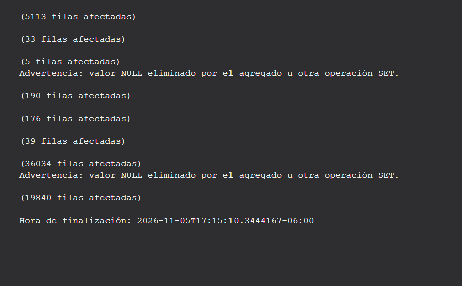 |
| 7.3a Rows | Same counts as the messages | 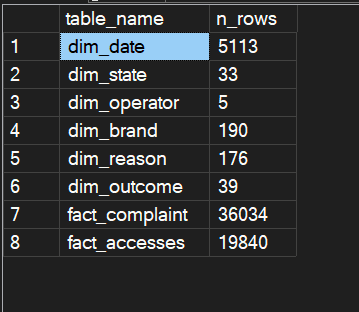 |
| 7.3b Reconciliation | Complaints 36,034 in `clean` and `mart`; BIT rows 592,281 in both; difference in accesses 0 | 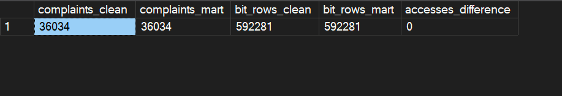 |
| 7.3c December 2024 | Telmex 11,208,977; Izzi 5,619,403; Megacable 5,316,545; Total Play 5,313,779 (as in 6.5b); Other 1,544,536 | 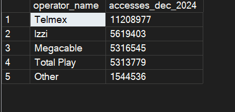 |
| 7.3d Keys | 0 complaints without filing date key; 66 without close date key, the same 66 as `flag_missing_close`; 0 orphan brands | 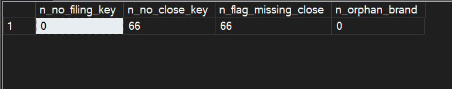 |
| 7.3e Complaints by filing year | The file has no filing year before 2022. Fixed broadband totals: 2022 4,101; 2023 2,965; 2024 2,591; 2025 2,959; 2026 742 (partial year) | 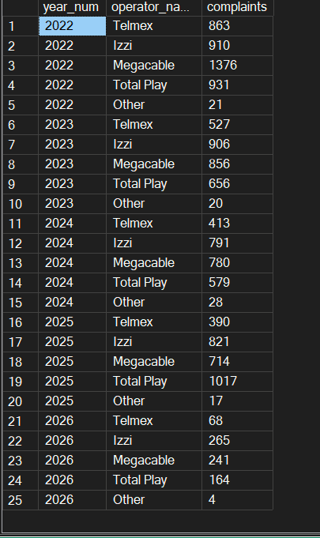 |
| 7.3f Rate per 100,000 accesses | See the table below | 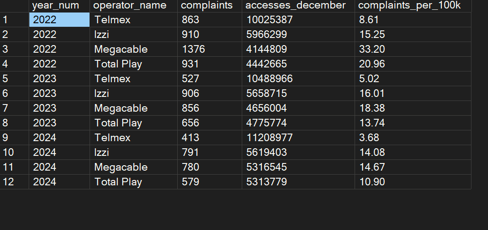 |
| 7.3g Service hint by operator | Fixed brands filed 2022 to 2024: 9,588 complaints (Telmex 1,803; Izzi 2,607; Megacable 3,012; Total Play 2,166; the counts match 7.3e). "Not specified" is 98.8%, 89.4%, 75.3% and 78.9%. Mobile telephony: 14 complaints (0.15%). Where the hint exists, Megacable has 513 Internet against 221 Television or Telephony, and Izzi 125 against 143 | 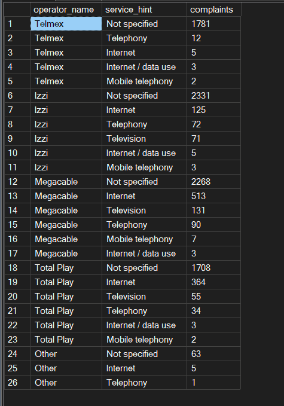 |

Preview of the rates (complaints filed in the year, fixed broadband brands, divided by the accesses of December; national level):

| Operator | 2022 | 2023 | 2024 |
|---|---|---|---|
| Telmex | 8.61 | 5.02 | 3.68 |
| Izzi | 15.25 | 16.01 | 14.08 |
| Megacable | 33.20 | 18.38 | 14.67 |
| Total Play | 20.96 | 13.74 | 10.90 |

Notes:

- The values were recalculated by hand from the counts and denominators of the checks and match.
- The numerator is every complaint of the brand, while the denominator is fixed broadband accesses only. Check 7.3g shows almost no mobile complaints (14 of 9,588), so no filter is needed, but the complaints include television and fixed telephony. The rate is read as **complaints about the fixed services of the operator per 100,000 of its broadband accesses**, with the broadband accesses as a proxy of its customer base. The hint covers only 1% to 25% of the rows, so the share of other services cannot be measured.
- Megacable's 2022 rate is the least comparable: its denominator has no technology in December 2022 and grows 28% in two years (see D13).
- Total Play has 1,017 complaints filed in 2025 against 579 in 2024. There are no BIT accesses for 2025, so it has no rate.

## Step 8: validation of the measures (`sql/common/step_8.sql`, 2026-11-06)

Profiles the duration, the outcomes and the service-level grid on the mart (decision D15). Evidence: `step_8_check_01.png` to `step_8_check_09.png`. One view is created: `mart.v_duration_cases` (12,833 cases).

| Check | Result | Evidence |
|---|---|---|
| 8.1 Usable duration | Fixed brands: Conciliation 12,924 (12,917 valid), Not identified 21 (16), Other legal procedure 18 (16), Queja 395 (386); total 13,358, as in step 3. Out of scope: 22,626 valid; all valid 35,961, the same as the flag | 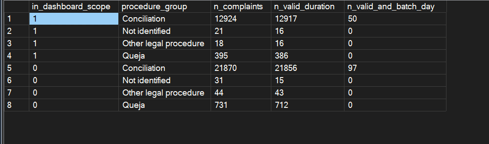 |
| 8.2 View | Created without errors | 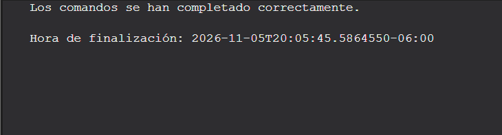 |
| 8.3 Batch-closing day | 50 cases in the population (3 Telmex, 15 Izzi, 13 Megacable, 19 Total Play); longer average than the rest but a lower maximum; kept | 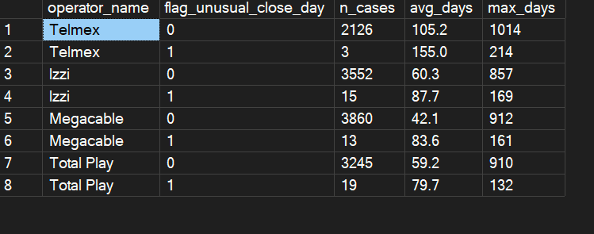 |
| 8.4 Median and P90 by close year | All four operators, all years: 12,833 cases, median 35, P90 138, mean 62.1. By operator: Telmex 70 and 225.2; Izzi 35 and 132.0; Megacable 24 and 92.0; Total Play 32 and 130.0. By close year (four operators): 2022 27 and 96.0; 2023 37 and 186.5; 2024 33 and 174.0; 2025 35 and 127.5; 2026 56 and 130.0 | 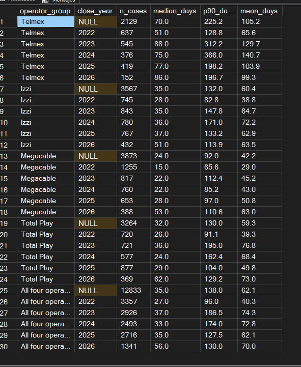 |
| 8.5 By filing year | Median and P90: 2022 32 and 169 (4,001 cases); 2023 35 and 161 (2,777); 2024 30 and 130 (2,390); 2025 41 and 118 (2,927); 2026 41 and 75 (738). The maximum falls from 1,014 to 137 days with the age of the cohort | 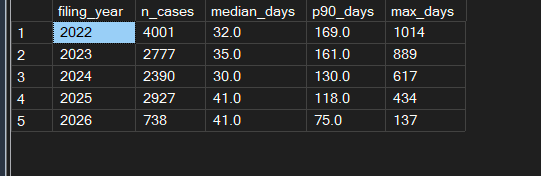 |
| 8.6 Service-level grid | % within 30, 60, 90, 120 and 180 days: Telmex 16.4, 44.3, 62.0, 75.4, 85.5; Izzi 42.8, 71.8, 82.3, 88.6, 94.4; Megacable 59.2, 81.2, 89.8, 93.2, 96.7; Total Play 48.6, 71.3, 81.9, 88.4, 94.4; four operators 44.9, 69.9, 81.1, 87.8, 93.6 | 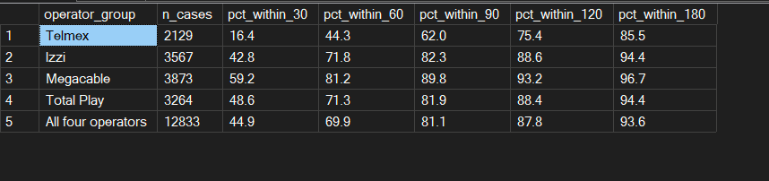 |
| 8.7 Outcomes by close year | Four operators, all years: 12,837 cases; Conciliada 8,319; No Conciliada 739; Desistimiento 3,720; Improcedente 58; other 1. Conciliation rate 64.8% (91.8% without withdrawals). By operator: Telmex 67.7%, Izzi 62.9%, Megacable 68.9%, Total Play 60.2% | 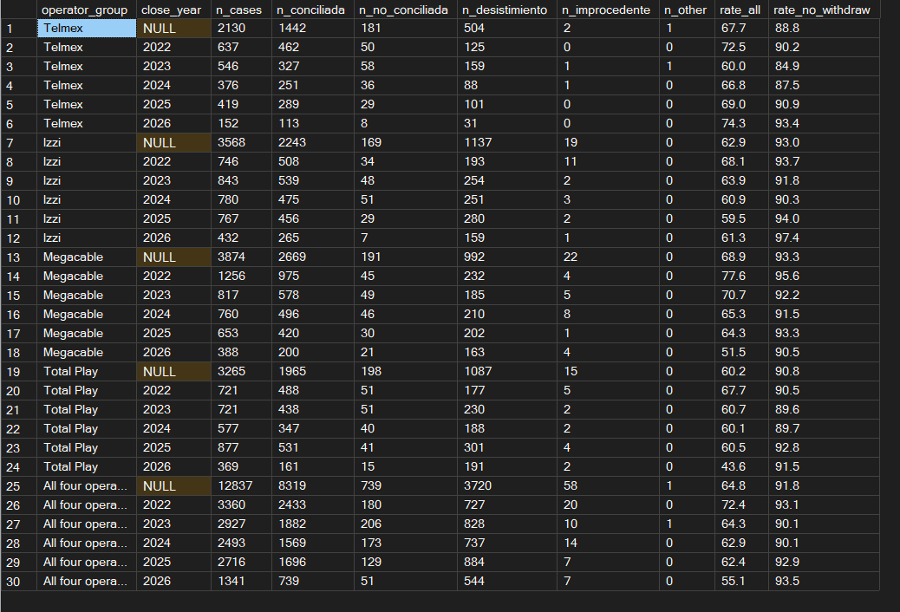 |
| 8.8 Median and P90 by filing year, by operator | Reference values for DAX. Four operators (median and P90): 2022 32 and 169.0; 2023 35 and 161.0; 2024 30 and 130.0; 2025 41 and 118.0; 2026 41 and 75.0. Telmex: 66 and 305.0; 76 and 250.0; 70 and 198.0; 74 and 161.6. Izzi: 32 and 140.0; 36 and 169.2; 33 and 130.6; 41 and 112.5. Megacable: 19 and 90.0; 22 and 106.6; 21 and 78.0; 31 and 100.9. Total Play: 33 and 181.0; 31 and 143.5; 22 and 102.0; 34 and 117.0. The cases add up to 12,833 for every operator and year, as in 8.5 | 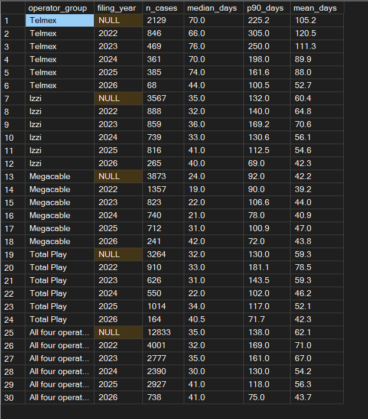 |
| 8.9 Outcomes by filing year, by operator | Reference values for DAX. Conciliation rate of the four operators: 2022 68.1%; 2023 66.0%; 2024 63.5%; 2025 60.2%; 2026 65.3% (partial). Without withdrawals: 91.1%, 91.6%, 90.9%, 92.8%, 96.6%. Withdrawal share: 24.8%, 27.5%, 29.7%, 34.8%, 31.8%. The cases add up to 12,837, as in 8.7 | 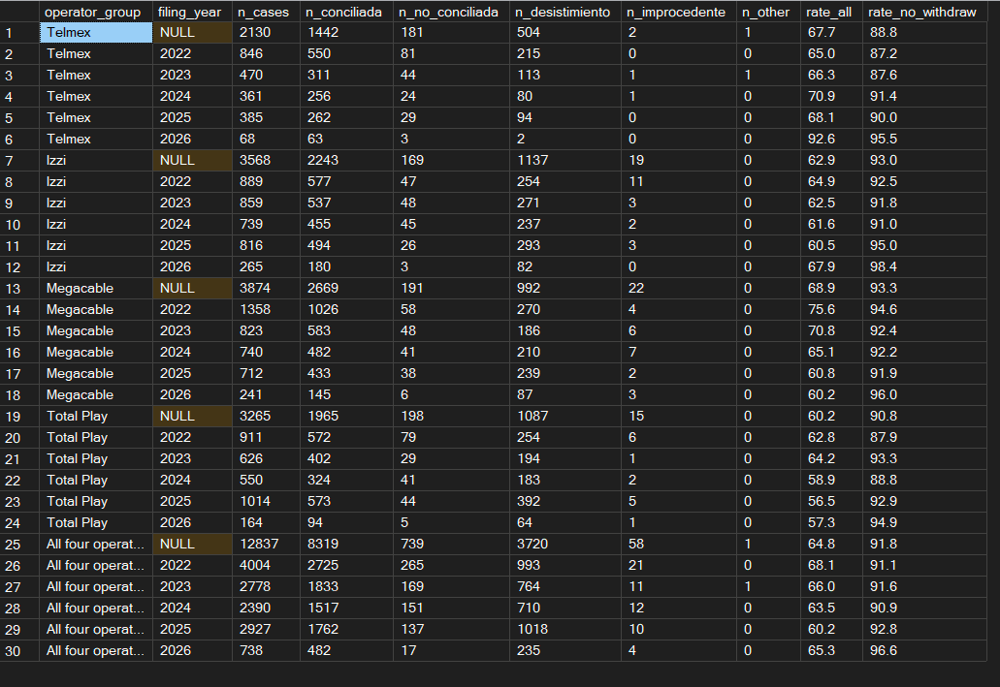 |

- Counts checked: the 12,833 cases of 8.4, 8.5 and 8.6 are the sum of the four operators (2,129 + 3,567 + 3,873 + 3,264); the outcome check has 4 more cases because it does not need a valid duration.
- Script fix while running it: 8.4 and 8.7 gave error 145 (with `SELECT DISTINCT` the `ORDER BY` can only use columns of the select list); both are wrapped in a subquery that sorts.
- Decision D15 explains why the filing year is the axis (left-truncation of the close year) and the other choices.

What the filing-year cohorts show (2022 to 2024 are complete; 2025 has an incomplete tail and 2026 is partial):

- **The conciliation rate of the four operators falls from 68.1% to 60.2% (2022 to 2025), and the fall comes from the withdrawals**, which go from 24.8% to 34.8% of the cases. Among the decided cases (Conciliada against No Conciliada) the share stays between 90.9% and 92.8%. This supports the choice of D15 to show the withdrawal share next to the rate.
- **By operator, the rate moves in different directions:** Megacable falls from 75.6% to 60.8%, Izzi from 64.9% to 60.5% and Total Play from 62.8% to 56.5%; Telmex rises from 65.0% to 68.1%.
- **The median duration of 2025 is higher than that of 2024 in the four operators** (41 against 30 days in total), even though the missing open cases push the 2025 values down. 2024 is the fastest cohort.
- **Telmex is the slowest in every cohort**, but its P90 falls from 305 to 198 days between 2022 and 2024.
- The 2026 conciliation rate (65.3%) and its P90 (75 days) are not comparable: the cohort has only the cases already closed.
- The cases of 8.8 are fewer than the complaints of check 7.3e for the same year (for example Telmex 2022: 846 against 863) because the population has only the Conciliation group with a valid duration.

## Step 9: Power BI model, measures and report (`powerbi/build_guide.md`, 2026-11-06 to 2026-11-08)

Import mode to the `mart` tables of `complaint_sla`. Every measure was checked against the SQL values of step 8 before it was used in a page (decision D16). The `.pbix` stays local; the PDF and the screenshots are published.

| Block | Check | Result | Evidence |
|---|---|---|---|
| A1 | Load | Eight `mart` tables loaded (6 dimensions, 2 facts) | 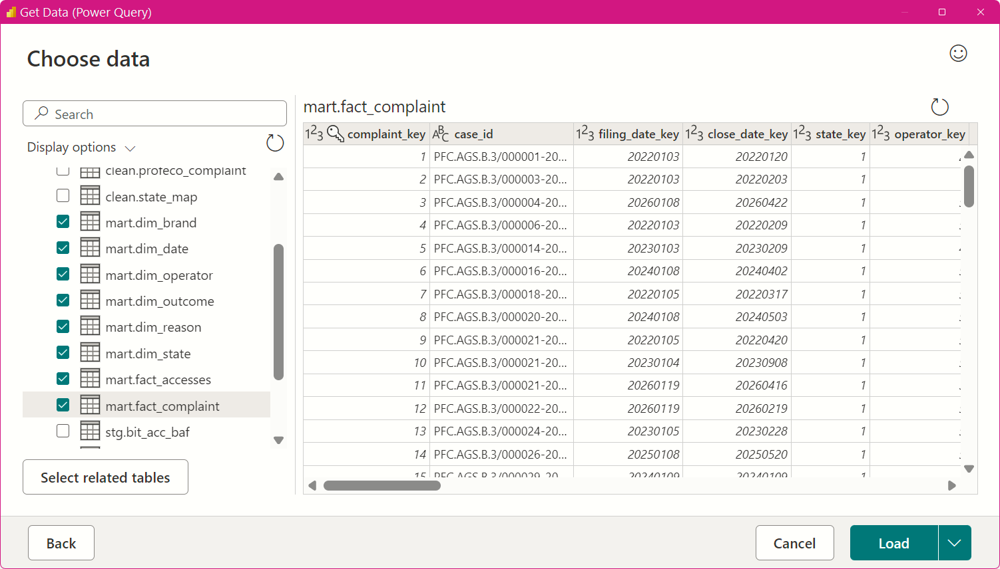 |
| A2 | Model | Star schema, 10 many-to-one single-direction relationships; `fact_complaint[filing_date_key]` to `dim_date` active, `close_date_key` inactive; no relationship between the two facts | 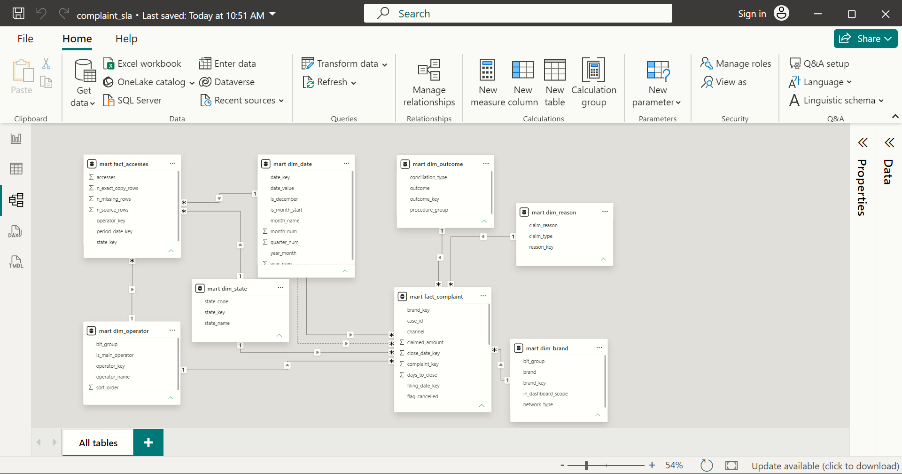 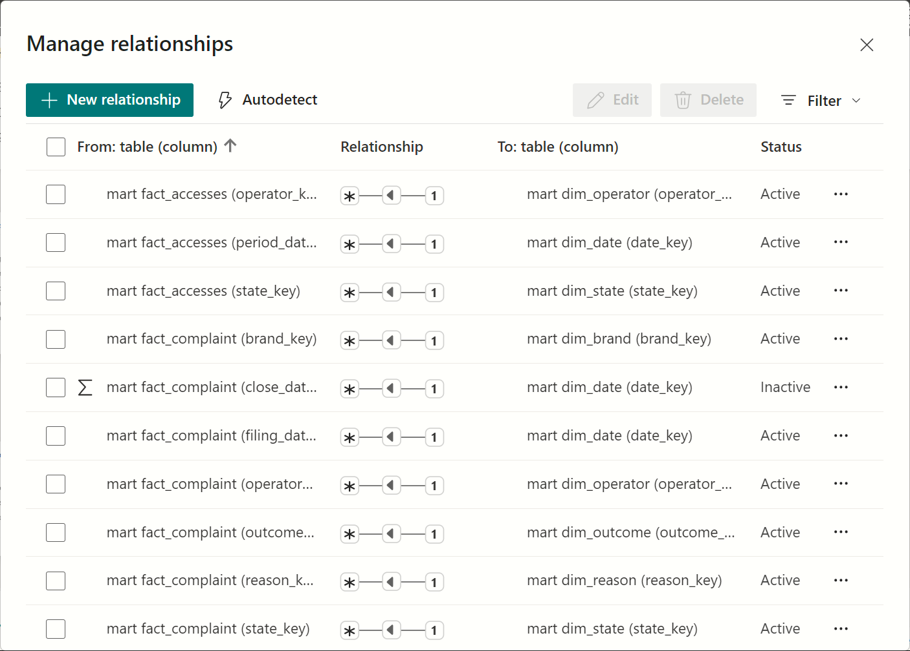 |
| A3 | DAX check | Row counts as in the mart: 36,034 complaints, 19,840 access rows, 12,833 duration cases | 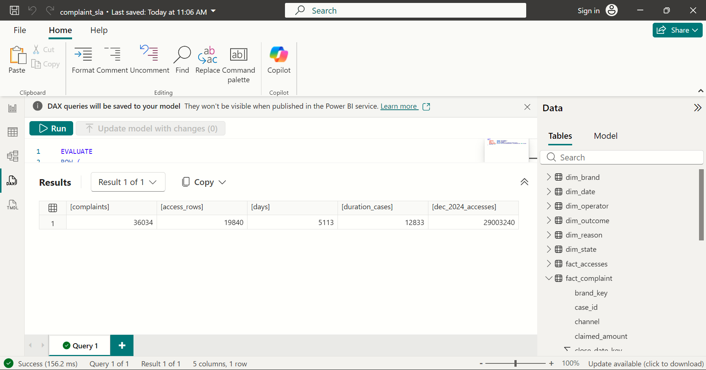 |
| B1 lot 1 | Duration by operator and filing year | Median and P90 equal check 8.8 | 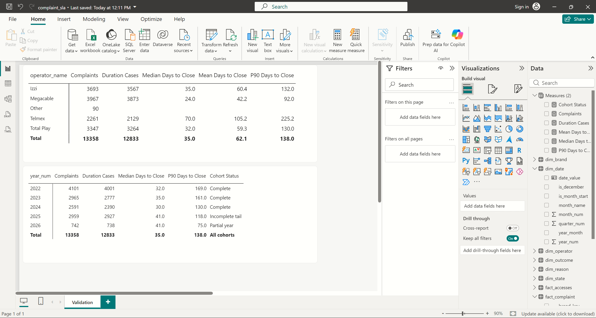 |
| B1 lot 2 | Outcomes, conciliation rate and `% Within SLA` | Equal checks 8.6, 8.7 and 8.9 | 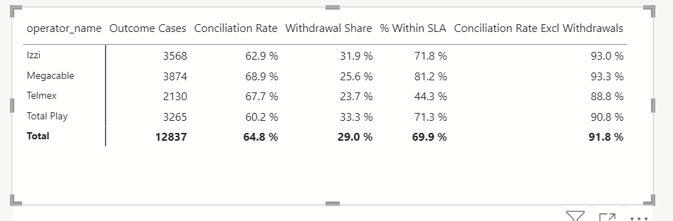 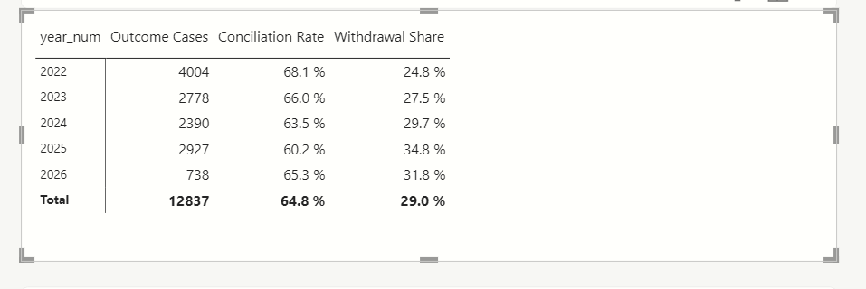 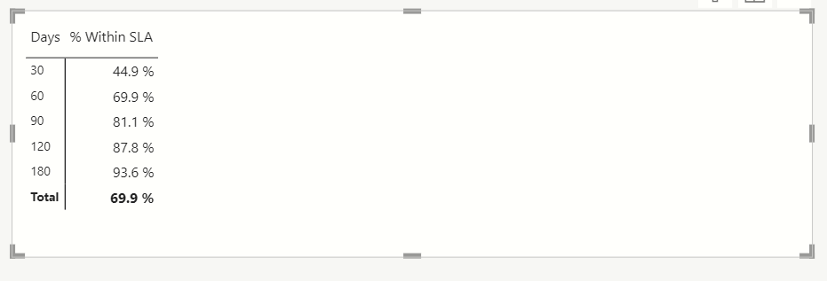 |
| B1 lot 3 | Accesses, rate per 100,000 and data-quality cards | Accesses of December 2024 29,003,240 (27,458,704 + 1,544,536); combined rate 16.60, 11.51 and 9.33 per 100,000 (2022 to 2024); `Central Office Share` 49.6% (fixed broadband) and 54.9% (all complaints), as SQL checks P1 and P2 | 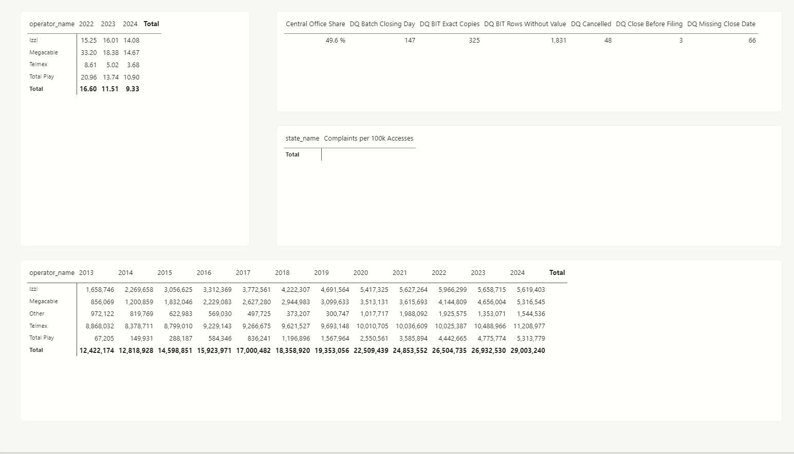 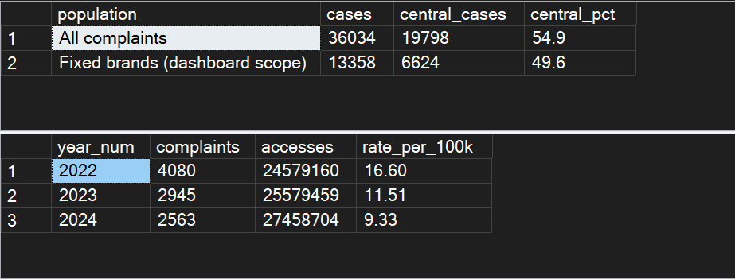 |
| B3 page 5 | Top 10 claim types and states | Same values as SQL checks P3 and P4: Ciudad de México 7,748, Estado de México 610, Yucatán 379; Cobro Indebido 4,343, Entrega del Producto o Servicio 4,335, Contratos 3,682 | 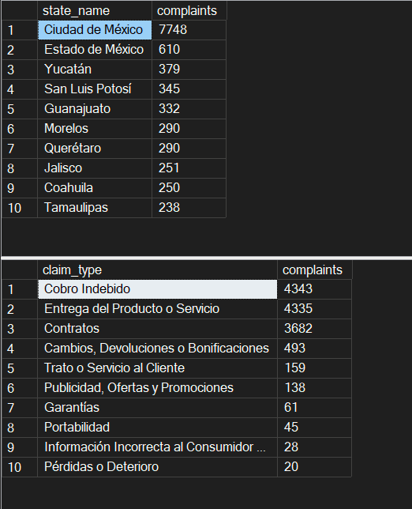 |

Report pages (screenshots in `docs/img/`, PDF in `powerbi/complaint_sla_report.pdf`, the two `Validation` pages are hidden and not exported):

| Page | Screenshot |
|---|---|
| 1 Overview | 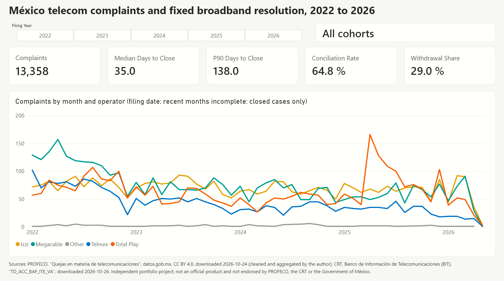 |
| 2 Resolution time | 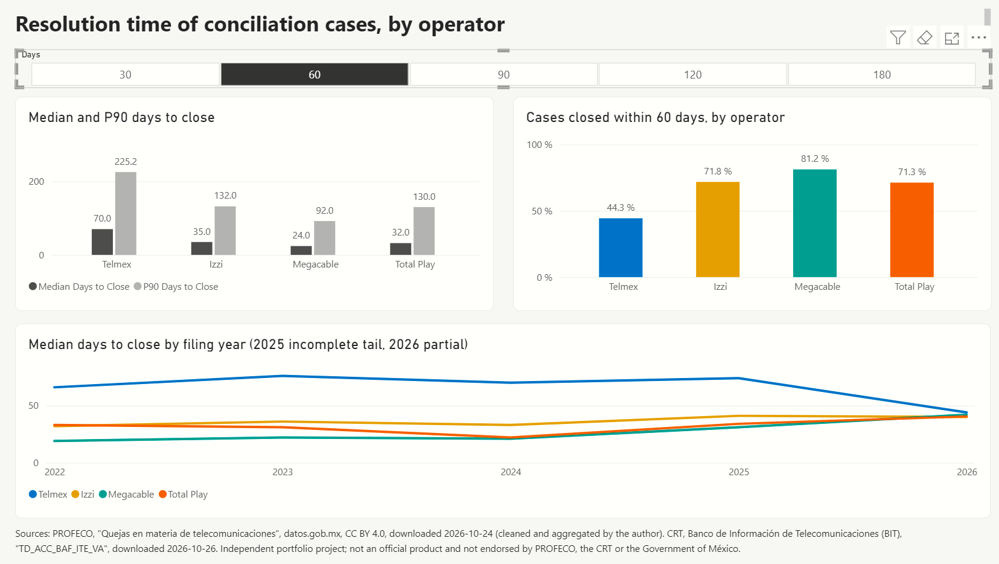 |
| 3 Outcomes | 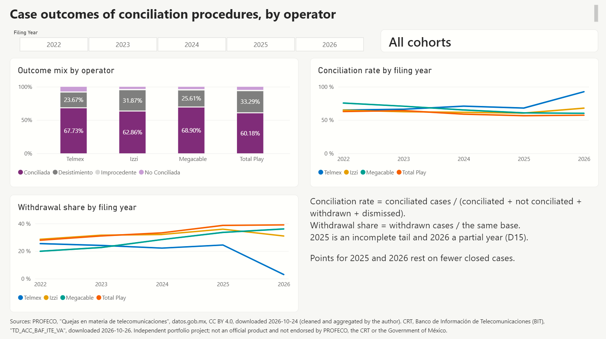 |
| 4 Complaints and accesses | 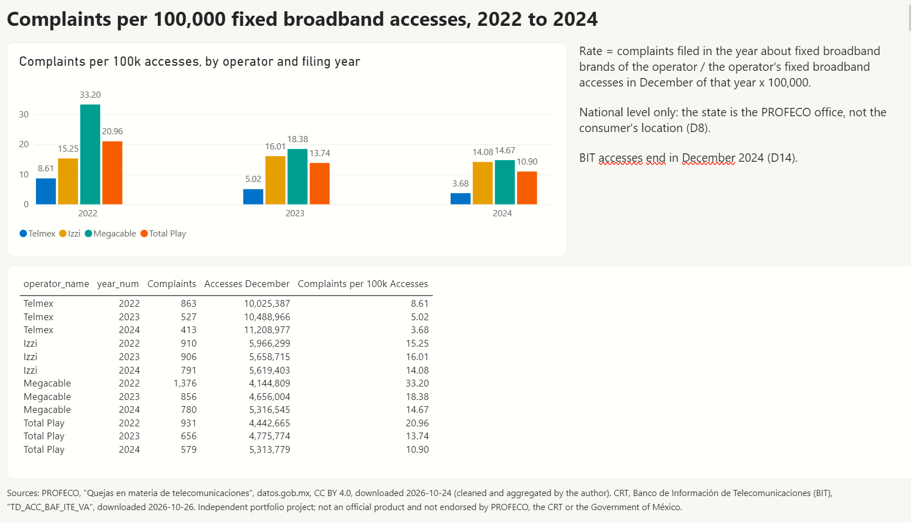 |
| 5 Reasons and offices | 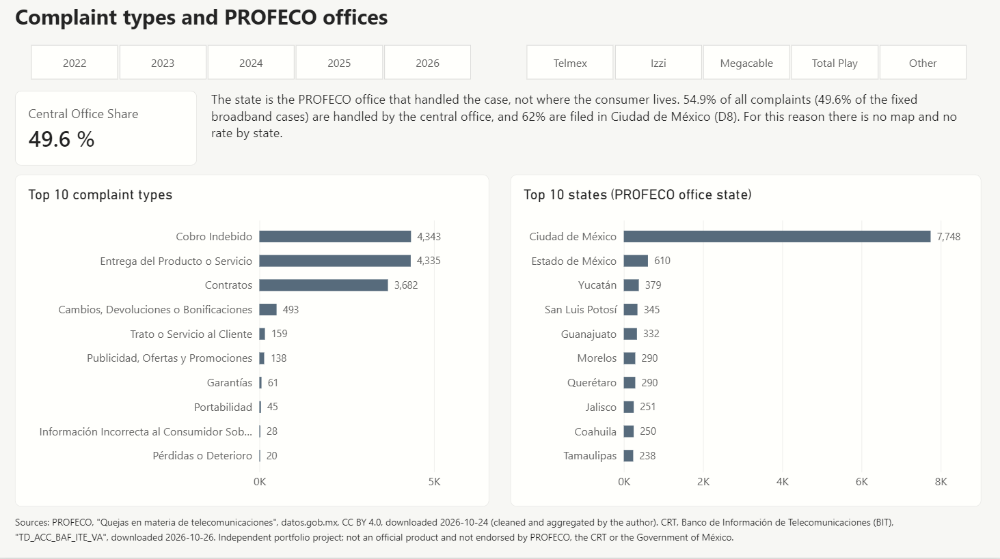 |
| 6 Data quality and limits | 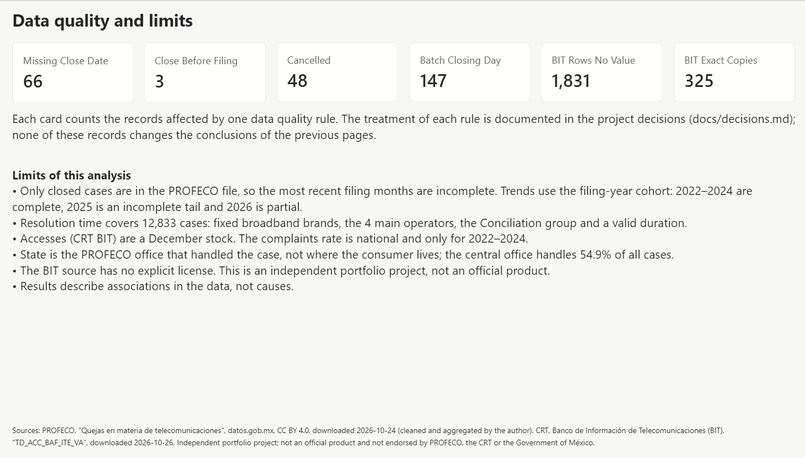 |

Incidents and fixes while building the model:

- **Connection:** "Invalid credentials" was a typo in the database name (`compliant_sla`); the encryption error was solved by clearing "Use encrypted connection" (local instance without a certificate).
- **Relationships:** Power BI created them by itself and left the filing and close dates with the active status inverted. Fixed by deactivating the close date first and then activating the filing date. Autodetect was turned off afterwards.
- **`Is Duration Case` showed an error:** the tables kept the prefix `mart ` in their names; they were renamed.
- **Numeric columns summed:** `year_num` aggregated as a sum broke the measures with `HASONEVALUE`; the numeric columns are set to "Don't summarize".
- **100% bar with an extra segment (Cancelada):** the `IN` filter of `Valid Outcome Cases` overrode the legend; fixed with `KEEPFILTERS`.
- **Blank calendar years in `Cohort Status`:** fixed with a blank guard on `[Complaints]`.
- **Page 5:** Ciudad de México was missing from the state chart because of an unexpected filter; it is kept in the chart on purpose, as the D8 warning explains.
- **`.pbix` pushed by mistake:** removed from the history (soft reset, `--force-with-lease` and `gc`); `*.pbix` and `.pbi/` are in `.gitignore`.

What the report shows (fixed broadband brands, 13,358 complaints):

- **Three claim types hold 92.5% of the complaints** (Cobro Indebido, Entrega del Producto o Servicio and Contratos: 12,360); the top 10 types hold 99.6%.
- **Ciudad de México concentrates 58.0% of the complaints by state** (7,748), far above Estado de México (610). The central office alone handles 49.6% of the cases, so the state chart reads as the PROFECO office and not as the place of the consumer (D8).
- **The complaints rate per 100,000 accesses falls from 16.60 (2022) to 9.33 (2024)** at national level; there are no accesses after December 2024 and no rate by state or by month.
- **Data quality is marginal** (66 without close date, 3 closing before filing, 48 cancelled, 147 on a batch closing day, 1,831 BIT rows without value, 325 exact copies) and does not change the findings; each rule is documented in D4, D7, D13 and D14.