# Source record: PROFECO telecommunications complaints (México)

Exploration log of the source. The first part was written **before** running the profiling scripts, so that the starting point and the expectations are on record. Evidence images are stored in `docs/img/` and their names start with `mx_profeco_`. The results of `step_2.sql` are added after the gate (see the end of this file).

## Publisher and access

| Item | Value |
|---|---|
| Publisher | PROFECO (Procuraduría Federal del Consumidor), published on datos.gob.mx |
| Dataset page | https://www.datos.gob.mx/dataset/quejas_materia_telecomunicaciones |
| Data dictionary | https://datos.profeco.gob.mx/diccionarioDatos.php |
| Last update shown by the portal | 2026-09-22 (evidence E1) |
| Resources on the dataset page | 5 (matches the five files below) |
| License | **To be verified** before publishing any file derived from these data |
| Download date | 2026-10-24 (file modification date shown by Windows Explorer, evidence E2) |

## Downloaded files

Five cuts were published. They are **not** simple, growing versions of one another (see observations).

| File | Size (KB) | Rows | Notes |
|---|---|---|---|
| `quejas_telecomunicaciones_2022_2025.csv` | 12,877 | ≈32,961 | Row count read from Excel (header assumed in row 1) |
| `quejas_telecomunicaciones_2022_ene_2026.csv` | 14,239 | ≈32,652 | Same method. Largest file by size |
| `quejas_telecomunicaciones_2022_may_2026.csv` | 1,561 | ≈4,081 | Same method. Looks like a partial slice |
| `quejas_telecomunicaciones_2022_junio_2026.csv` | 14,010 | 36,034 | Counted in Power Query. **Provisional base file** (decision D4) |
| `quejas_telecom_2022_jul2026.csv` | 12,537 | ≈31,926 | Same method as the first rows. The file name pattern differs |

SHA-256 of the base file (optional, proves the file was not modified): TBD.

## Evidence

### E1. Dataset page on datos.gob.mx

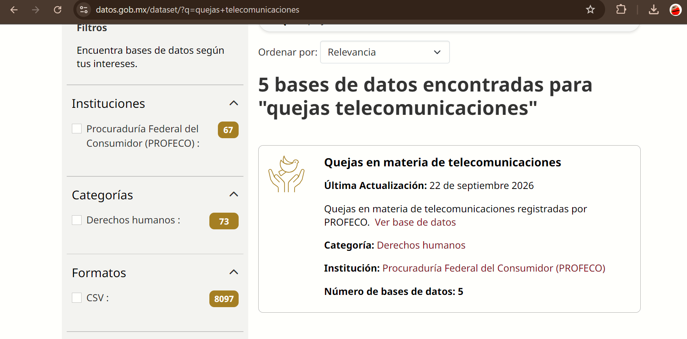

The portal lists "Quejas en materia de telecomunicaciones" (publisher PROFECO) with **5 databases** and a last update on **22 September 2026**.

### E2. Files downloaded to the project folder

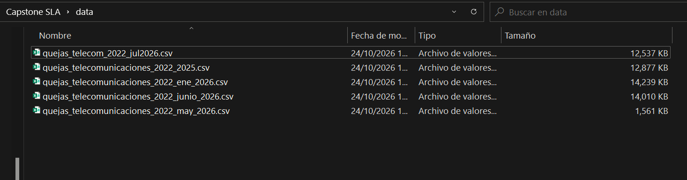

Five CSV files, all modified on 24/10/2026. At this point they are still in `data\`, not yet in `data/raw/`.

### E3. Profile of `fecha_ingreso` (junio_2026, Power Query)

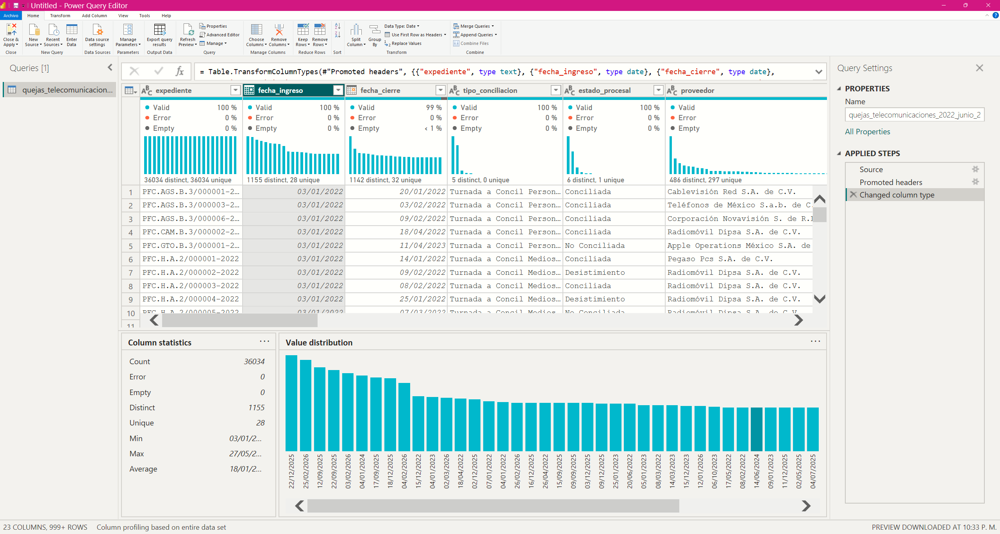

36,034 rows, 0 errors, 0 empty values, 1,155 distinct dates. Minimum 03/01/2022 and maximum 27/05/2026 (the year is cut off in the capture and is to be confirmed in `step_2.sql`, block 2.5).

### E4. Profile of `fecha_cierre` (junio_2026, Power Query)

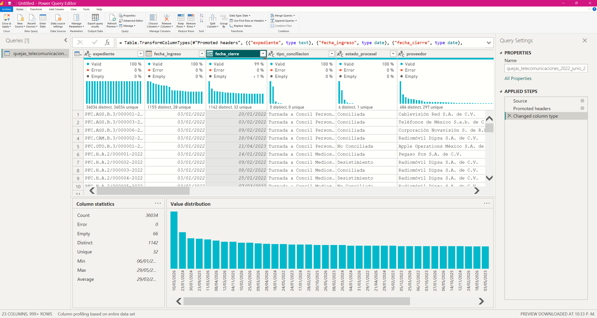

36,034 rows, 0 errors, **66 empty** (0.18%), 1,142 distinct dates. Minimum 06/01/2022 and maximum 29/05/2026. The most frequent close date is 10/03/2026, well above the typical day (possible batch closing, see block 2.12).

### E5. Dirty values in the amount columns

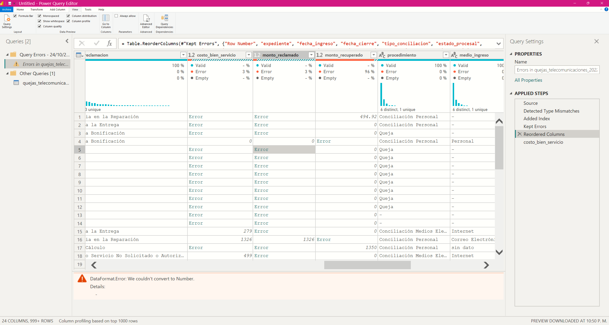

Power Query "Kept Errors" view. `costo_bien_servicio`, `monto_reclamado` and `monto_recuperado` fail with "We couldn't convert to Number"; the offending value is a dash (`-`). `medio_ingreso` also contains the placeholder `sin dato`. The profile in this view uses only the top 1,000 rows, so its percentages are not reliable.

## Choosing the base cut: evidence and criteria

The five cuts were published by hand, with no documented methodology: the names follow different patterns (`quejas_telecom_2022_jul2026`, `..._ene_2026`, `..._junio_2026`), the row counts do not grow with time and the content of the close date is not consistent. Since the publisher gives no rule to choose a cut, the project defines its own criteria (decision D4 in `docs/decisions.md`):

1. **Integrity:** unique `expediente` and no type errors in the dates.
2. **Coverage:** widest date range and highest volume.
3. **Plausibility:** close dates vary and are not a single cut-off date.
4. **Consistency with the other cuts:** overlapping cases agree (overlap audit, pending).
5. **Traceability:** name, size, date and hash of the file are recorded.

Evidence: the end of each file as seen in Excel (the last rows show the latest records of each cut).

| Cut | Rows | What the end of the file shows | Verdict |
|---|---|---|---|
| `..._2022_2025.csv` | ≈32,961 | Rows sorted by filing date. The last filing is 25/11/2025 and the last close date seen is 28/11/2025, so coverage ends in November 2025 | Audit only |
| `..._2022_ene_2026.csv` | ≈32,652 | A last block sorted by office, with filings from 2025 and close dates in January 2026. The file is larger in bytes per row than the others | Audit only |
| `..._2022_may_2026.csv` | ≈4,081 | Filings from 12/05/2026 to 27/05/2026 and close dates up to 29/05/2026. Only the end was inspected; it looks like a partial slice | Audit only |
| `..._2022_junio_2026.csv` | 36,034 | Same last records as `may_2026`. Power Query: unique `expediente`, no date errors, 0.18% of close dates empty, close dates up to 29/05/2026 | **Base (provisional)** |
| `quejas_telecom_2022_jul2026.csv` | ≈31,926 | Every visible close date is 31/07/2026, even for cases filed in 2025 (it may be a cut-off date, not a real close date) | Audit only, until it is understood |

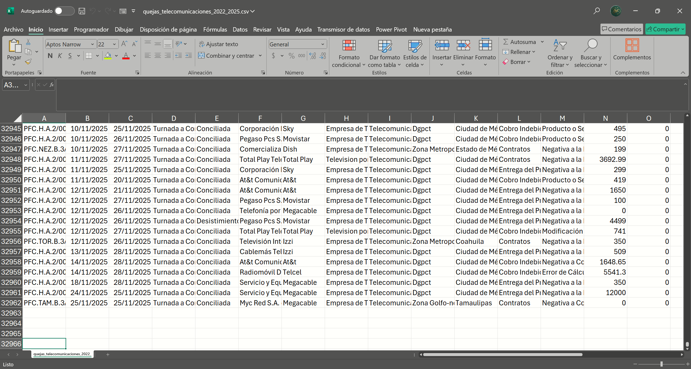
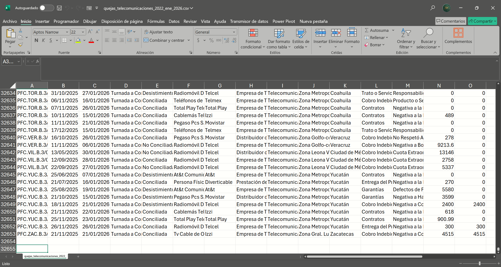
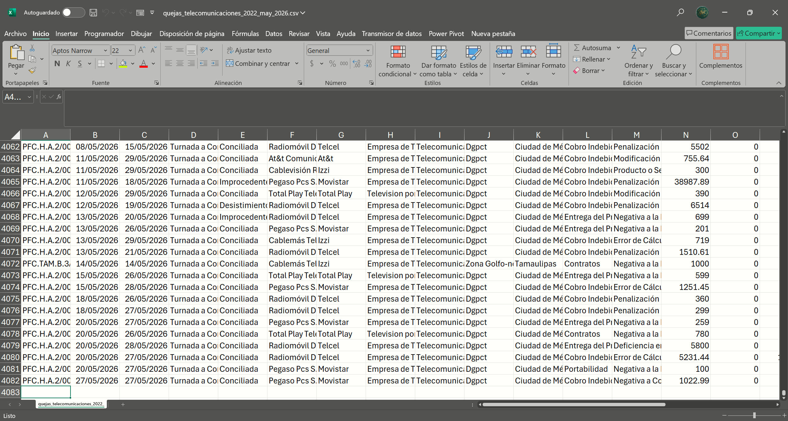
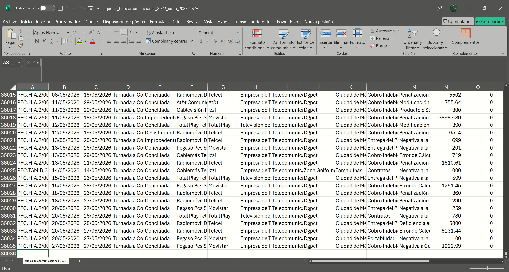
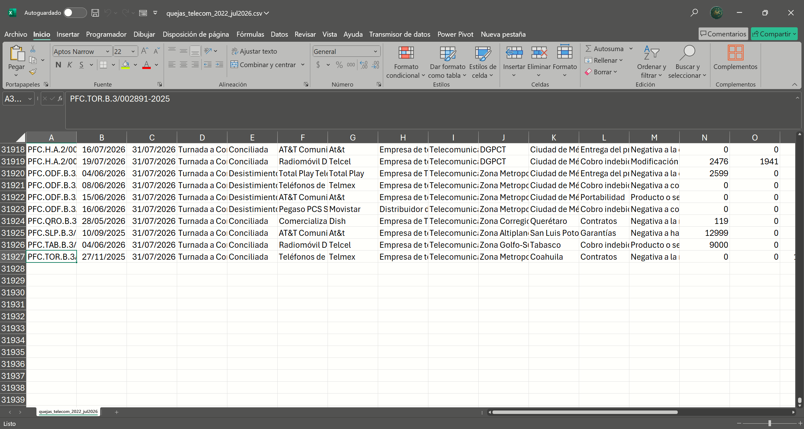

Only the end of each file was inspected, and the checks for criteria 1 and 4 were done only for `junio_2026`. The verdicts are therefore provisional and will be reviewed with the overlap audit.

## Observations (hypotheses to verify)

1. Row counts do not follow the order of the cuts: `ene_2026` and `jul2026` have fewer rows than `2022_2025`.
2. `junio_2026` ends with the same latest records as `may_2026` (last close date 2026-05-29), so its name does not mean it contains June closings.
3. In `jul2026`, every visible row at the end of the file has the close date 2026-07-31, even cases filed in 2025. It may be a cut-off date and not a real close date.
4. The portal reports a last update on 2026-09-22 (E1). The newest cut may be `jul2026`, which has fewer rows and a different name pattern. The relation between cuts is not understood yet.
5. `ene_2026` is the largest file by size (14,239 KB) but not by rows: about 447 bytes per row against about 400 in the other files. Its content differs (extra spaces, longer text or other quoting). To be inspected.
6. Text values differ in capitalization between cuts (for example "Cobro indebido" vs "Cobro Indebido", "DGPCT" vs "Dgpct").
7. There is **no complete column for the type of service** (internet, mobile, TV). `giro` is a provider classification and `problema_especial` has a service name in only 27% of the rows. Decision D7: analysis at provider level. See the section *Type of service* below.
8. Rows with `estado_procesal` = Cancelada: 48 rows, all filed in 2022 to 2024. 44 of them have no close date. The provider "-" appears in only 10 rows of the whole file and the brand "Otros" in 126, so these placeholders are not limited to cancelled cases (block 2.14).
9. Placeholders are used instead of empty values: `-` in amounts, provider and other columns, and `sin dato` in `medio_ingreso`. All of them become `NULL` in the clean layer.
10. In `junio_2026`, the last filing date is 2026-05-27 and the last close date is 2026-05-29 (E3, E4).
11. Dates are text with the year first and dashes (`yyyy-mm-dd`). Confirmed in `step_2.sql` (blocks 2.3 and 2.4: 0 values with a different format).

## Columns (23, in file order)

`expediente`, `fecha_ingreso`, `fecha_cierre`, `tipo_conciliacion`, `estado_procesal`, `proveedor`, `nombre_comercial`, `giro`, `sector`, `odeco`, `estado`, `tipo_reclamacion`, `motivo_reclamacion`, `costo_bien_servicio`, `monto_reclamado`, `monto_recuperado`, `procedimiento`, `medio_ingreso`, `clase`, `tipo_producto`, `modalidad_compra`, `modalidad_pago`, `problema_especial`.

## Handling rules

- Raw files are never edited. They are stored in `data/raw/`, which is not versioned.
- The data are loaded as text into `stg.profeco_raw` (`sql/mx_profeco/step_1.sql`) and cleaned only in SQL.
- The publisher may update the data retroactively. The download date and file identity are recorded here.

## Pending evidence

- [ ] Dataset page ("Ver base de datos") with the list of the five resources, their update dates and the license field.
- [ ] Page of the data dictionary.
- [ ] Left-hand columns of the Power Query errors view (cancelled cases with provider "-").
- [x] Results of `step_2.sql` in SSMS (blocks 2.1 to 2.14), received on 2026-10-26.
- [x] Results of the repeated-ID queries (block 2.2), block 2.15 and block 2.16.
- [ ] Results of block 2.8 for `sector`, `procedimiento`, `medio_ingreso` and `tipo_conciliacion`.
- [ ] Files moved to `data/raw/`.
- [ ] Save the five Excel captures of the file ends as `mx_profeco_tail_2022_2025.png`, `mx_profeco_tail_ene_2026.png`, `mx_profeco_tail_may_2026.png`, `mx_profeco_tail_junio_2026.png` and `mx_profeco_tail_jul2026.png` in `docs/img/`.
- [ ] BIT portal: download page and the list of subscriber tables.

## Type of service (`step_2.sql`, block 2.8)

Visual inspection suggested that no column tells which service a complaint is about. Block 2.8 tested it with the checks below (run on 2026-10-26).

| Check | Question | Result | Evidence |
|---|---|---|---|
| A | Brands with more than one `giro` | 58 brands. Telcel 5, Megacable 7, Izzi 5, Telmex 6 | 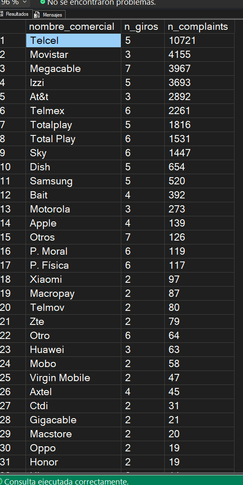 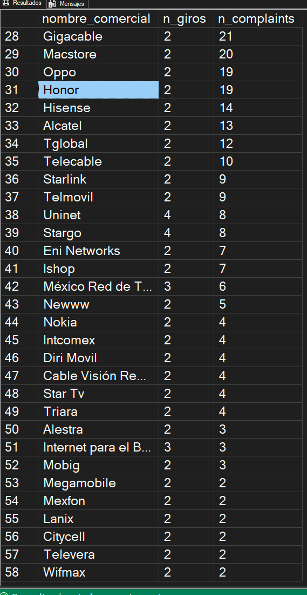 |
| B | Do reason columns mention a service? | `motivo_reclamacion` 0, `tipo_reclamacion` 0, `problema_especial` 5,443 | 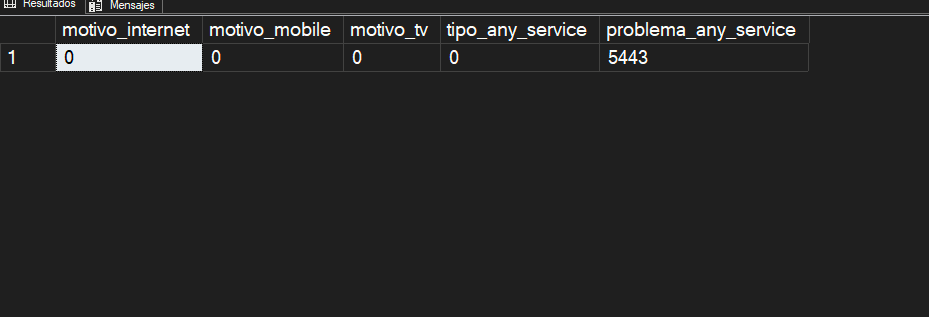 |
| C | Values of `giro` | Mobile telephony 18,466; pay TV 10,211; local telephony 2,354; cable TV 2,051; internet giros 944 | 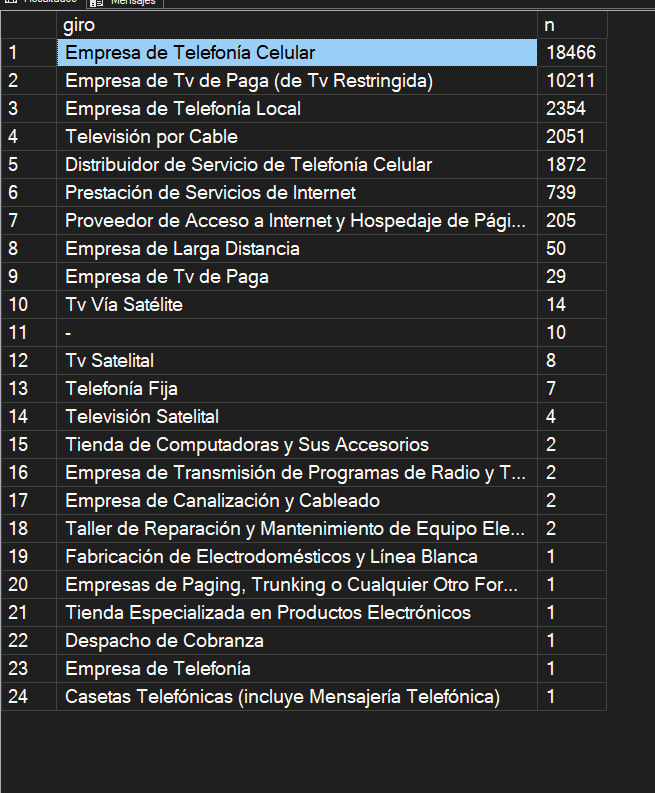 |
| D | `giro` of the main brands | Izzi: 3,530 of 3,693 as pay TV and 80 as internet | 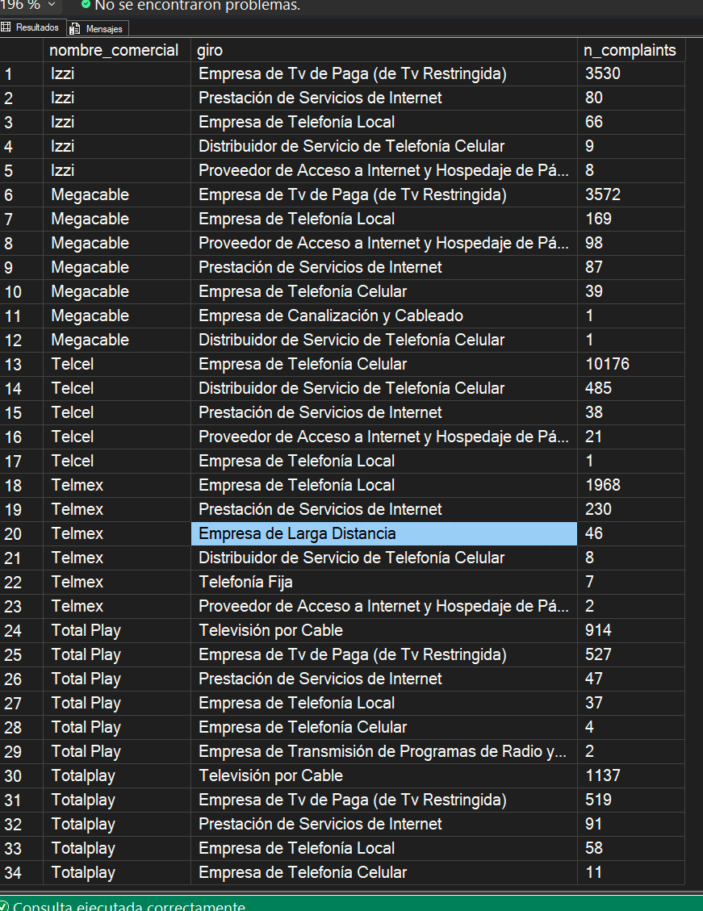 |
| E | `giro` inside one legal name | It changes (Radiomóvil Dipsa 5 values, Total Play 6) | 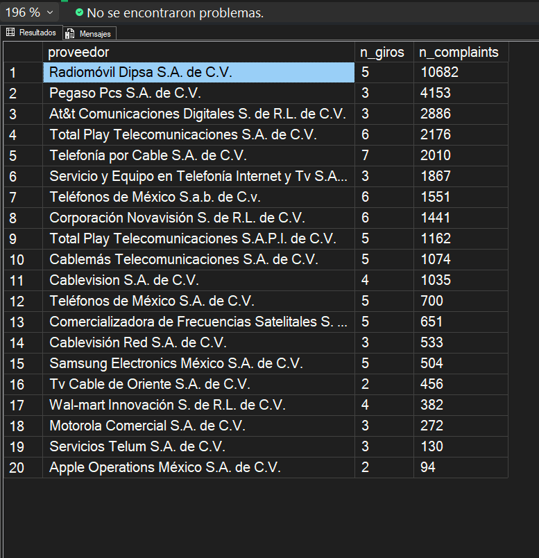 |
| F | Values of `problema_especial` | 26,116 "No Problema Especial" (72.5%); 9,806 with a service name (27.2%) | 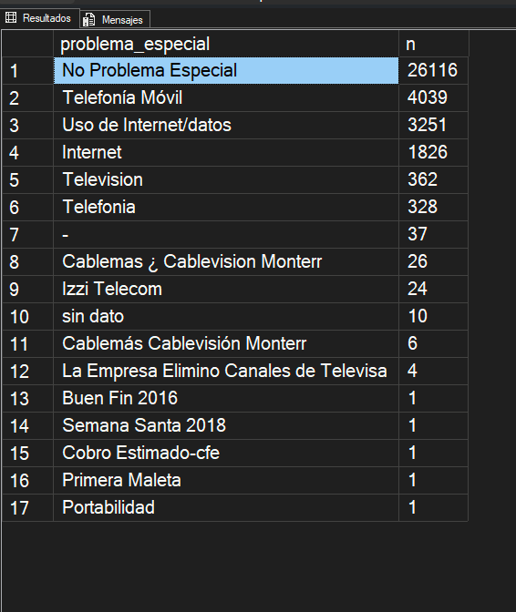 |
| G | `giro` of Total Play by year | Both labels, "Televisión por Cable" and "Empresa de Tv de Paga", appear every year | 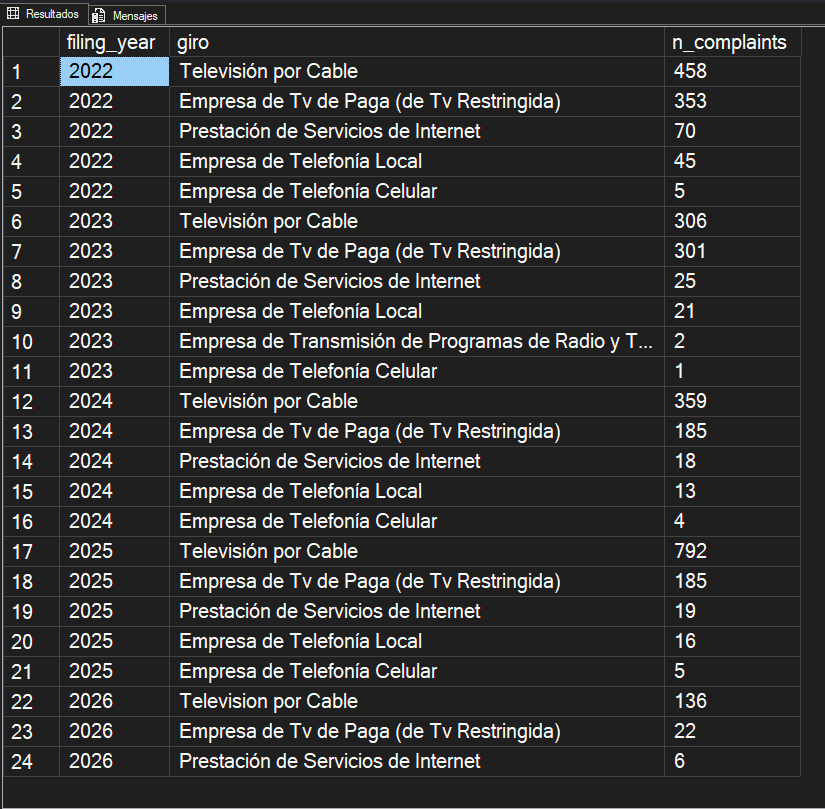 |
| H | Brand vs `problema_especial` | Coherent with the business of each brand (see below) | 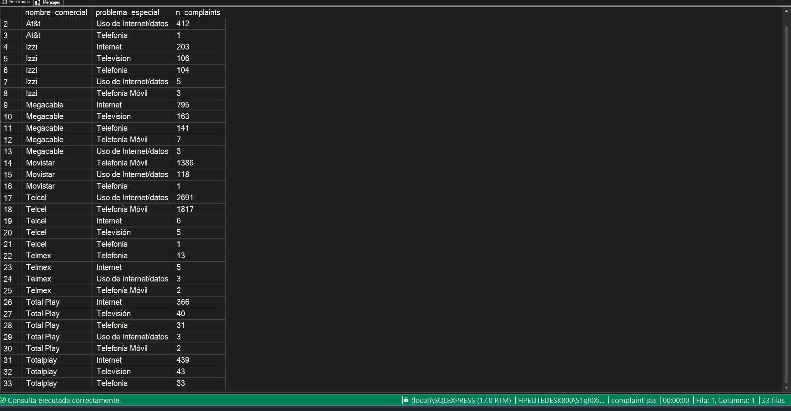 |
| I | Coverage of `problema_especial` by year | 2022 20%, 2023 21%, 2024 28%, 2025 38%, 2026 43% | 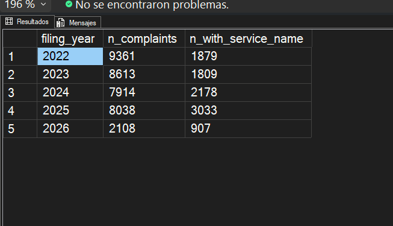 |

Reading of check H (values with a service name, as a share of each brand's complaints):

| Brand | Complaints | With service name | Main values |
|---|---|---|---|
| Telcel | 10,721 | about 42% | Uso de Internet/datos 2,691; Telefonía Móvil 1,817 |
| Movistar | 4,155 | about 36% | Telefonía Móvil 1,386; Uso de Internet/datos 118 |
| Megacable | 3,967 | about 28% | Internet 795; Television 163; Telefonia 141 |
| Total Play + Totalplay | 3,347 | about 29% | Internet 805; Television 83; Telefonia 64 |
| Izzi | 3,693 | about 11% | Internet 203; Television 106; Telefonia 104 |
| Telmex | 2,261 | about 1% | Telefonia 13; Internet 5 |

Conclusions (decision D7):

- `giro` is not the service of the complaint.
- `problema_especial` is coherent with the brand but incomplete and unstable over time, so it is used only as a labeled partial hint.
- Other values of `problema_especial` are free text (for example `Cablemas ¿ Cablevision Monterr`, 26 rows), and `-` or `sin dato` (47 rows). The character `¿` may come from the source file; to be checked in the original CSV.
- `clase` and `tipo_producto` do not give the telecom service either. `clase` is Servicio (31,340) or Bien (4,226), and `tipo_producto` is Servicio Normal (30,314), Producto Nuevo (4,718), Servicio Adicional o Conexo (690), Producto Usado (245) and Producto Reconstruido (23). They separate services from goods (for example phones). Evidence: 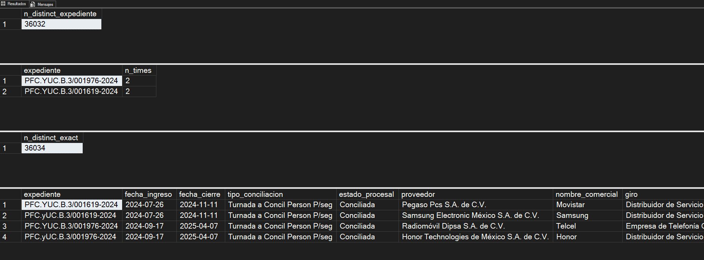
- **Anomaly:** `clase` also holds Internet (187), Personal (181), Escrito (61) and Correo Electrónico (1). These are values of `medio_ingreso`, not of `clase`: in those rows the two columns are swapped (see the section below). The counts above are shown as loaded; after the correction, Servicio is 31,692 and Bien is 4,304.

## Results of the feasibility gate

Run on 2026-10-26 on `stg.profeco_raw` (36,034 rows).

| # | Criterion | Result | Status |
|---|---|---|---|
| 1 | At least 2,000 complaints against fixed-network operators | 13,268 (Telmex 2,261; Izzi 3,693; Megacable 3,967; Total Play and Totalplay 3,347) | Passed |
| 2 | Missing `fecha_cierre` below 30% | 66 rows, 0.18% | Passed |
| 3 | At least 100 complaints per year for each of the four operators | See the table below | Passed for 2022 to 2025. In 2026 (to May 27) Telmex has 68 |
| 4 | Subscribers by operator and state in BIT | Not checked yet | Pending |

Complaints by filing year (the two spellings of Total Play are added):

| Operator | 2022 | 2023 | 2024 | 2025 | 2026 (to May 27) |
|---|---|---|---|---|---|
| Izzi | 910 | 906 | 791 | 821 | 265 |
| Megacable | 1,376 | 856 | 780 | 714 | 241 |
| Telmex | 863 | 527 | 413 | 390 | 68 |
| Total Play | 931 | 656 | 579 | 1,017 | 164 |

Evidence: 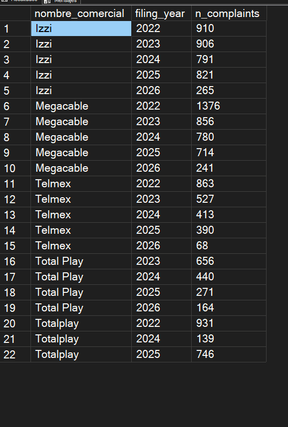 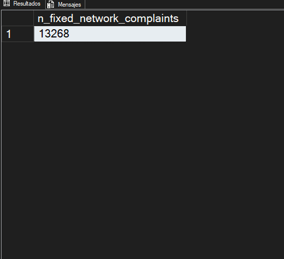 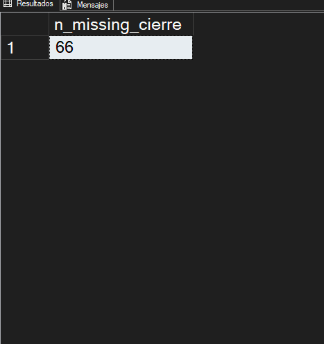

Notes on the gate:

- **2026 is partial.** The data end on 2026-05-27 (about five months), and only closed cases are in the file, so the most recent complaints are missing (right-censoring). The 68 of Telmex is about 14 per month; the threshold of 100 would be reached in about seven months. The criterion text already says that 2026 is partial; the margin is recorded here.
- **Telmex falls** from 863 (2022) to 390 (2025). The file does not explain why.
- **Total Play is written two ways**, and each spelling is used in different years: "Totalplay" has no rows in 2023 and 2026, and "Total Play" has none in 2022. Counted separately, the operator would seem to fail the criterion in some years. The provider mapping table must merge them.

### Other findings of `step_2.sql`

| Block | Finding | Handling in the clean layer |
|---|---|---|
| 2.1, 2.2 | 36,034 rows, but 36,032 distinct `expediente`. The 2 "repeated" IDs differ only in case and belong to different providers (see below) | No deduplication. Surrogate key; `expediente` normalized to upper case |
| 2.3 to 2.5 | All dates are `yyyy-mm-dd`. Filing 2022-01-03 to 2026-05-27; closing 2022-01-06 to 2026-05-29 | `TRY_CONVERT` to `date` |
| 2.6 | 66 rows without close date: 44 Cancelada, 15 No Conciliada, 5 Desistimiento and 2 Conciliada | Flag, no days to close. The 2 Conciliada rows are inconsistent |
| 2.7 | 3 rows with close date before filing date | Flag, excluded from duration KPIs |
| 2.9 | 477 distinct legal names and 196 brands. Power Query showed 486 legal names because it compares text with case and accents, while the database collation does not | Provider mapping table by brand |
| 2.9 | Brand variants: Totalplay and Total Play; Virgin (24) and Virgin Mobile (47); Telmov and Telmovil. Generic values: Otros (126), Otro (64), P. Moral (119), P. Física (117) | Mapping table; generic values become "not identified" |
| 2.12 | The close date 2026-03-10 has 147 cases; the next highest is 94 (2024-01-23) | Flag days with unusual volume of closings (possible batch closings) |
| 2.13 | `monto_reclamado`: `-` (32), `sin dato` (4) and `Oo` (1, probably a typing error). `monto_recuperado`: `-` in 1,479 rows. `costo_bien_servicio`: `-` (33) and `sin dato` (1) | Placeholders become `NULL`. The `-` of `monto_recuperado` is spread over all outcomes at a low rate, so it means "unknown" and not "nothing recovered" |
| 2.14 | 48 cancelled cases (21 in 2022, 17 in 2023, 10 in 2024). Provider `-` in 10 rows. Brand Otros in 126 rows | Flag cancelled cases and exclude them from KPIs |

Evidence images for blocks 2.3 to 2.5, 2.7, 2.9, 2.12, 2.13 and 2.14 are saved as `step_2_<block>.png` in `docs/img/` (block 2.9 is `step_2_9.png`).

### Repeated IDs, swapped columns and missing close dates (blocks 2.2, 2.15 and 2.16)

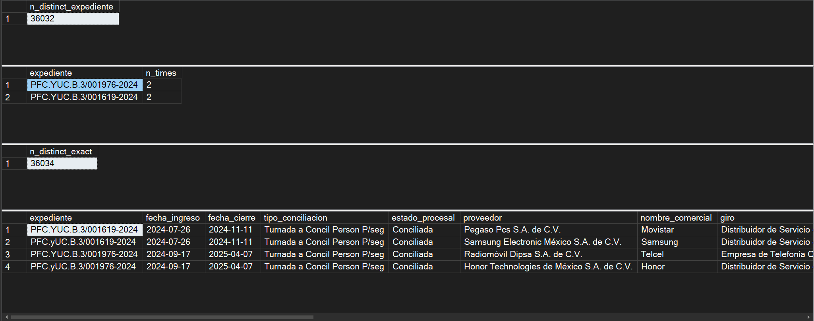

**Repeated `expediente` (2.2).** The 2 repeated IDs are not duplicate rows:

- `PFC.YUC.B.3/001619-2024` appears for Movistar (Pegaso Pcs) and for Samsung, with the same dates and outcome. `PFC.YUC.B.3/001976-2024` appears for Telcel (Radiomóvil Dipsa) and for Honor, also with the same dates.
- In each pair, one row is written with a lowercase `y` (`PFC.yUC...`). The database collation ignores case, so both spellings compare as equal and `COUNT(DISTINCT)` gives 36,032. Compared by exact text, there are 36,034 different IDs.
- It is probably one case filed against two providers (the carrier and the phone maker), with one row per provider. This is not confirmed.
- **Handling:** no deduplication. The fact table gets its own surrogate key, `expediente` is converted to upper case, and a flag marks the IDs shared by more than one provider. The grain is one row per case and provider.

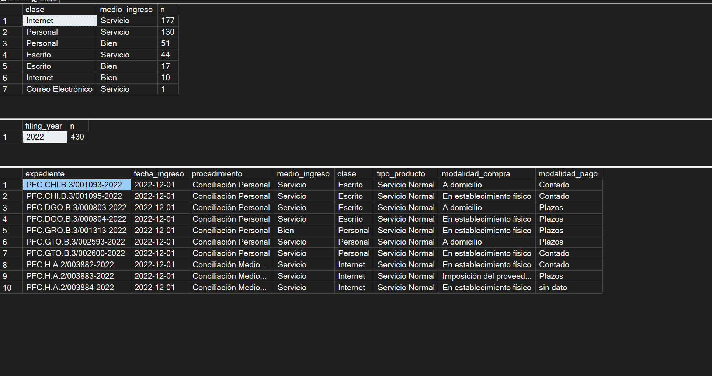

**Swapped columns (2.15).** The 430 rows with a channel in `clase` have Servicio or Bien in `medio_ingreso`, so the two columns are swapped:

| `clase` as loaded | `medio_ingreso` as loaded | Rows |
|---|---|---|
| Internet | Servicio | 177 |
| Personal | Servicio | 130 |
| Personal | Bien | 51 |
| Escrito | Servicio | 44 |
| Escrito | Bien | 17 |
| Internet | Bien | 10 |
| Correo Electrónico | Servicio | 1 |

- All 430 rows were filed in 2022 (the sample rows are from 2022-12-01). The neighbor columns are coherent: `procedimiento` agrees with the channel, and `modalidad_compra` and `modalidad_pago` have valid values.
- **Handling:** in the clean layer, when `clase` is Internet, Personal, Escrito or Correo Electrónico, the two values are swapped and the row is flagged. After the correction, no row may have a channel in `clase`.

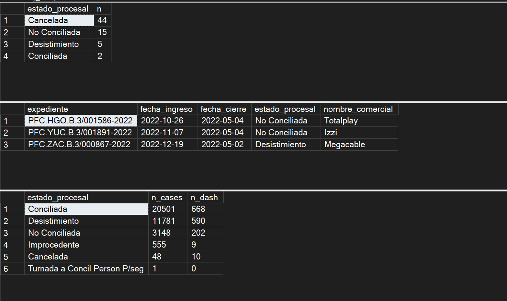

**Missing close date (2.16).** The 66 rows are 44 Cancelada, 15 No Conciliada, 5 Desistimiento and 2 Conciliada. A conciliated case should have a close date, so those 2 rows are inconsistent.

**Close date before filing date (2.16).** All 3 rows are from 2022:

| `expediente` | Filing | Close | Outcome | Brand |
|---|---|---|---|---|
| PFC.HGO.B.3/001586-2022 | 2022-10-26 | 2022-05-04 | No Conciliada | Totalplay |
| PFC.YUC.B.3/001891-2022 | 2022-11-07 | 2022-05-04 | No Conciliada | Izzi |
| PFC.ZAC.B.3/000867-2022 | 2022-12-19 | 2022-05-02 | Desistimiento | Megacable |

It is not possible to tell which of the two dates is wrong. The rows are flagged and excluded from duration KPIs.

**`monto_recuperado` equal to `-` (2.16).** The dash is spread over every outcome at a low rate: Conciliada 668 of 20,501 (3.3%), Desistimiento 590 of 11,781 (5.0%), No Conciliada 202 of 3,148 (6.4%), Improcedente 9 of 555 and Cancelada 10 of 48. If it meant "nothing recovered", it would concentrate in the cases without conciliation. It is a missing value and becomes `NULL`.

**Values of `estado_procesal` (2.16).** Conciliada 20,501 (56.9%), Desistimiento 11,781 (32.7%), No Conciliada 3,148 (8.7%), Improcedente 555 (1.5%), Cancelada 48 and one row with the value `Turnada a Concil Person P/seg`. That text is a value of `tipo_conciliacion`, so it is one more value in the wrong column. The row is flagged.