# Source record: PROFECO telecommunications complaints (México)

Exploration log of the source. The first part was written **before** running the profiling scripts, so that the starting point and the expectations are on record. Evidence images are stored in `docs/img/`: the names of the inspection images start with `mx_profeco_`, and the SSMS evidence is named `step_<N>_<block>.png`. The results of `step_2.sql` are added after the gate (see the end of this file).

## Publisher and access

| Item | Value |
|---|---|
| Publisher | PROFECO (Procuraduría Federal del Consumidor), published on datos.gob.mx |
| Dataset page | https://www.datos.gob.mx/dataset/quejas_materia_telecomunicaciones |
| Data dictionary | https://datos.profeco.gob.mx/diccionarioDatos.php (returns "File not found" on 2026-10-31; the dictionary must be found again) |
| Last update shown by the portal | 2026-09-22 (evidence E1) |
| Resources on the dataset page | 5 (matches the five files below) |
| License | Creative Commons Attribution 4.0, from the resource page (see `licenses.md`) |
| Download date | 2026-10-24 (file modification date shown by Windows Explorer, evidence E2) |

## Downloaded files

Five cuts were published. They are **not** simple, growing versions of one another (see observations).

| File | Size (KB) | Rows | Notes |
|---|---|---|---|
| `quejas_telecomunicaciones_2022_2025.csv` | 12,877 | ≈32,961 | Row count read from Excel (header assumed in row 1) |
| `quejas_telecomunicaciones_2022_ene_2026.csv` | 14,239 | ≈32,652 | Same method. Largest file by size |
| `quejas_telecomunicaciones_2022_may_2026.csv` | 1,561 | ≈4,081 | Same method. Looks like a partial slice |
| `quejas_telecomunicaciones_2022_junio_2026.csv` | 14,010 | 36,034 | Counted in Power Query. **Base file** (decision D4, accepted) |
| `quejas_telecom_2022_jul2026.csv` | 12,537 | ≈31,926 | Same method as the first rows. The file name pattern differs |

SHA-256 of the two files loaded into SQL Server (calculated on 2026-11-05 with PowerShell `Get-FileHash -Algorithm SHA256`; evidence `docs/img/sha256_raw_files.png`). They prove that the files used are the ones downloaded and not modified:

| File | SHA-256 |
|---|---|
| `quejas_telecomunicaciones_2022_junio_2026.csv` (PROFECO, base file) | `C1F13B4A13ED4E8B766BF78A0FFD7B00142DDEEC59611AE59E760D6BAF89FD3F` |
| `TD_ACC_BAF_ITE_VA.csv` (BIT) | `428886B24842DF63AA2BEFF304609999D50650B768F2B7B8D7EEE85EF460838A` |

## Evidence

### E1. Dataset page on datos.gob.mx

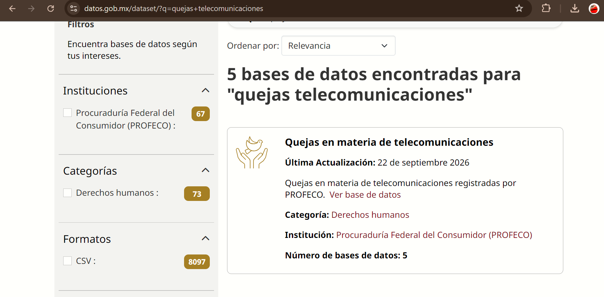

The portal lists "Quejas en materia de telecomunicaciones" (publisher PROFECO) with **5 databases** and a last update on **22 September 2026**.

Dataset page captured on 2026-11-05 (two captures, because the five resources do not fit in one):

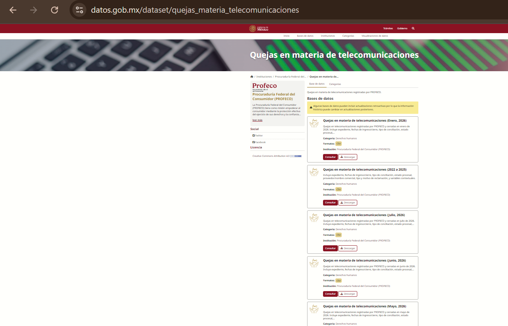
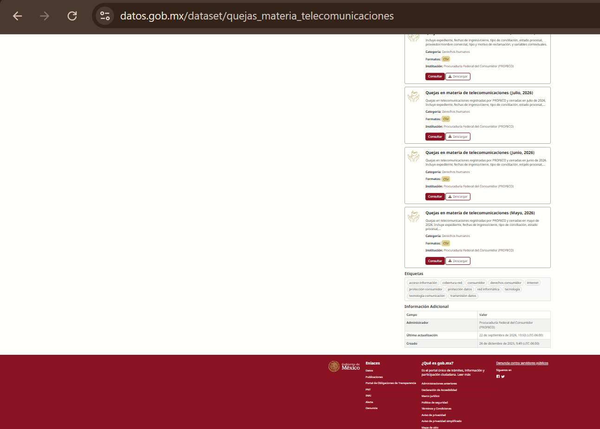

What the page shows:

- **Five resources**, all in CSV: Enero 2026, 2022 a 2025, Julio 2026, Junio 2026 and Mayo 2026. They match the five downloaded files (`2022_ene_2026`, `2022_2025`, `jul2026`, `junio_2026`, `may_2026`).
- **License of the dataset:** Creative Commons Attribution 4.0, in the left column of the page.
- **Additional information:** administrator PROFECO; last update 22 September 2026, 10:53 (UTC-06:00); created 26 December 2025, 09:49.
- **Warning of the portal:** "Algunas bases de datos pueden incluir actualizaciones retroactivas por lo que la información histórica puede cambiar en actualizaciones posteriores." This is why the download date and the SHA-256 of the base file are recorded.
- The page shows dates for the dataset, not for each resource. The date of the base resource (2026-09-22) is on its own resource page (`profeco_license_note.png`).

### E2. Files downloaded to the project folder

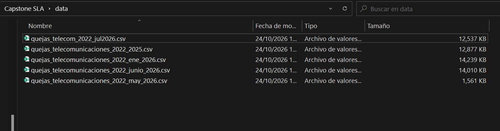

Five CSV files, all modified on 24/10/2026. At this point they are still in `data\`, not yet in `data/raw/`.

### E3. Profile of `fecha_ingreso` (junio_2026, Power Query)

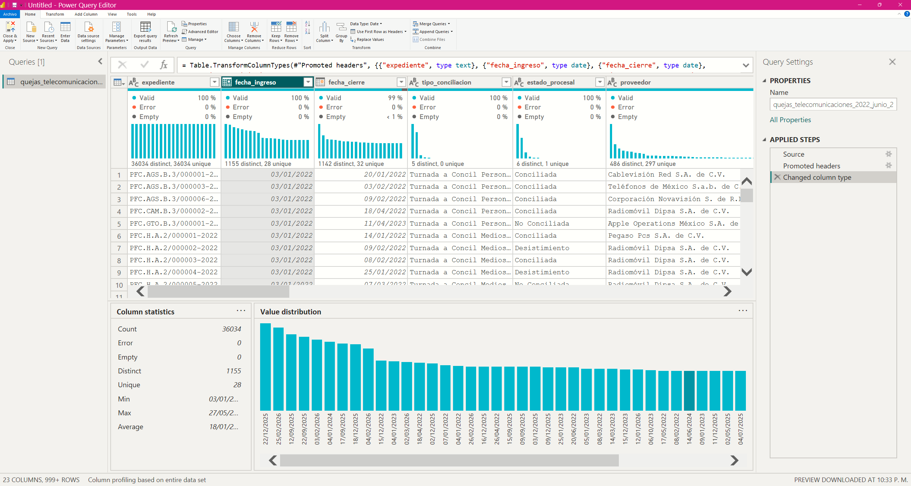

36,034 rows, 0 errors, 0 empty values, 1,155 distinct dates. Minimum 03/01/2022 and maximum 27/05/2026 (the year is cut off in the capture; confirmed in `step_2.sql`, block 2.5: 2022-01-03 to 2026-05-27).

### E4. Profile of `fecha_cierre` (junio_2026, Power Query)

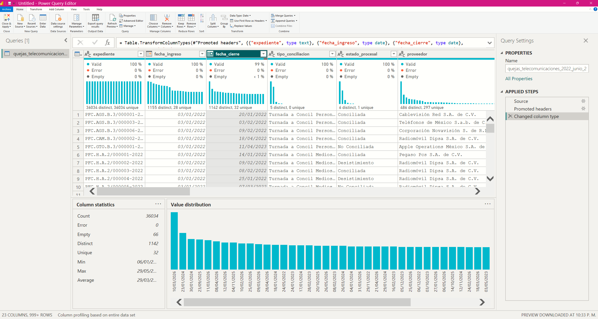

36,034 rows, 0 errors, **66 empty** (0.18%), 1,142 distinct dates. Minimum 06/01/2022 and maximum 29/05/2026. The most frequent close date is 10/03/2026, well above the typical day (possible batch closing, see block 2.12).

### E5. Dirty values in the amount columns

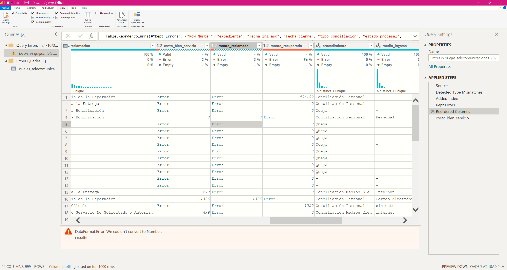

Power Query "Kept Errors" view. `costo_bien_servicio`, `monto_reclamado` and `monto_recuperado` fail with "We couldn't convert to Number"; the offending value is a dash (`-`). `medio_ingreso` also contains the placeholder `sin dato`. The profile in this view uses only the top 1,000 rows, so its percentages are not reliable.

## Choosing the base cut: evidence and criteria

The five cuts were published by hand, with no documented methodology: the names follow different patterns (`quejas_telecom_2022_jul2026`, `..._ene_2026`, `..._junio_2026`), the row counts do not grow with time and the content of the close date is not consistent. Since the publisher gives no rule to choose a cut, the project defines its own criteria (decision D4 in `docs/decisions.md`):

1. **Integrity:** unique `expediente` and no type errors in the dates.
2. **Coverage:** widest date range and highest volume.
3. **Plausibility:** close dates vary and are not a single cut-off date.
4. **Consistency with the other cuts:** overlapping cases agree (overlap audit done: see the section at the end).
5. **Traceability:** name, size, date and hash of the file are recorded.

Evidence: the end of each file as seen in Excel (the last rows show the latest records of each cut).

| Cut | Rows | What the end of the file shows | Verdict |
|---|---|---|---|
| `..._2022_2025.csv` | ≈32,961 | Rows sorted by filing date. The last filing is 25/11/2025 and the last close date seen is 28/11/2025, so coverage ends in November 2025 | Audit only |
| `..._2022_ene_2026.csv` | ≈32,652 | A last block sorted by office, with filings from 2025 and close dates in January 2026. The file is larger in bytes per row than the others | Audit only |
| `..._2022_may_2026.csv` | ≈4,081 | Filings from 12/05/2026 to 27/05/2026 and close dates up to 29/05/2026. Only the end was inspected; it looks like a partial slice | Audit only |
| `..._2022_junio_2026.csv` | 36,034 | Same last records as `may_2026`. Power Query: unique `expediente`, no date errors, 0.18% of close dates empty, close dates up to 29/05/2026 | **Base (confirmed)** |
| `quejas_telecom_2022_jul2026.csv` | ≈31,926 | Every visible close date is 31/07/2026, even for cases filed in 2025 (it may be a cut-off date, not a real close date) | Audit only, until it is understood |

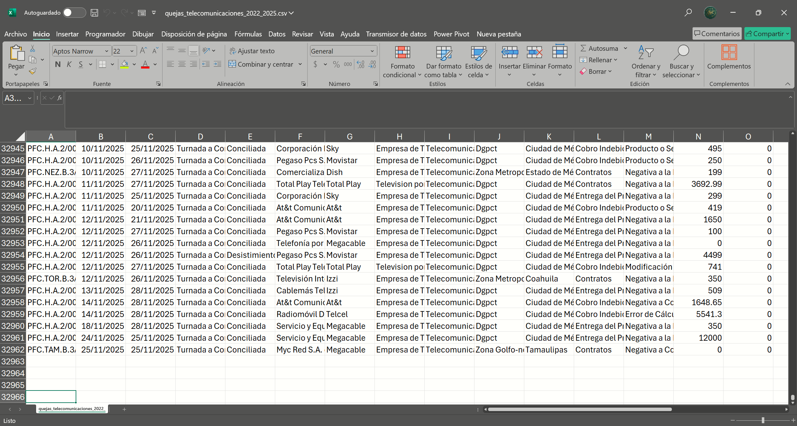
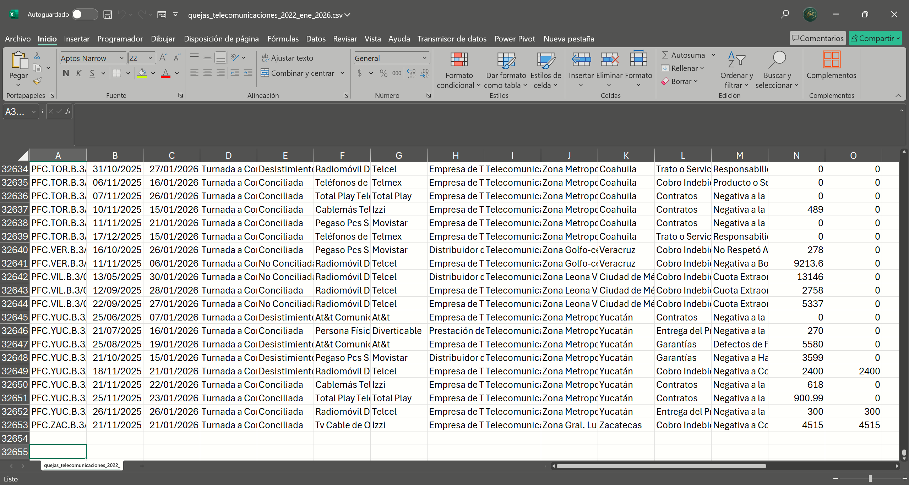
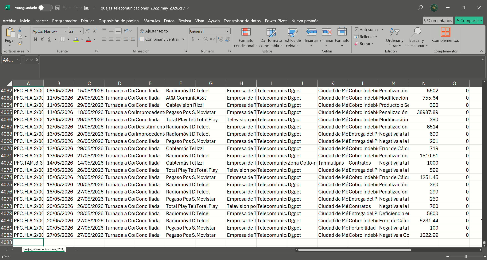
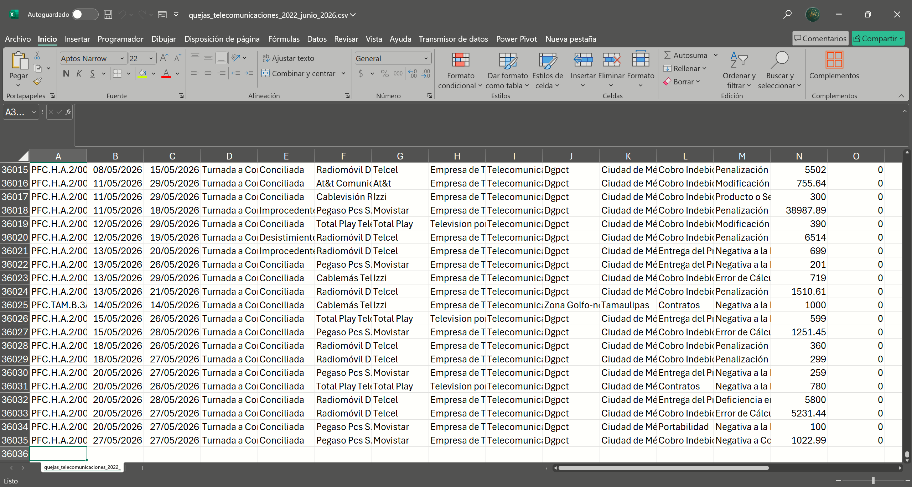
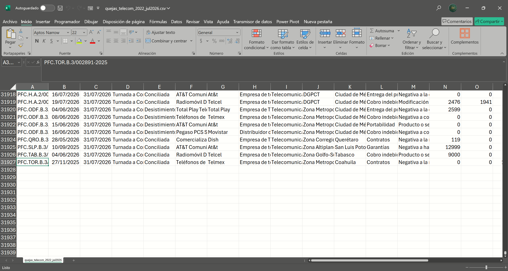

Only the end of each file was inspected, and the checks for criteria 1 and 4 were done only for `junio_2026`. The verdicts were reviewed with the overlap audit (`step_4.sql`, see the last section) and confirmed.

## Observations (hypotheses to verify)

1. Row counts do not follow the order of the cuts: `ene_2026` and `jul2026` have fewer rows than `2022_2025`.
2. `junio_2026` ends with the same latest records as `may_2026` (last close date 2026-05-29), so its name does not mean it contains June closings.
3. In `jul2026`, every visible row at the end of the file has the close date 2026-07-31, even cases filed in 2025. It may be a cut-off date and not a real close date.
4. The portal reports a last update on 2026-09-22 (E1). The newest cut may be `jul2026`, which has fewer rows and a different name pattern. The relation between cuts is not understood yet.
5. `ene_2026` is the largest file by size (14,239 KB) but not by rows: about 447 bytes per row against about 400 in the other files. Its content differs (extra spaces, longer text or other quoting). To be inspected.
6. Text values differ in capitalization between cuts (for example "Cobro indebido" vs "Cobro Indebido", "DGPCT" vs "Dgpct").
7. There is **no complete column for the type of service** (internet, mobile, TV). `giro` is a provider classification and `problema_especial` has a service name in only 27% of the rows. Decision D7: analysis at provider level. See the section *Type of service* below.
8. Rows with `estado_procesal` = Cancelada: 48 rows, all filed in 2022 to 2024. 44 of them have no close date. The provider "-" appears in only 10 rows of the whole file and the brand "Otros" in 126, so these placeholders are not limited to cancelled cases (block 2.14).
9. Placeholders are used instead of empty values: `-` in amounts, provider and other columns, and `sin dato` in `medio_ingreso`. All of them become `NULL` in the clean layer.
10. In `junio_2026`, the last filing date is 2026-05-27 and the last close date is 2026-05-29 (E3, E4).
11. Dates are text with the year first and dashes (`yyyy-mm-dd`). Confirmed in `step_2.sql` (blocks 2.3 and 2.4: 0 values with a different format).

## Columns (23, in file order)

`expediente`, `fecha_ingreso`, `fecha_cierre`, `tipo_conciliacion`, `estado_procesal`, `proveedor`, `nombre_comercial`, `giro`, `sector`, `odeco`, `estado`, `tipo_reclamacion`, `motivo_reclamacion`, `costo_bien_servicio`, `monto_reclamado`, `monto_recuperado`, `procedimiento`, `medio_ingreso`, `clase`, `tipo_producto`, `modalidad_compra`, `modalidad_pago`, `problema_especial`.

## Handling rules

- Raw files are never edited. They are stored in `data/raw/`, which is not versioned.
- The data are loaded as text into `stg.profeco_raw` (`sql/mx_profeco/step_1.sql`) and cleaned only in SQL.
- The publisher may update the data retroactively. The download date and file identity are recorded here.

## Pending evidence

- [x] Dataset page with the list of the five resources (`profeco_dataset_page_1.png`, `profeco_dataset_page_2.png`, 2026-11-05). The page shows the dataset license and the dataset dates; the license field of the base resource is also on record (`profeco_license_note.png`).
- [x] Page of the data dictionary: the old URL returns "File not found". Not pursued: D8 and D9 were accepted without it (2026-11-05).
- [x] Left-hand columns of the Power Query errors view: no longer needed, the clean layer is built in SQL (D2).
- [x] Results of `step_2.sql` in SSMS (blocks 2.1 to 2.14), received on 2026-10-26.
- [x] Results of the repeated-ID queries (block 2.2), block 2.15 and block 2.16.
- [x] Results of block 2.8 for `sector`, `procedimiento`, `medio_ingreso` and `tipo_conciliacion`.
- [x] Results of block 2.17 (length of `procedimiento`, meaning of `En Proceso`).
- [x] Files moved to `data/raw/` (the base file is loaded from there by `step_1.sql`).
- [x] Excel captures of the file ends saved in `docs/img/` (`mx_profeco_tail_*.png`).
- [x] Captures of checks B and C (`giro`) of block 2.8 (`step_2_8_b.png`, `step_2_8_c_giro.png`).
- [x] Block 2.2 re-run with the exact comparison: 36,034 distinct IDs (`step_2_2.png`).
- [x] SHA-256 of the base file and of the BIT file (2026-11-05, `sha256_raw_files.png`).
- [x] License evidence of both sources (`docs/sources/licenses.md`).
- [x] Meaning of the column `odeco`: name of the PROFECO office (check 3.3.16).
- [x] Meaning of the amount columns: not documented; D9 accepted without the dictionary (2026-10-31).
- [x] `step_3_check_06p1.png` and `step_3_check_06p2.png` captured again after revision 2, and check 3.3.17 run (`step_3_check_17.png`).
- [x] BIT portal: download pages and the list of tables (criterion 4).
- [x] BIT: the `TotalPlay` rows of `EMPRESA` have `GRUPO` = `GRUPO SALINAS` (`bit_acc_baf_pivot_salinas_2024.png`, `bit_acc_baf_pivot_salinas_all.png`), and the terms of use were checked (`licenses.md`).

## Type of service (`step_2.sql`, block 2.8)

Visual inspection suggested that no column tells which service a complaint is about. Block 2.8 tested it with the checks below (run on 2026-10-26).

| Check | Question | Result | Evidence |
|---|---|---|---|
| A | Brands with more than one `giro` | 58 brands. Telcel 5, Megacable 7, Izzi 5, Telmex 6 | 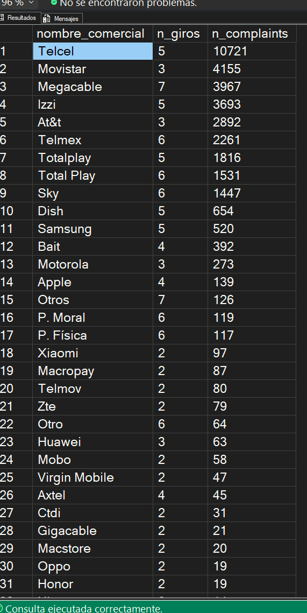 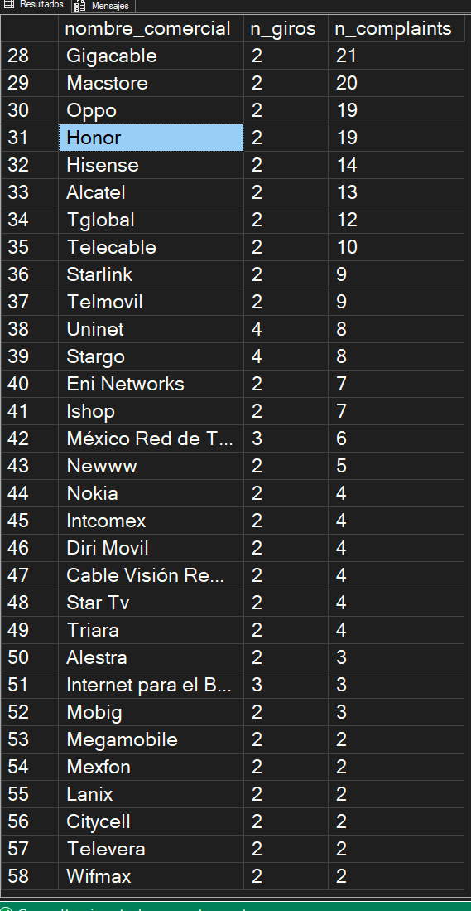 |
| B | Do reason columns mention a service? | `motivo_reclamacion` 0, `tipo_reclamacion` 0, `problema_especial` 5,443 | 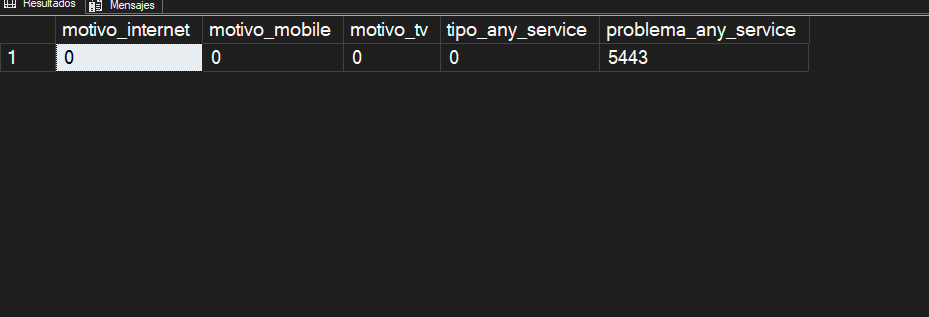 |
| C | Values of `giro` | Mobile telephony 18,466; pay TV 10,211; local telephony 2,354; cable TV 2,051; internet giros 944 | 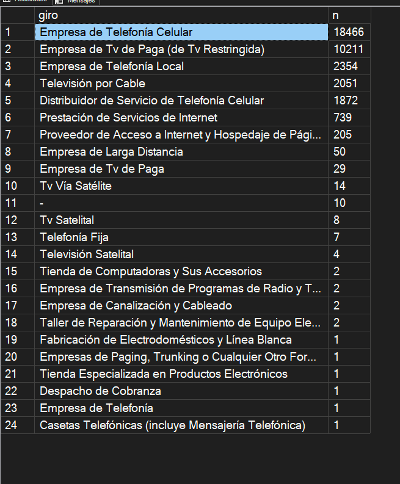 |
| D | `giro` of the main brands | Izzi: 3,530 of 3,693 as pay TV and 80 as internet | 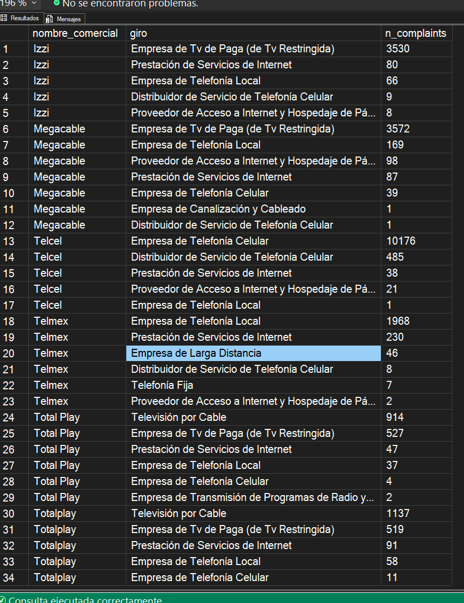 |
| E | `giro` inside one legal name | It changes (Radiomóvil Dipsa 5 values, Total Play 6) | 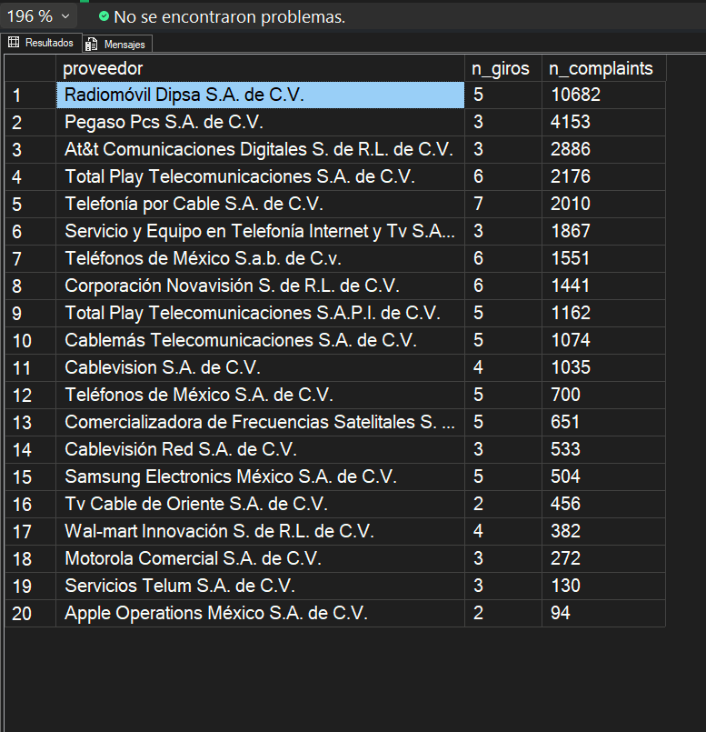 |
| F | Values of `problema_especial` | 26,116 "No Problema Especial" (72.5%); 9,806 with a service name (27.2%) | 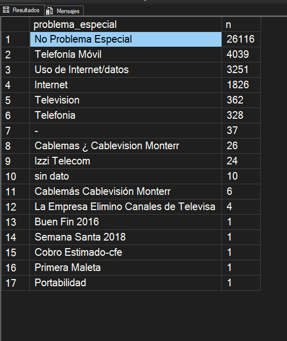 |
| G | `giro` of Total Play by year | Both labels, "Televisión por Cable" and "Empresa de Tv de Paga", appear every year | 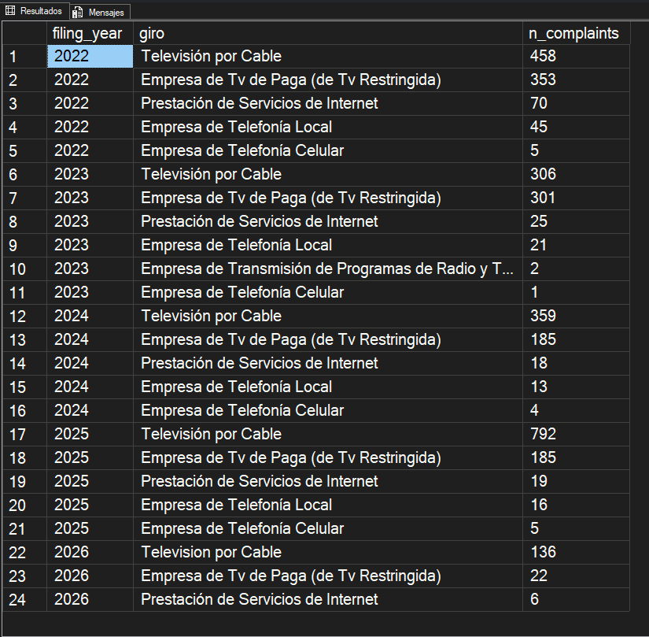 |
| H | Brand vs `problema_especial` | Coherent with the business of each brand (see below) | 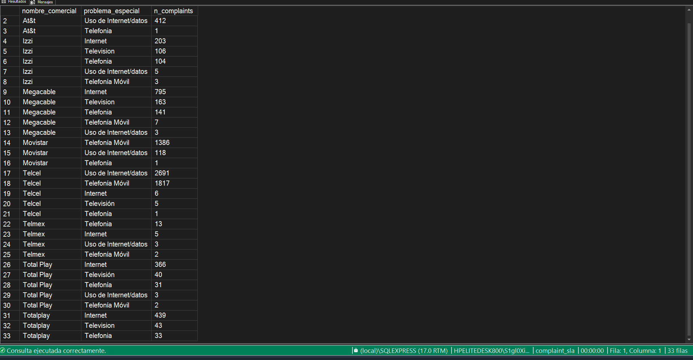 |
| I | Coverage of `problema_especial` by year | 2022 20%, 2023 21%, 2024 28%, 2025 38%, 2026 43% | 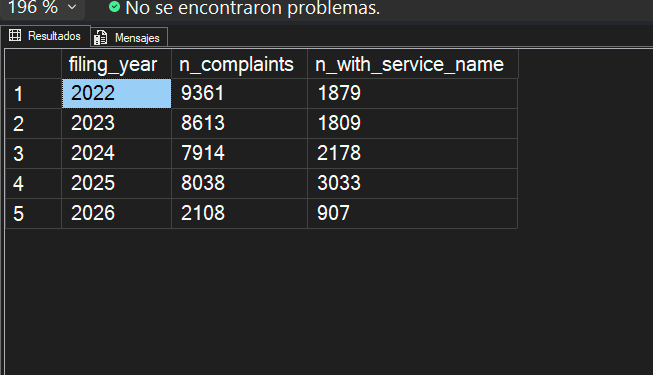 |

Reading of check H (values with a service name, as a share of each brand's complaints):

| Brand | Complaints | With service name | Main values |
|---|---|---|---|
| Telcel | 10,721 | about 42% | Uso de Internet/datos 2,691; Telefonía Móvil 1,817 |
| Movistar | 4,155 | about 36% | Telefonía Móvil 1,386; Uso de Internet/datos 118 |
| Megacable | 3,967 | about 28% | Internet 795; Television 163; Telefonia 141 |
| Total Play + Totalplay | 3,347 | about 29% | Internet 805; Television 83; Telefonia 64 |
| Izzi | 3,693 | about 11% | Internet 203; Television 106; Telefonia 104 |
| Telmex | 2,261 | about 1% | Telefonia 13; Internet 5 |

Conclusions (decision D7):

- `giro` is not the service of the complaint.
- `problema_especial` is coherent with the brand but incomplete and unstable over time, so it is used only as a labeled partial hint.
- Other values of `problema_especial` are free text (for example `Cablemas ¿ Cablevision Monterr`, 26 rows), and `-` or `sin dato` (47 rows). The character `¿` may come from the source file; to be checked in the original CSV.
- `clase` and `tipo_producto` do not give the telecom service either. `clase` is Servicio (31,340) or Bien (4,226), and `tipo_producto` is Servicio Normal (30,314), Producto Nuevo (4,718), Servicio Adicional o Conexo (690), Producto Usado (245) and Producto Reconstruido (23). They separate services from goods (for example phones). Evidence: 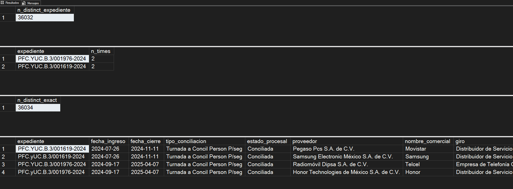
- **Anomaly:** `clase` also holds Internet (187), Personal (181), Escrito (61) and Correo Electrónico (1). These are values of `medio_ingreso`, not of `clase`: in those rows the two columns are swapped (see the section below). The counts above are shown as loaded; after the correction, Servicio is 31,692 and Bien is 4,304.

## Other columns (`step_2.sql`, block 2.8)

Values of the columns that describe how the complaint was filed and handled (run on 2026-10-26).

**`sector`:** a single value, `Telecomunicaciones`, in all 36,034 rows. It carries no information and is not used in the model. Evidence: 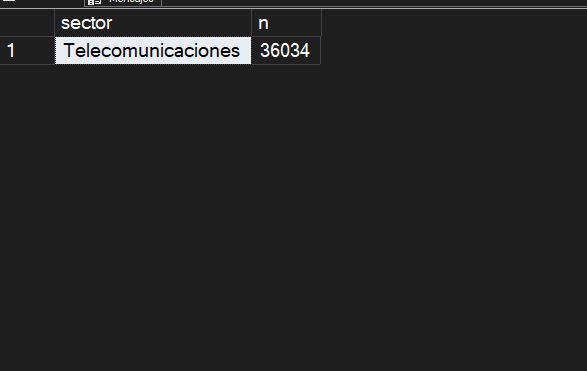

**`medio_ingreso`** (channel). Evidence: 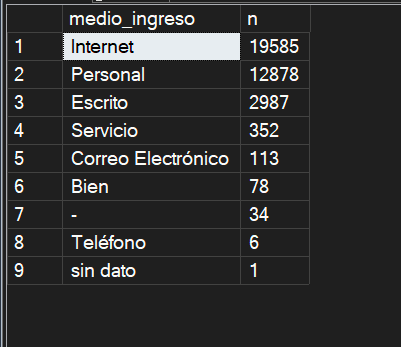

| Value | As loaded | After correcting the swap (2.15) |
|---|---|---|
| Internet | 19,585 | 19,772 |
| Personal | 12,878 | 13,059 |
| Escrito | 2,987 | 3,048 |
| Correo Electrónico | 113 | 114 |
| Teléfono | 6 | 6 |
| Servicio | 352 | 0 |
| Bien | 78 | 0 |
| `-` | 34 | 34 |
| `sin dato` | 1 | 1 |

The 352 "Servicio" and 78 "Bien" are exactly the 430 swapped rows of block 2.15, so the swap explains every non-channel value of this column. `-` and `sin dato` (35 rows) become `NULL`.

**`procedimiento`.** Evidence: 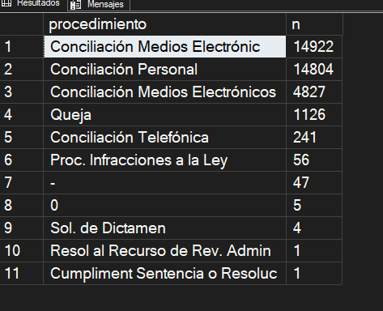

| Value | Rows |
|---|---|
| Conciliación Medios Electrónic | 14,922 |
| Conciliación Personal | 14,804 |
| Conciliación Medios Electrónicos | 4,827 |
| Queja | 1,126 |
| Conciliación Telefónica | 241 |
| Proc. Infracciones a la Ley | 56 |
| `-` | 47 |
| `0` | 5 |
| Sol. de Dictamen | 4 |
| Resol al Recurso de Rev. Admin | 1 |
| Cumpliment Sentencia o Resoluc | 1 |

- **Labels cut at 30 characters.** Three values have exactly 30 characters ("Conciliación Medios Electrónic", "Resol al Recurso de Rev. Admin" and "Cumpliment Sentencia o Resoluc"), which would be very unlikely by chance. But the full label "Conciliación Medios Electrónicos" (32 characters, 4,827 rows) exists in the same column, so the text was cut in part of the records only. Both spellings end in similar outcomes (Conciliada 54% and 52%), so they are the same procedure (14,922 + 4,827 = 19,749 rows). Handling: a mapping of labels in the clean layer. Evidence: 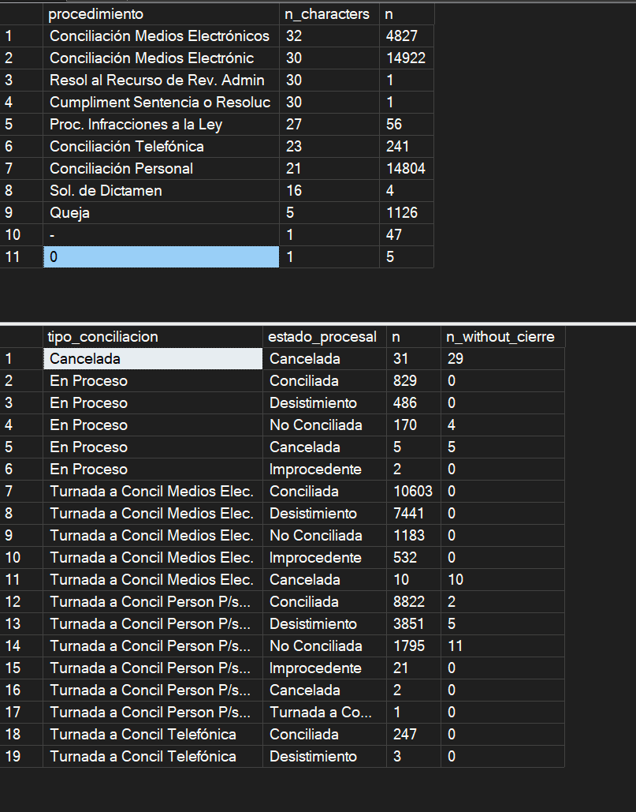
- **Placeholders:** `-` (47) and `0` (5) become `NULL`.
- **Procedure groups** (block 2.17). Evidence: 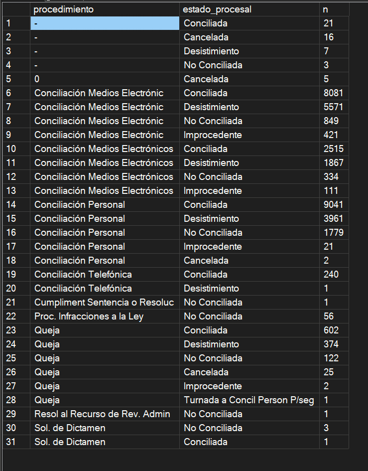

| Group | Values | Rows | Outcomes |
|---|---|---|---|
| Conciliation | Medios Electrónic(os), Personal, Telefónica | 34,794 | Conciliada, Desistimiento, No Conciliada and Improcedente |
| Queja | Queja | 1,126 | Conciliada 602, Desistimiento 374, No Conciliada 122, Cancelada 25, Improcedente 2 and one `Turnada a Concil Person P/seg` |
| Other legal procedures | Proc. Infracciones a la Ley (56), Sol. de Dictamen (4), Resol al Recurso de Rev. Admin (1), Cumpliment Sentencia o Resoluc (1) | 62 | 61 No Conciliada and 1 Conciliada |
| Not identified | `-` (47), `0` (5) | 52 | 21 Cancelada, 21 Conciliada, 7 Desistimiento and 3 No Conciliada |

  The clean layer keeps a `procedure_group`. Proposal: the duration KPIs use the Conciliation group, and Queja is checked separately because 25 of the 48 cancelled cases belong to it. The other legal procedures are almost always "No Conciliada" and are not a conciliation.

**`tipo_conciliacion`.** Evidence: 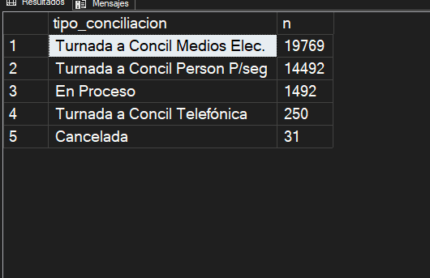

| Value | Rows |
|---|---|
| Turnada a Concil Medios Elec. | 19,769 |
| Turnada a Concil Person P/seg | 14,492 |
| En Proceso | 1,492 |
| Turnada a Concil Telefónica | 250 |
| Cancelada | 31 |

- The labels are abbreviated by the publisher. The groups (electronic means, in person, telephone) agree in size with `medio_ingreso` and `procedimiento`, but they do not match exactly.
- **`En Proceso` (1,492 rows) is not the state of the case.** These rows have final outcomes (Conciliada 829, Desistimiento 486, No Conciliada 170, Cancelada 5 and Improcedente 2), and only 9 have no close date. It looks like the label of cases without an assigned conciliation channel (interpretation, not confirmed by the publisher). This supports the assumption that the file holds closed cases only. Evidence: [block 2.17](../img/step_2_17_1.png).
- `Cancelada` appears in 31 rows here and in 48 rows of `estado_procesal`: the other 17 have another conciliation type (En Proceso 5, Medios Elec. 10, Person 2). The 22 non-cancelled rows without close date are 18 `Person` and 4 `En Proceso`.

## Results of the feasibility gate

Run on 2026-10-26 on `stg.profeco_raw` (36,034 rows).

| # | Criterion | Result | Status |
|---|---|---|---|
| 1 | At least 2,000 complaints against fixed-network operators | 13,268 (Telmex 2,261; Izzi 3,693; Megacable 3,967; Total Play and Totalplay 3,347) | Passed |
| 2 | Missing `fecha_cierre` below 30% | 66 rows, 0.18% | Passed |
| 3 | At least 100 complaints per year for each of the four operators | See the table below | Passed for 2022 to 2025. In 2026 (to May 27) Telmex has 68 |
| 4 | Subscribers by operator and state in BIT | Accesses by operator group and state, 2013 to December 2024 (see below) | Passed, with limitations |

### Criterion 4: BIT check (2026-10-27)

Source: BIT (Banco de Información de Telecomunicaciones, CRT), module *Descarga de datos*. The files `Servicio Fijo de Acceso a Internet TODO_BAF.zip` (10 CSV) and `Servicio Fijo de Telefonia TODO_TF.zip` (13 CSV) were downloaded to `data/BIT/` (not versioned). The definitions come from the IFT *Manual de definiciones de los indicadores estadísticos de telecomunicaciones* (April 2018): https://www.ift.org.mx/sites/default/files/contenidogeneral/estadisticas/manualdefinicionesmarzo2018.pdf. It describes each indicator, its BIT table key and its breakdowns. It is dated 2018, so the table structure was also checked directly on the downloaded files.

**Table checked: `TD_ACC_BAF_ITE_VA`** (fixed broadband accesses, manual indicator 4.3.1).

| Item | Finding |
|---|---|
| Rows | 592,281 |
| Columns | `FOLIO`, `K_ENTIDAD`, `K_MUNICIPIO`, `K_ACCESO_INTERNET`, `TECNO_ACCESO_INTERNET`, `FECHA`, `ANIO`, `MES`, `K_EMPRESA`, `EMPRESA`, `CONCESIONARIO`, `A_TOTAL_E`, `K_GRUPO`, `GRUPO`, `ENTIDAD`, `MUNICIPIO` |
| Grain | One row per folio, state, municipality, technology, company and month. `A_TOTAL_E` is the number of accesses |
| Period | January 2013 to December 2024 (minimum year 2013, last year 2024 with 12 months) |
| Operator | Company (`EMPRESA`) and group (`GRUPO`). The four groups of interest appear in `GRUPO` as `AMÉRICA MÓVIL` (Telmex), `GRUPO TELEVISA` (Izzi), `MEGACABLE-MCM` and `GRUPO SALINAS`. In `EMPRESA` there is no entry called Grupo Salinas, but there is one called `TotalPlay`, so Total Play is identified by `EMPRESA`. Confirmed on 2026-10-31: `GRUPO SALINAS` contains only `TOTALPLAY`, in 2024 and in all years |
| Date format | `FECHA` is text like `15Jan2021`; use `ANIO` and `MES` |
| Encoding | Not UTF-8 (a CSV viewer rejected it); the load script must set the code page |

Accesses by group in December 2024 (pivot table in Excel, filters `ANIO` = 2024 and `MES` = 12):

| Group | Accesses | States with data (of 32) |
|---|---|---|
| América Móvil | 11,208,977 | 31 (none in state 99) |
| Grupo Televisa | 5,970,288 | 32 |
| Megacable-MCM | 5,316,545 | 31 (none in Quintana Roo, state 23) |
| Grupo Salinas | 5,313,779 | 32 |
| All four | 27,809,589 | 32 states plus state 99 |

- Accesses without state (`K_ENTIDAD` = 99, "Sin información de Entidad"): 35,990, which is **0.13%** of the total.
- **Total Play confirmed:** under `GRUPO SALINAS` the only company is `TOTALPLAY`, so the group and the company are the same operator (2024 and all years pivots).
- **Companies inside each group** (pivot of all years, `bit_acc_baf_pivot_grupos_all.png`):

| BIT group | Companies (`EMPRESA`) | Rule for the PROFECO brand |
|---|---|---|
| AMÉRICA MÓVIL | TELMEX (1,318 M) and TELNOR (59.6 M, 4.3%) | Telmex = the whole group (Telnor is the Telmex subsidiary of the north) |
| GRUPO TELEVISA | IZZI (333 M), CABLEMAS, CABLEVISION, CABLECOM, CABLEVISION RED, TELEVISION INTERNACIONAL, BESTEL, FTTH, and `SKY` (34.1 M) | Izzi = the group **without** `SKY`. The cable companies are the historical entities of the Izzi network; in 2024 the group has only IZZI and SKY |
| MEGACABLE-MCM | MEGACABLE (402 M, 99.9%), MCM TELECOM, TELEVIA and a small Telecable | Megacable = the whole group |
| GRUPO SALINAS | TOTALPLAY only | Total Play = the whole group |

- **Grupo Televisa is not only Izzi:** `SKY` is about 7% of the group in 2024 (5.1 M of 73.0 M summed monthly accesses). Using the group would understate the Izzi rate, so Sky is excluded from the Izzi denominator in step 4 (the Sky complaints are already outside the fixed scope, see `clean.brand_map`).
- **Do not add months:** `A_TOTAL_E` is a stock of accesses per month. The 2024 sum of Grupo Salinas (62,000,222) is about twelve months of stock (about 5.2 M a month). Rates use the December value or the monthly average, never the yearly sum.
- Some groups have very few accesses in some states (Grupo Salinas: 137 in Tlaxcala, 190 in Zacatecas, 228 in Baja California Sur, 419 in Campeche, 568 in Oaxaca; Grupo Televisa: 562 in Baja California Sur). State rates need a minimum denominator.
- The portal footer says "Algunos Derechos Reservados"; the terms of use were not read yet (open item in `licenses.md`).
- The fixed telephony table `TD_LINEAS_TELFIJA_ITE_VA` and the subscriptions table `TD_SUS_BAF_ITE_VA` were not inspected. They are an improvement, not a condition of the gate.
- Background: a news report (Yahoo Noticias, January 2026) said the BIT had gone 143 days without a significant update after the IFT was replaced by the CRT. The December 2024 end of the series is consistent with that delay.

**Consequences for the design**

- Rates per 100,000 accesses can only be computed for 2022 to 2024. Complaints of 2025 and 2026 are used for volume and duration.
- The BIT operator is a group. The provider mapping table (`clean.brand_map`, in `step_3.sql`) maps each PROFECO brand to a group.
- Evidence files in `docs/img/`: `bit_portal_baf.png`, `bit_portal_tf.png`, `bit_zip_baf.png`, `bit_zip_tf.png`, `bit_market_share_baf.png`, `bit_market_share_telfija.png`, `bit_acc_baf_filter_anio.png`, `bit_acc_baf_filter_mes.png`, `bit_acc_baf_pivot_entidad.png`, `bit_acc_baf_pivot_grupo.png`.

Complaints by filing year (the two spellings of Total Play are added):

| Operator | 2022 | 2023 | 2024 | 2025 | 2026 (to May 27) |
|---|---|---|---|---|---|
| Izzi | 910 | 906 | 791 | 821 | 265 |
| Megacable | 1,376 | 856 | 780 | 714 | 241 |
| Telmex | 863 | 527 | 413 | 390 | 68 |
| Total Play | 931 | 656 | 579 | 1,017 | 164 |

Evidence: 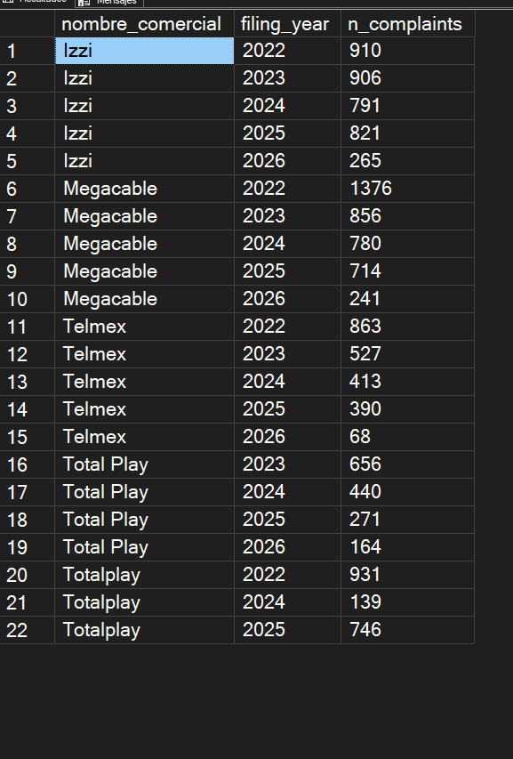 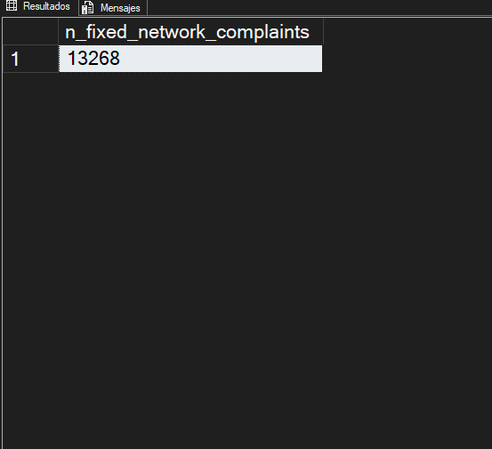 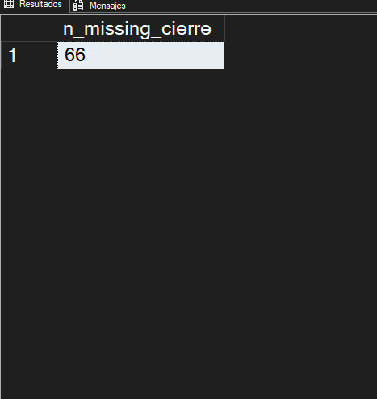

Notes on the gate:

- **2026 is partial.** The data end on 2026-05-27 (about five months), and only closed cases are in the file, so the most recent complaints are missing (right-censoring). The 68 of Telmex is about 14 per month; the threshold of 100 would be reached in about seven months. The criterion text already says that 2026 is partial; the margin is recorded here.
- **Telmex falls** from 863 (2022) to 390 (2025). The file does not explain why.
- **Total Play is written two ways**, and each spelling is used in different years: "Totalplay" has no rows in 2023 and 2026, and "Total Play" has none in 2022. Counted separately, the operator would seem to fail the criterion in some years. The provider mapping table must merge them.

### Other findings of `step_2.sql`

| Block | Finding | Handling in the clean layer |
|---|---|---|
| 2.1, 2.2 | 36,034 rows, but 36,032 distinct `expediente`. The 2 "repeated" IDs differ only in case and belong to different providers (see below) | No deduplication. Surrogate key; `expediente` normalized to upper case |
| 2.3 to 2.5 | All dates are `yyyy-mm-dd`. Filing 2022-01-03 to 2026-05-27; closing 2022-01-06 to 2026-05-29 | `TRY_CONVERT` to `date` |
| 2.6 | 66 rows without close date: 44 Cancelada, 15 No Conciliada, 5 Desistimiento and 2 Conciliada | Flag, no days to close. The 2 Conciliada rows are inconsistent |
| 2.7 | 3 rows with close date before filing date | Flag, excluded from duration KPIs |
| 2.9 | 477 distinct legal names and 196 brands. Power Query showed 486 legal names because it compares text with case and accents, while the database collation does not | Provider mapping table by brand |
| 2.9 | Brand variants: Totalplay and Total Play; Virgin (24) and Virgin Mobile (47); Telmov and Telmovil. Generic values: Otros (126), Otro (64), P. Moral (119), P. Física (117) | Mapping table; generic values become "not identified" |
| 2.12 | The close date 2026-03-10 has 147 cases; the next highest is 94 (2024-01-23) | Flag days with unusual volume of closings (possible batch closings) |
| 2.13 | `monto_reclamado`: `-` (32), `sin dato` (4) and `Oo` (1, probably a typing error). `monto_recuperado`: `-` in 1,479 rows. `costo_bien_servicio`: `-` (33) and `sin dato` (1) | Placeholders become `NULL`. The `-` of `monto_recuperado` is spread over all outcomes at a low rate, so it means "unknown" and not "nothing recovered" |
| 2.14 | 48 cancelled cases (21 in 2022, 17 in 2023, 10 in 2024). Provider `-` in 10 rows. Brand Otros in 126 rows | Flag cancelled cases and exclude them from KPIs |

Evidence images of each block: [2.1](../img/step_2_1.png), [2.3](../img/step_2_3.png), [2.4](../img/step_2_4.png), [2.5](../img/step_2_5.png), [2.7](../img/step_2_7.png), [2.9](../img/step_2_9.png), [2.12](../img/step_2_12.png), [2.13](../img/step_2_13.png) and [2.14](../img/step_2_14.png).

### Repeated IDs, swapped columns and missing close dates (blocks 2.2, 2.15 and 2.16)

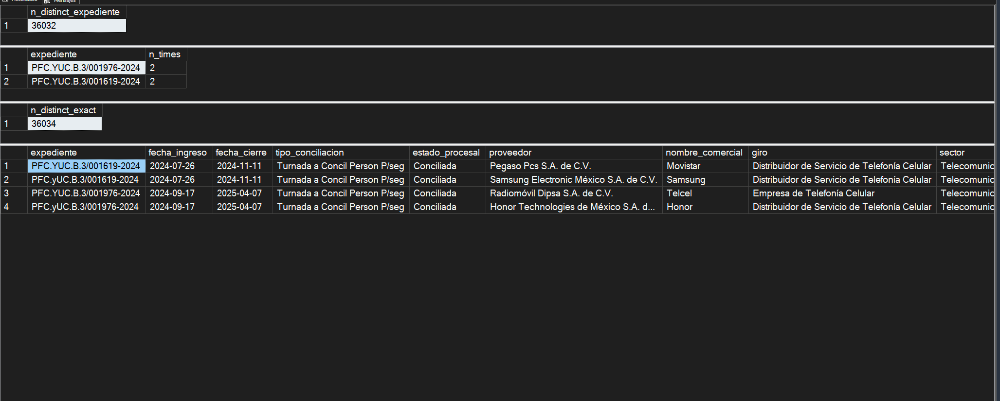

**Repeated `expediente` (2.2).** The 2 repeated IDs are not duplicate rows:

- `PFC.YUC.B.3/001619-2024` appears for Movistar (Pegaso Pcs) and for Samsung, with the same dates and outcome. `PFC.YUC.B.3/001976-2024` appears for Telcel (Radiomóvil Dipsa) and for Honor, also with the same dates.
- In each pair, one row is written with a lowercase `y` (`PFC.yUC...`). The database collation ignores case, so both spellings compare as equal and `COUNT(DISTINCT)` gives 36,032. Compared by exact text, there are 36,034 different IDs.
- It is probably one case filed against two providers (the carrier and the phone maker), with one row per provider. This is not confirmed.
- **Handling:** no deduplication. The fact table gets its own surrogate key, `expediente` is converted to upper case, and a flag marks the IDs shared by more than one provider. The grain is one row per case and provider.

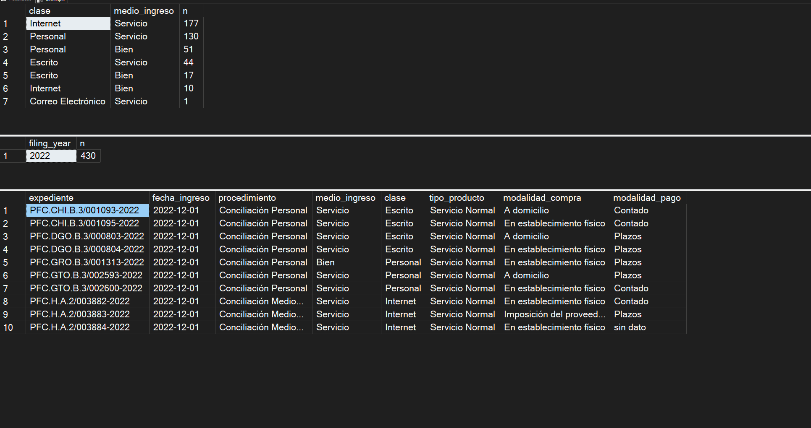

**Swapped columns (2.15).** The 430 rows with a channel in `clase` have Servicio or Bien in `medio_ingreso`, so the two columns are swapped:

| `clase` as loaded | `medio_ingreso` as loaded | Rows |
|---|---|---|
| Internet | Servicio | 177 |
| Personal | Servicio | 130 |
| Personal | Bien | 51 |
| Escrito | Servicio | 44 |
| Escrito | Bien | 17 |
| Internet | Bien | 10 |
| Correo Electrónico | Servicio | 1 |

- All 430 rows were filed in 2022 (the sample rows are from 2022-12-01). The neighbor columns are coherent: `procedimiento` agrees with the channel, and `modalidad_compra` and `modalidad_pago` have valid values.
- **Handling:** in the clean layer, when `clase` is Internet, Personal, Escrito or Correo Electrónico, the two values are swapped and the row is flagged. After the correction, no row may have a channel in `clase`.

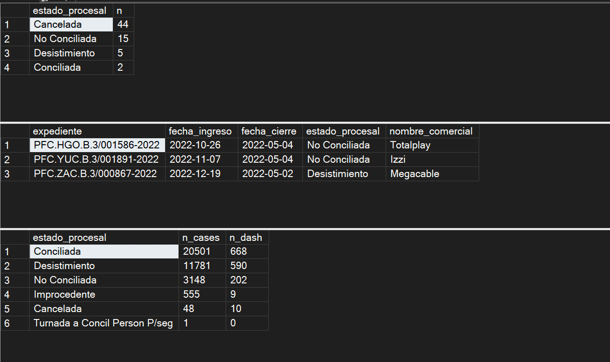

**Missing close date (2.16).** The 66 rows are 44 Cancelada, 15 No Conciliada, 5 Desistimiento and 2 Conciliada. A conciliated case should have a close date, so those 2 rows are inconsistent.

**Close date before filing date (2.16).** All 3 rows are from 2022:

| `expediente` | Filing | Close | Outcome | Brand |
|---|---|---|---|---|
| PFC.HGO.B.3/001586-2022 | 2022-10-26 | 2022-05-04 | No Conciliada | Totalplay |
| PFC.YUC.B.3/001891-2022 | 2022-11-07 | 2022-05-04 | No Conciliada | Izzi |
| PFC.ZAC.B.3/000867-2022 | 2022-12-19 | 2022-05-02 | Desistimiento | Megacable |

It is not possible to tell which of the two dates is wrong. The rows are flagged and excluded from duration KPIs.

**`monto_recuperado` equal to `-` (2.16).** The dash is spread over every outcome at a low rate: Conciliada 668 of 20,501 (3.3%), Desistimiento 590 of 11,781 (5.0%), No Conciliada 202 of 3,148 (6.4%), Improcedente 9 of 555 and Cancelada 10 of 48. If it meant "nothing recovered", it would concentrate in the cases without conciliation. It is a missing value and becomes `NULL`.

**Values of `estado_procesal` (2.16).** Conciliada 20,501 (56.9%), Desistimiento 11,781 (32.7%), No Conciliada 3,148 (8.7%), Improcedente 555 (1.5%), Cancelada 48 and one row with the value `Turnada a Concil Person P/seg`. That text is a value of `tipo_conciliacion`, so it is one more value in the wrong column. The row is flagged.

## Results of the clean layer (`step_3.sql`, 2026-10-27)

`clean.profeco_complaint` has 36,034 rows, one per case and provider, and every check of the script matched the values expected from `step_2.sql`.

| Check | Result | Evidence |
|---|---|---|
| 3.3.1 Rows | 36,034 in `stg` and in `clean` | 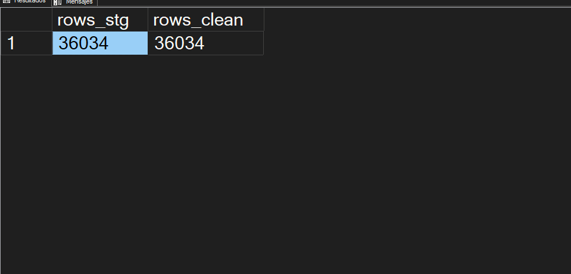 |
| 3.3.2 Conversion | 0 bad filing dates, 0 bad close dates, 0 empty case IDs | 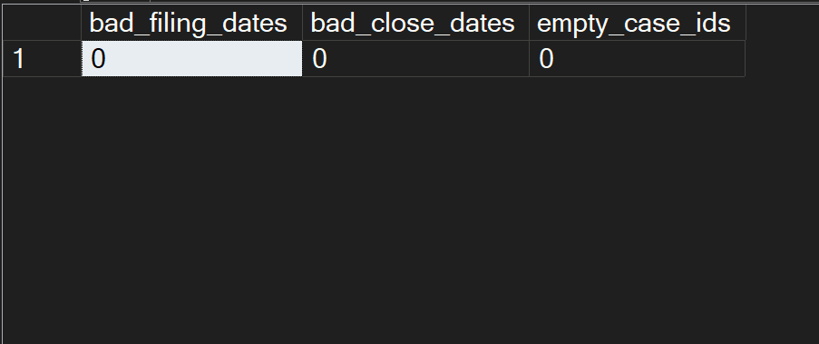 |
| 3.3.3 Flags | missing close 66; close before filing 3; cancelled 48; swapped columns 430; shared case ID 4; outcome anomaly 1; unusual close day 147; valid duration 35,961 | 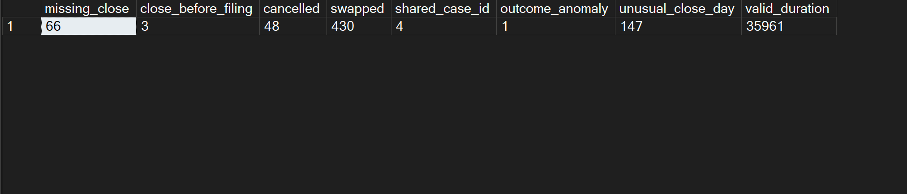 |
| 3.3.4 Swapped columns | `item_class`: Servicio 31,692, Bien 4,304, NULL 38. `channel`: Internet 19,772, Personal 13,059, Escrito 3,048, Correo Electrónico 114, Teléfono 6, NULL 35 | 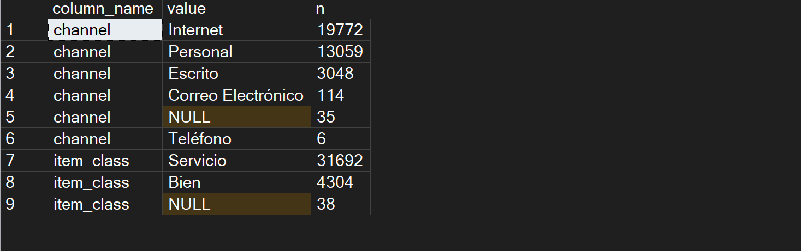 |
| 3.3.5 Procedure groups | Conciliation 34,794; Queja 1,126; Other legal procedure 62; Not identified 52 | 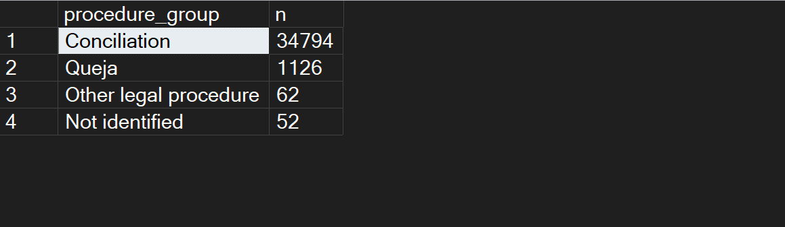 |
| 3.3.6 Brands (fixed), after revision 2 | Megacable 3,967; Izzi 3,693; Total Play 3,347 (two spellings merged); Telmex 2,261; Axtel 45; Gigacable 21; Telecable 10; Starlink 9; Newww 5 (13,358 in total). Gigacable and Telecable have no BIT group yet | 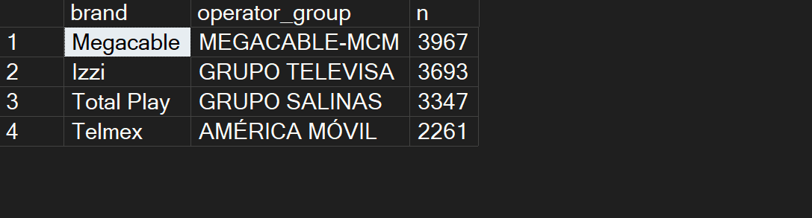 |
| 3.3.6 Brands (not classified), after revision 2 | Biggest: Not identified 426, Telmov 89, Macropay 87, Mobo 58, Ctdi 31, Macrocel 31. The rest has 20 cases or fewer each (for example Uninet 8, Hughes México 4, Alestra 3) | 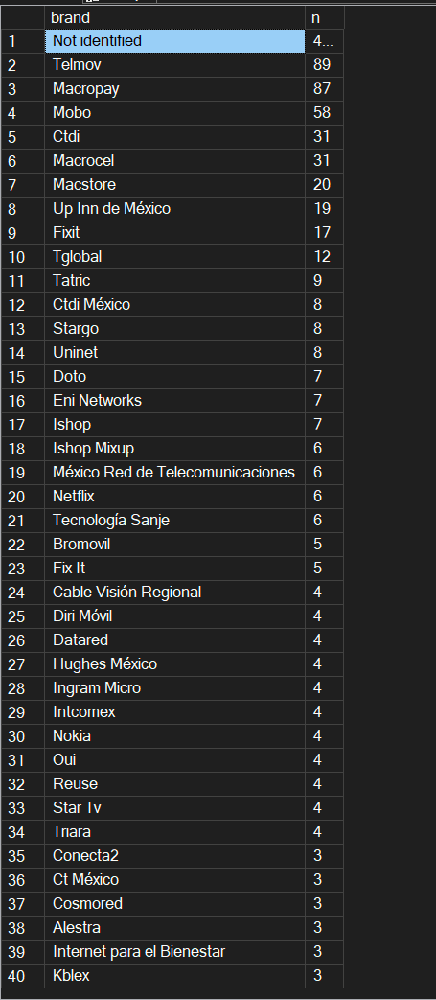 |
| 3.3.7 States | Every state text matched. 31 states have complaints; Tlaxcala (29) has none | 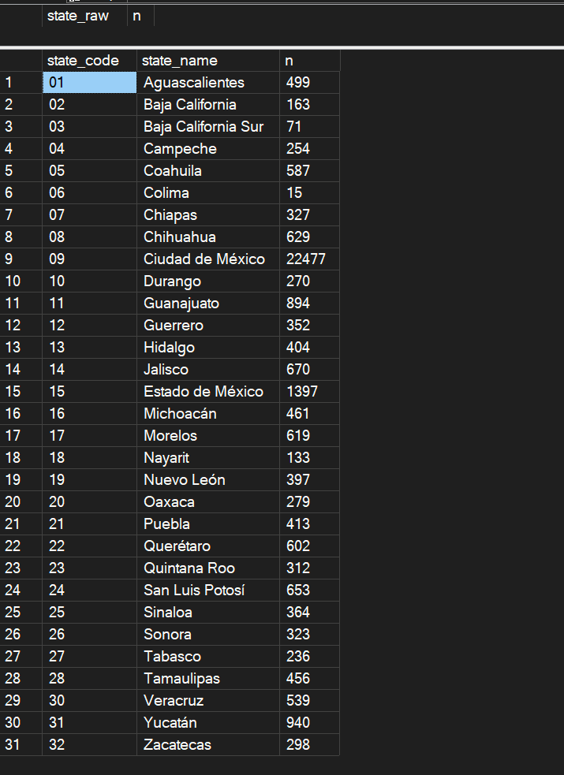 |
| 3.3.8 Service hint | Not specified 26,228 (73%); Mobile telephony 4,039; Internet / data use 3,251; Internet 1,826; Television 362; Telephony 328. The five hints add up to 9,806 (27.2%), the same count as `step_2.sql` | 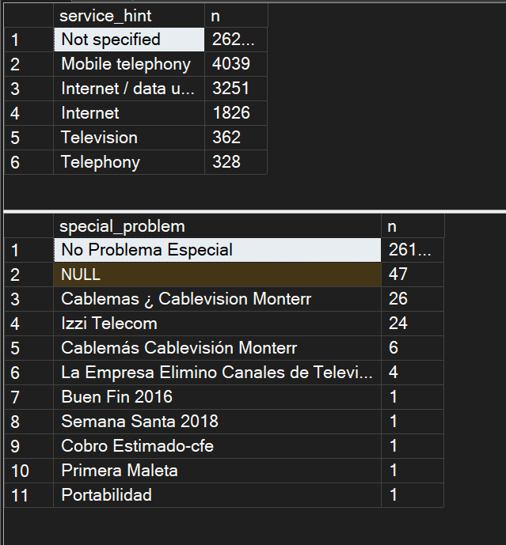 |
| 3.3.9 Amounts | NULL: claimed 37, cost 34, recovered 1,479. Claimed 0.00 to 551,335.06; recovered 0.00 to 556,800.00 | 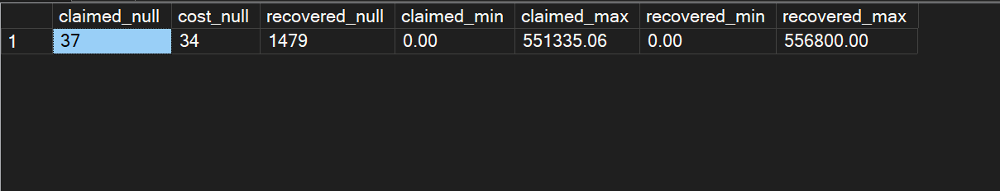 |
| 3.3.10 Days to close | Conciliation: 34,773 rows, 0 to 1,014 days, average 67.9. Queja: 1,098 rows, average 160.6. Other legal procedure: 59 rows, average 173.3. Not identified: 31 rows, average 82.0 | 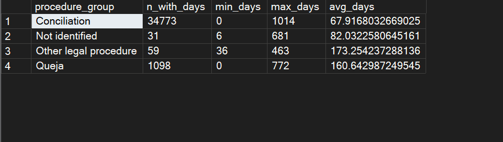 |
| 3.3.11 Identical rows | 0 groups of fully identical rows in `stg` | 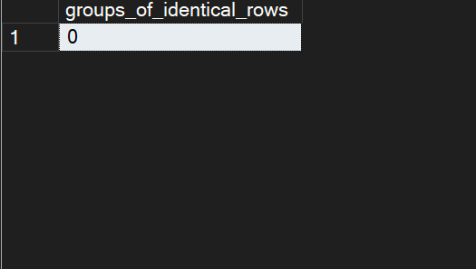 |
| 3.3.12 State and office | Internet channel: 19,626 of 19,772 cases (99.3%) are in Ciudad de México. By brand: Megacable 69.7%, Total Play 68.3%, Izzi 59.1%, Telmex 21.2%. The office in the case ID matches the state one to one (YUC 940, JAL 670, GTO 663, ...), except office `H` (about 19,700 cases), which is Ciudad de México | 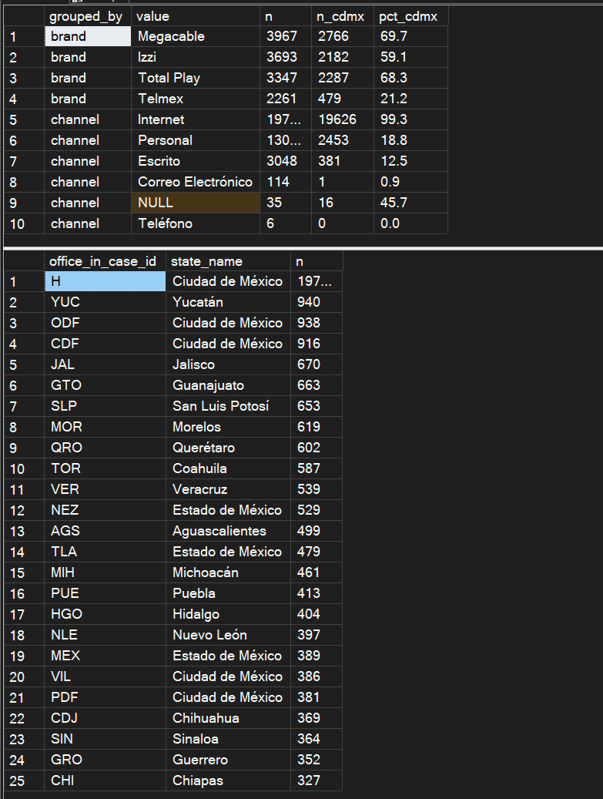 |
| 3.3.13 Amounts | `monto_reclamado` = 0 in 28,142 rows (78%); `monto_recuperado` = 0 in 22,187 (62%); recovered larger than claimed in 8,739 rows (24%). The biggest differences have claimed 0.00 and a large recovered amount | 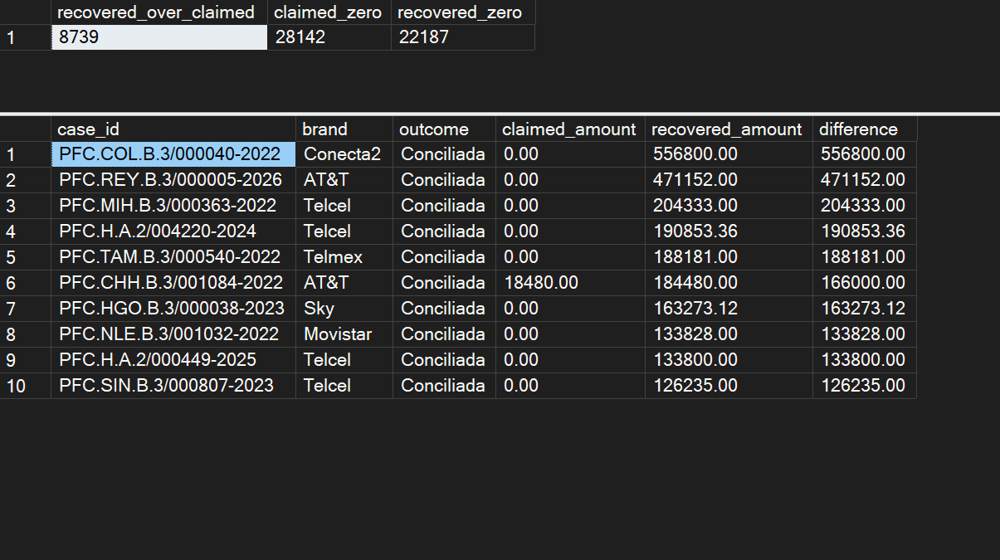 |
| 3.3.14 Office H and channel (revision 2) | Office `H`: 19,798 cases, all in Ciudad de México (Internet 19,607, Personal 140, Escrito 40, no channel 10, Correo Electrónico 1). The other 165 Internet cases are spread over 31 states | 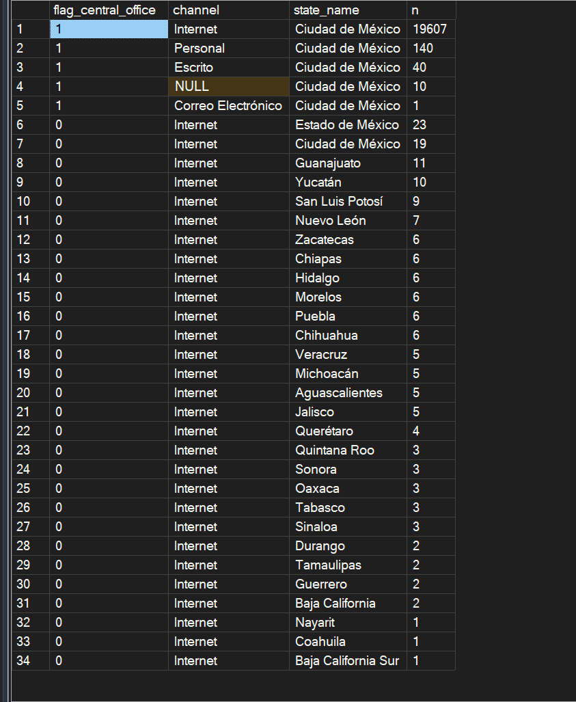 |
| 3.3.15 Brands by category (revision 2) | Mobile 18,231 (5 brands); Fixed 13,358 (9 brands); Pay TV (satellite) 2,101 (2); Device maker 1,243 (11); Not classified 1,101 (163 brands). Total 36,034 |  |
| 3.3.16 `odeco` (revision 2) | `odeco` is the name of the PROFECO office (zone), one per office code (for example "Zona Metropolitana de Mérida" is YUC). Office `H` has two names: "Dir. Gral. Cons. Telecom" (16,016) and "Dgpct" (3,782) |  |
| 3.3.17 State vs office (revision 2) | Of the 16,236 cases not handled by office `H`, 16,221 (99.9%) have the main state of their office and 15 have another state |  |

The days with a valid duration add up to 35,961 (34,773 + 1,098 + 59 + 31), the same value as the flag.

Image names follow the pattern `step_3_check_<NN>.png`; a check with two result tables has two files, `p1` and `p2` (check 6). Checks 6, 14, 15, 16 and 17 were run or captured again after revision 2 (the brand table by category is in check 15).

### What the results say

- **Brand mapping.** The "Not identified" brand is 426 rows, exactly Otros 126 + Otro 64 + P. Moral 119 + P. Física 117. The biggest brands left without classification are not fixed or mobile carriers of the analysis: satellite TV (Sky, Dish), phone makers (Samsung, Motorola, Apple, Xiaomi, Zte, Huawei, Honor, Oppo) and some small operators (Bait, Axtel, Gigacable, Telecable, Starlink, Uninet). After revision 2 the brands of these groups have their own category (check 15), and 1,101 rows (3%) stay "Not classified", in 163 brands with few cases each (check 6, part 2). Some of them are small operators (Uninet, Hughes México, Alestra) and are not worth a manual mapping for now.
- **Service hint.** The free text of `problema_especial` that is not a service (for example "Cablemas ¿ Cablevision Monterr" 26 rows, "Izzi Telecom" 24) stays "Not specified". The `¿` is in the data as loaded; it still has to be compared with the original CSV.
- **State is the PROFECO office, not where the consumer lives (decision D8).** The Internet channel (55% of the cases) is 99.3% Ciudad de México, and the case IDs show why: office `H` handles about 19,700 cases centrally, all in Ciudad de México, while the other offices match one state each (for example YUC is Yucatán; ODF, CDF, VIL and PDF are Ciudad de México; NEZ, TLA and MEX are Estado de México; TOR is Coahuila; CDJ is Chihuahua). Tlaxcala has no complaints because there is no office with that code. So 62% of Ciudad de México is a result of central handling.
- **Amounts are not reliable for KPIs (decision D9).** `monto_reclamado` is 0 in 78% of the rows, and the recovered amount is larger than the claimed one in 24%. In the 10 biggest differences the claimed amount is 0.00, and one row looks like a typing error (claimed 18,480.00, recovered 184,480.00). The amounts stay as loaded and are used only as descriptive information.
- **Duration.** The first look is plausible: 0 to 1,014 days, with an average of about 68 days for the conciliation procedure. It is a sanity check, not a project result (closed cases only, see right-censoring).

## Overlap audit of the five cuts (`step_4.sql`, 2026-10-31)

Evidence: `step_4_check_01.png` to `step_4_check_06.png` (checks 4.1 to 4.6). The cuts are compared with the base file `junio_2026` by case ID (`expediente`, exact comparison).

| Check | Result | Evidence |
|---|---|---|
| 4.1 Rows and distinct IDs | Base 36,034 / 36,034. `2022_2025`: 32,961 rows but 31,973 distinct IDs (988 repeated). `may_2026`: 4,081 rows, 4,067 distinct (14 repeated). `ene_2026` 32,652 and `jul2026` 31,926: all unique. No empty IDs |  |
| 4.2 Date range | All dates convert (0 bad). Max close: `2022_2025` 2025-11-30, `ene_2026` 2026-01-30, base and `may_2026` 2026-05-29, `jul2026` 2026-07-31. Empty close dates: 74 / 68 / 64 / 66 (base) / 0 (`may_2026`). `may_2026` starts in 2025-01 (partial slice) |  |
| 4.3 Overlap | `2022_2025`, `ene_2026` and `may_2026`: **every case is in the base** (0 only in the cut). `jul2026`: 29,966 in the base, **1,960 only in the cut**, and the base has 6,068 cases that `jul2026` lacks |  |
| 4.4 Exact differences | Dates differ in 100% of the rows of `2022_2025` and `ene_2026` (format, see below). `jul2026` differs in `tipo_conciliacion` (887), `odeco` (3,422), `procedimiento` (4,064) and in both amounts (about 96% of the rows) |  |
| 4.5 Ignoring case and accents | `jul2026`: `tipo_conciliacion`, `odeco`, `estado` and `procedimiento` drop to 0 (capitalization only). Still different: `proveedor` 487, `nombre_comercial` 5, amounts 28,645 and 27,197. `ene_2026`: `odeco` 529 and `monto_recuperado` 1,479 remain |  |
| 4.6 Cases not in the base | All 1,960 cases of `jul2026` are closed in June 2026 (1,008) or July 2026 (952), after the end of the base (2026-05-29) |  |

What the results say:

- **The base contains every case of the three older cuts.** Their cases add nothing to it, and `2022_2025` and `may_2026` have repeated IDs, so they fail the integrity criterion. This supports D4.
- **The dates differ only in format.** `2022_2025` and `ene_2026` write `2025/02/18`; the base and the other cuts write `2025-02-18`. The follow-up check 4.7 compares them as dates.
- **`jul2026` is a newer publication, not a corrected version of the base.** It adds 1,960 cases closed in June and July 2026, but lacks 6,068 base cases (check 4.8 looks at which ones), and it capitalizes names differently.
- **Amounts differ in text** in `jul2026` and `may_2026` (check 4.10d), which is another reason not to rely on them (D9).
- Follow-up checks 4.7 to 4.11 (dates as dates, missing cases, repeated IDs, sample of the differing values) are in `step_4.sql`; their results are below.

### Follow-up checks (4.7 to 4.10)

Evidence: `step_4_check_07.png`, `step_4_check_08.png`, `step_4_check_09.png`, `step_4_check_10_a-c.png` (4.10a to 4.10c), `step_4_check_10_d-e.png` (4.10d and 4.10e) and `step_4_check_11.png` (4.11a and 4.11b).

| Check | Result | Evidence |
|---|---|---|
| 4.7 Dates as dates | Filing date: **0 differences** in every cut. Close date: 50 cases in `2022_2025` (0.15%), 6 in `ene_2026`, 3 in `jul2026`, 0 in `may_2026` |  |
| 4.8 Base cases missing in `jul2026` | 6,067 of the 6,068 were filed in **2025**, in every outcome (Conciliada 3,380; Desistimiento 2,059; No Conciliada 532; Improcedente 95). `jul2026` leaves out part of the 2025 filings, so it is not a superset of the base |  |
| 4.9 Repeated IDs | `2022_2025`: 958 IDs in 1,946 rows, **932 with conflicting rows** and 26 exact copies. `may_2026`: 14 IDs, all exact copies |  |
| 4.10a to c | Brand differences in `2022_2025` are swaps between brands (Telcel with Samsung, Motorola, Zte, At&t...): the second row of a repeated ID. In `ene_2026` the office `H` is called "Dir. Gral. Cons. Telecom" and in the base "Dgpct" (526 cases; the two names are already known). In `jul2026` the provider names differ in punctuation ("S. de R.L. de C.V." and "C.V") |  |
| 4.10d and e | Amounts differ only in format: `0` and `0.0`, `100` and `100.0` (`jul2026`); the base has `-` where `ene_2026` has an empty value (1,479). No real difference of value |  |

| 4.11a Conflicts in repeated IDs | Of 958 repeated IDs in `2022_2025`: brand differs in 837, provider in 931, close date in 41, reason in 49, outcome in 1; **filing date and office never differ**. They are the same case with a second provider |  |
| 4.11b Fixed operators | 134 repeated IDs involve Telmex, Izzi, Megacable or Total Play; the base keeps a fixed brand in 89 and another brand in 45 |  |

Reading: dates, amounts and names agree once the format is ignored. The two real findings are that `jul2026` omits part of the 2025 filings, and that the older cut repeats some IDs with a second provider (a complaint against two providers, for example the operator and the phone maker). The base keeps one row per ID, so about 45 of 13,268 fixed-operator complaints (0.3%) may carry the other provider. This is below the 1% threshold and is recorded as a known limitation in D4.

**Verdict:** the base file `junio_2026` is confirmed (decision D4 Accepted).

## Load of the BIT into `stg` (`step_5.sql`, 2026-11-01)

Evidence: `step_5_check_00.png` to `step_5_check_08p2.png`. Table `stg.bit_acc_baf`, 16 text columns, loaded from `TD_ACC_BAF_ITE_VA.csv` (downloaded 2026-10-26).

| Check | Result | Evidence |
|---|---|---|
| 5.0 Probe | Comma separator, quoted text, CR+LF line ends, accents correct in code page 1252, and two empty extra columns at the end of every line |  |
| 5.1 Load | 592,281 rows, as in Excel. The two extra columns are empty (`n_not_empty` = 0) and are dropped |   |
| 5.2 First rows | Values in the right columns. The state is a name ("México") and the municipality a name; the technologies include "DSL" and "Tecnología móvil" |  |
| 5.3 Encoding | The four groups show correct accents; `n_broken` = 0 |  |
| 5.4 Year, month, numbers | Years 2013 to 2024, months 1 to 12; 0 bad years, months and states; **1,831 empty accesses** |  |
| 5.5 December 2024 | América Móvil 11,208,977; Grupo Televisa 5,970,288; Megacable-MCM 5,316,545; Grupo Salinas 5,313,779; the four groups **27,809,589** (same as the Excel pivots) |  |
| 5.6 States | 33 codes. Without state (99) in December 2024: 1,051,366 for all operators and **35,990 for the four groups** (0.13%) |  |
| 5.7 Companies | The companies of each group reproduce the pivot of the section on the BIT (Telmex and Telnor; Total Play; Izzi, Sky and the historical cable companies; Megacable, MCM, Televia and a small Telecable) |  |
| 5.8 Empty accesses | All 1,831 values are NULL (empty field), not text. 1,462 are in the four groups (2013 to 2021: 1,417; 2022: 33; 2023: 12; 2024: 0) and 369 in other operators |   |

What the results say:

- The load is faithful: the row count and the December 2024 totals match the manual evidence.
- The empty accesses (0.31% of the rows) stay empty in the clean layer, they are not turned into 0. They are flagged. December 2024, the base of the rates, has none in the four groups.
- **Open question for the clean layer:** the column `TECNO_ACCESO_INTERNET` has several technologies, one of them "Tecnología móvil", and the December 2024 totals above include all of them. Before using them as the denominator, the technologies must be listed (a check of the next step) and the project must decide if all of them count as fixed broadband accesses.
- **Do not add months:** `A_TOTAL_E` is a stock at the end of each month (see the section on the BIT).

## Clean layer of the BIT (`step_6.sql`, 2026-11-01)

Evidence: `step_6_check_01p1.png` to `step_6_check_09.png`. Table `clean.bit_access`, 592,281 rows, one per row of the file.

| Check | Result | Evidence |
|---|---|---|
| 6.1 Technologies | Eight technologies. In December 2024 the four groups have fiber, DSL, coaxial cable and "Sin tecnología especificada"; "Tecnología móvil" (349,879) is only in Grupo Televisa (Sky) |   |
| 6.2a, 6.2b Grain | 36,562 repeated keys (year, month, state, municipality, technology, company); 0 accesses with decimals |  |
| 6.2c Folio | Adding the folio leaves 35,887 repeated keys: the folio does not separate the rows |  |
| 6.2d Exact copies | 325 groups of rows identical in the 16 columns, 325 surplus rows (0.05%) |  |
| 6.2e December 2024 | 3,303 repeated keys in the four groups, 6,632 rows |  |
| 6.2f Rows | Repeated rows share concessionaire and technology but have very different accesses (for example 1,105 and 69,186) |  |
| 6.2g November 2024 | 3,268 keys, 6,555 rows: the same as December, so the repetition is stable |  |
| 6.2h Weight of copies | 106 accesses in AMÉRICA MÓVIL (0.0009%); 0 in the other three groups |  |
| 6.3 Months | 12 months in every year 2013 to 2024 |  |
| 6.4 Build | 592,281 rows inserted |  |
| 6.5a Rows and flags | 592,281 rows; 1,831 missing accesses; 9,078 without state; 13,247 without municipality; 325 exact copies; 0 without date |  |
| 6.5b December 2024 | Telmex 11,208,977; Total Play 5,313,779; Izzi 5,619,403; Other (Sky) 350,885; Megacable 5,316,545. Grupo Televisa adds 5,970,288, as in step 5 |  |
| 6.5c States | 33 codes; only code 99 is "Not specified" (9,078 rows) |  |
| 6.6 Denominators | See the table below |  |
| 6.6b Technologies | No mobile, satellite or wireless technology in the four operators; Megacable has unspecified technology |  |

Decisions: D12 (grain) and D13 (no technology filter).

### Denominators: accesses at the end of December

| Operator | 2022 | 2023 | 2024 |
|---|---|---|---|
| Telmex | 10,025,387 | 10,488,966 | 11,208,977 |
| Izzi | 5,966,299 | 5,658,715 | 5,619,403 |
| Megacable | 4,144,809 | 4,656,004 | 5,316,545 |
| Total Play | 4,442,665 | 4,775,774 | 5,313,779 |

Notes:

- These are BIT **accesses**, not subscriptions or customers.
- Megacable's technology is unspecified in 100% of its December 2022 accesses (4,144,809), 5.7% in 2023 and 0.6% in 2024. The growth of Megacable (+28% in two years) can be partly a change in how it reports; the rates are read with that caution.
- Izzi has one row with missing accesses in December 2022 (technology unspecified). It does not change the sum.
- Accesses without state (code 99) are 35,990 for the four groups in December 2024 (0.13%) and are left out of the rates by state.